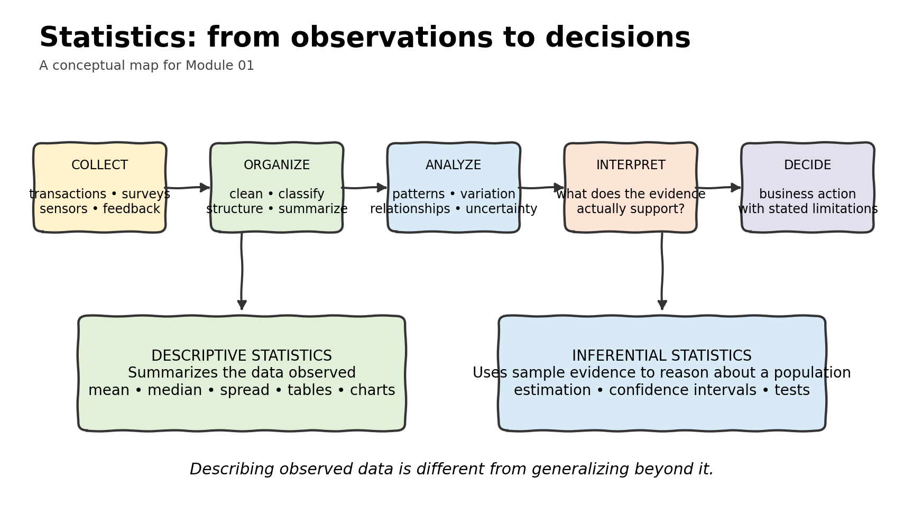
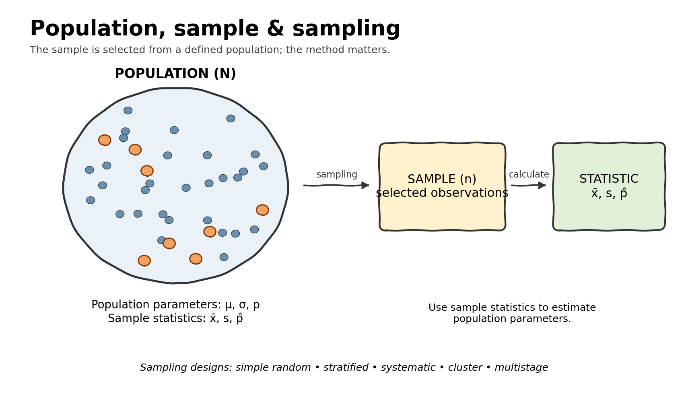
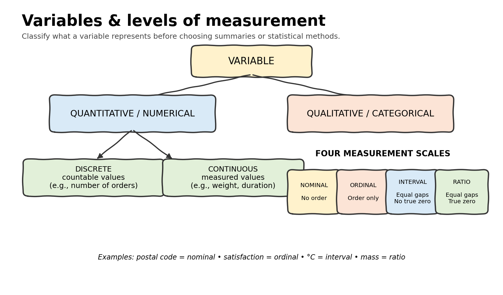
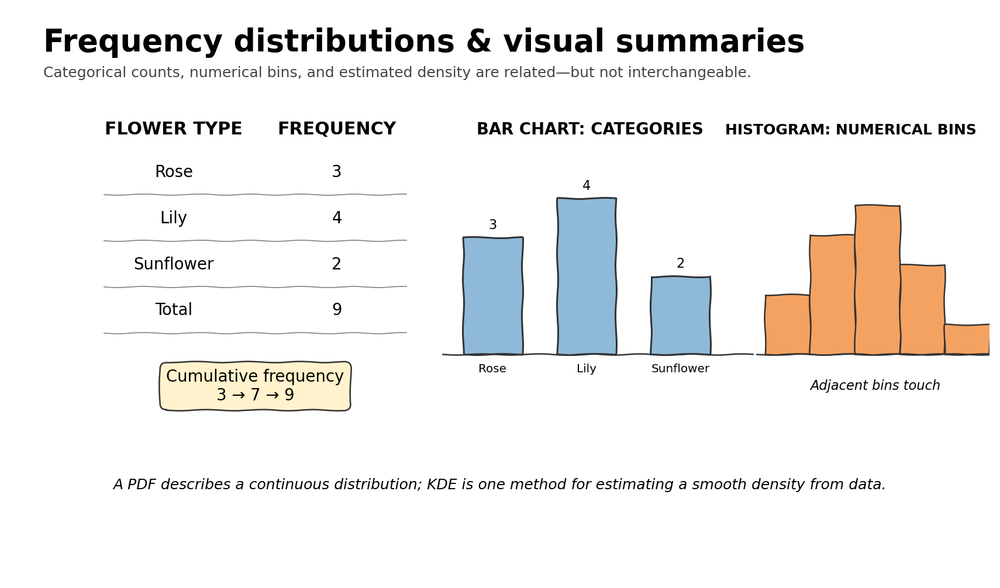

# Module 01 - Statistical Foundations

> [!NOTE]
>
> **Section:** Krish Naik - [Complete Statistics for Data Science](https://www.youtube.com/watch?v=LZzq1zSL1bs)
> 
> **Purpose:** Establish the language and reasoning needed to analyze data responsibly. This module covers what statistics is, how populations and samples relate, how variables are classified, and how to summarize observations using frequency distributions and basic visualizations.

---

## Visual overview

---

# 1. What is Statistics?

**Statistics** is the discipline concerned with collecting, organizing, analyzing, interpreting, and communicating data to understand patterns, quantify uncertainty, and support decisions.

Organizations collect data from transactions, websites, applications, surveys, sensors, and operational systems. Statistics helps turn recorded observations into evidence.

### Why statistics matters

An e-commerce business may collect:

- Customer purchase history
- Product prices and categories
- Website visits and cart activity
- Customer ratings and feedback
- Marketing campaign results

Statistical questions include:

- What is the average order value?
- Which categories contribute most to revenue?
- Has the conversion rate changed?
- Is an observed improvement likely to reflect a real effect or random variation?
- How uncertain is an estimate based on a sample?

### A simplified statistical workflow

1. **Collect:** Obtain observations relevant to a question.
2. **Organize:** Structure, clean, classify, and summarize observations.
3. **Analyze:** Apply appropriate statistical methods.
4. **Interpret:** Explain what the evidence does and does not support.
5. **Communicate and decide:** Present findings, assumptions, uncertainty, and limitations.

### What is data?

Data are recorded observations, measurements, values, or information about entities and events. Data are not limited to numbers.

| Observation | Example | Possible type |
|---|---|---|
| Customer age | 28 years | Quantitative |
| Order value | ₹1,250.50 | Quantitative |
| Product category | Electronics | Categorical |
| Customer feedback | "Delivery was late" | Text |
| Satisfaction rating | Very dissatisfied → Very satisfied | Ordinal categorical |

> [!IMPORTANT]
> A recorded value can be categorical even when digits represent it. A postal code or customer ID is usually an identifier/category, not a numerical measurement.

---

# 2. Types of Statistics

Statistics is commonly divided into two broad branches.

## 2.1 Descriptive Statistics

**Descriptive statistics** organizes, summarizes, and presents the characteristics of observed data.

Example: A company has order records for 1,000 transactions. It calculates:

- Mean and median order value
- Minimum and maximum order value
- Standard deviation
- Sales by product category
- Frequency distributions and percentages

Descriptive statistics describes the data observed. It does not, by itself, establish that the same result applies to a wider population.

## 2.2 Inferential Statistics

**Inferential statistics** uses information from a sample to estimate, test, or draw conclusions about a population or process while accounting for uncertainty.

Example: A company has 100,000 customers and surveys 1,000 of them. It uses the responses to estimate overall customer satisfaction and quantify uncertainty around that estimate.

Common methods include:

- Confidence intervals
- Hypothesis tests
- Statistical significance tests
- Regression-based inference

| Descriptive | Inferential |
|---|---|
| Summarizes observed data | Uses sample evidence to reason about a population or process |
| Mean, median, mode | Confidence intervals |
| Variance and standard deviation | Hypothesis testing |
| Frequency tables and charts | Population parameter estimation |

> [!NOTE]
> Descriptive statistics can summarize a sample or a complete population. Inferential statistics goes beyond the observed sample to estimate or test claims about a broader population or process.

---

# 3. Population, Sample, Parameters, and Statistics

## 3.1 Population

A **population** is the complete set of individuals, objects, events, or observations relevant to a defined research question.

Examples:

- All customers who purchased from a company during a specified year
- All transactions processed by a payment system in a month
- All eligible voters in a defined election
- All products manufactured during a specified production period

Population size is commonly denoted by uppercase $N$.

The population must be defined precisely. "All customers" may be too vague unless the company, time period, and eligibility criteria are specified.

## 3.2 Sample

A **sample** is a subset of the population selected for observation or analysis. Sample size is commonly denoted by lowercase $n$.

Sampling is used when collecting data from every population member is impractical, expensive, time-consuming, or unnecessary.

### Example: Election survey

- **Population:** All eligible voters in the defined target population.
- **Sample:** Selected eligible voters approached for the survey.
- **Sample data:** Responses collected from those selected voters.
- **Inference:** An estimate of voting preferences in the population.

A sample supports useful conclusions only when the sampling design, coverage, and data collection process are appropriate. A large sample does not automatically eliminate bias.

## 3.3 Parameter vs. statistic

A **parameter** describes a characteristic of a population. A **statistic** describes a characteristic calculated from a sample.

| Quantity | Population parameter | Sample statistic |
|---|---|---|
| Mean | $\mu$ | $\bar{x}$ |
| Standard deviation | $\sigma$ | $s$ |
| Proportion | $p$ | $\hat{p}$ |
| Size | $N$ | $n$ |

The sample mean is:

$$
\bar{x}=\frac{\sum_{i=1}^{n}x_i}{n}
$$

Where $x_i$ is an observed sample value and $n$ is the sample size.

The sample mean is often used to estimate the population mean. Do not confuse the statistic with the parameter it is intended to estimate.

---

# 4. Sampling Techniques

Sampling methods determine how units are selected from a population. A useful first distinction is between **probability sampling** and **non-probability sampling**.

## 4.1 Simple Random Sampling

Each population member has an equal chance of selection. In the standard fixed-size design, every possible sample of that size has an equal chance of being selected.

**Example:** A company randomly selects 100 employees from a list of 1,000 employees.

## 4.2 Stratified Sampling

The population is divided into non-overlapping groups called **strata**, usually based on a relevant characteristic. A sample is then selected from each stratum.

A valid partition should be:

- **Mutually exclusive:** Each population member belongs to one stratum.
- **Collectively exhaustive:** Every population member belongs to a stratum.

**Example:** Divide employees into Engineering, Marketing, and Finance, then randomly sample employees from every department.

Stratified sampling can improve representation of important subgroups. The sample may be proportional or disproportionate to stratum size.

## 4.3 Systematic Sampling

Select units at a fixed interval from an ordered sampling frame, usually after choosing a random starting position.

$$
k=\frac{N}{n}
$$

Where:

- $N$ = population size
- $n$ = desired sample size
- $k$ = sampling interval

**Example:** If $N=1{,}000$ and $n=100$, then $k=10$. Choose a random starting position from 1 to 10, then select every 10th unit.

**Limitation:** If the list has a periodic pattern that aligns with the interval, systematic sampling can produce a biased sample.

## 4.4 Convenience Sampling

Select participants because they are readily accessible or easy to recruit.

**Example:** Survey the first 50 people encountered at a shopping mall.

It is quick and inexpensive, but the sample may not represent the target population.

## 4.5 Do not confuse these non-probability methods

The lecture loosely groups convenience sampling with voluntary response sampling. They are different.

| Method | Selection mechanism | Example |
|---|---|---|
| Convenience | Accessibility | Survey nearby shoppers |
| Voluntary response | People choose to participate | Open online poll |
| Purposive / judgment | Researcher deliberately selects relevant cases | Interview experienced database administrators |

Selecting domain experts for a specialist study is generally **purposive sampling**, not simply convenience sampling.

## 4.6 Additional sampling designs

- **Cluster sampling:** Divide the population into clusters, randomly select clusters, and survey all or some units within selected clusters.
- **Multistage sampling:** Select samples in multiple stages, often combining cluster and random sampling.
- **Proportional stratified sampling:** Select from each stratum in proportion to its population size.
- **Disproportionate stratified sampling:** Use different sampling fractions across strata, often to obtain enough observations from smaller groups.

## 4.7 Sampling bias and limitations

- **Selection bias:** The selection process systematically favors certain members or characteristics.
- **Non-response bias:** Selected participants who do not respond differ meaningfully from respondents.
- **Voluntary response bias:** People with strong opinions or greater interest may be more likely to participate.
- **Coverage bias:** The sampling frame excludes part of the target population.
- **Convenience bias:** Easily accessible participants are not representative.

**Example:** A customer satisfaction survey sent only to recent purchasers excludes cart abandoners and inactive customers. The result may overstate satisfaction.

---

# 5. Variables and Types of Variables

A **variable** is a characteristic or attribute that can take different values across observations or entities.

Examples:

- Customer age
- Order value
- Number of orders
- Product category
- Payment method
- Delivery status

## 5.1 Quantitative variables

Quantitative variables represent numerical quantities for which arithmetic operations have meaningful interpretations, subject to the measurement scale.

### Discrete variables

Discrete variables take distinct, countable values. They often arise from counting.

Examples:

- Number of bank accounts
- Number of children in a family
- Number of orders placed
- Number of defects in a batch

A count of bank accounts can be 0, 1, 2, 3, and so on not 2.5 accounts.

### Continuous variables

Continuous variables represent measurements that can take any value within a range, subject to measurement precision.

Examples:

- Height
- Weight
- Distance
- Duration
- Rainfall

A person's measured weight might be 62 kg, 62.4 kg, or 62.45 kg, depending on the measurement precision.

## 5.2 Qualitative / categorical variables

Categorical variables classify observations into groups or labels.

Examples:

- Product category
- Payment method
- Blood group
- Marital status
- Delivery status

Arithmetic on category labels is generally not meaningful. If categories are encoded as numbers, the numbers are labels rather than quantities.

**Example:** If payment methods are encoded as 1 = UPI, 2 = Card, 3 = Cash, calculating their average has no meaningful interpretation.

## 5.3 Classifying examples

| Variable | Classification | Reason |
|---|---|---|
| Gender category | Categorical | Labels/groups |
| Marital status | Categorical | Labels/groups |
| River length | Quantitative, continuous | Measurement |
| State population | Quantitative, discrete | Count of people |
| Song duration | Quantitative, continuous | Measurement of time |
| Blood pressure | Quantitative, generally continuous | Measurement |
| PIN / postal code | Categorical, nominal | Identifier, not a quantity |
| Number of customer orders | Quantitative, discrete | Count |

**Important:** The classification depends on what the values represent, not merely how they are stored. A column containing digits may still be categorical.

---

# 6. Levels of Measurement

Measurement scales describe what information a variable carries and which comparisons or operations are meaningful.

There are four common levels: nominal, ordinal, interval, and ratio.

## 6.1 Nominal

Nominal data are categories with **no inherent order**.

Examples:

- Blood group
- Product category
- Payment method
- Country
- Postal code

You can count category frequencies and identify the mode. You cannot meaningfully rank nominal categories.

## 6.2 Ordinal

Ordinal data have a **meaningful order**, but the distances between levels are not necessarily equal or known.

Examples:

- Satisfaction: dissatisfied, neutral, satisfied
- T-shirt size: small, medium, large
- Competition rank: first, second, third
- Education levels

A rank tells us order, but the difference between first and second need not equal the difference between second and third.

## 6.3 Interval

Interval data have:

- Ordered values
- Equal, meaningful differences between values
- No meaningful absolute zero

Example: Temperature in Celsius or Fahrenheit.

A change from 10°C to 20°C is the same size as a change from 20°C to 30°C. However, 0°C does not mean an absence of temperature, and 20°C is not twice as hot as 10°C.

## 6.4 Ratio

Ratio data have:

- Ordered values
- Equal, meaningful differences
- A meaningful zero representing the absence of the measured quantity

Examples:

- Mass
- Height
- Distance
- Duration
- Revenue

A duration of 20 minutes is twice a duration of 10 minutes.

| Property | Nominal | Ordinal | Interval | Ratio |
|---|---:|---:|---:|---:|
| Categories / labels | Yes | Yes | Values | Values |
| Meaningful order | No | Yes | Yes | Yes |
| Equal intervals | No | Not guaranteed | Yes | Yes |
| Meaningful absolute zero | No | No | No | Yes |
| Example | Blood group | Satisfaction level | °C | Weight |

**Why this matters:** Measurement scale affects which summaries, comparisons, transformations, and statistical methods are appropriate. For example, calculating an average of nominal category codes is meaningless.

---

# 7. Frequency Distribution

A **frequency distribution** summarizes how often each value or category occurs in a dataset.

### Example: Flower categories

Suppose a dataset contains observations of roses, lilies, and sunflowers.

| Flower type | Frequency |
|---|---:|
| Rose | 3 |
| Lily | 4 |
| Sunflower | 2 |
| **Total** | **9** |

Frequency means the count of observations in a category or value.

Frequency tables can summarize categorical variables and numerical data grouped into intervals.

## 7.1 Cumulative Frequency

**Cumulative frequency** is the running total of frequencies up to the current value or class.

For the flower example:

| Flower type | Frequency | Cumulative frequency |
|---|---:|---:|
| Rose | 3 | 3 |
| Lily | 4 | 7 |
| Sunflower | 2 | 9 |

$$
CF_i=\sum_{j=1}^{i}f_j
$$

Where $f_j$ is the frequency of category or class $j$.

**Important:** Cumulative frequency is most meaningful when values or classes have a natural order, such as age intervals or satisfaction levels. For nominal categories such as flower types, the running total depends on arbitrary category order and usually has little analytical meaning.

---

# 8. Bar Chart vs. Histogram

## 8.1 Bar Chart

A bar chart displays frequencies or other summaries across categories.

- X-axis: Categories
- Y-axis: Frequency or another measured summary
- Bars are separated by gaps because categories are distinct.

Examples:

- Orders by payment method
- Customers by region
- Products by category

## 8.2 Histogram

A histogram displays the distribution of numerical data by grouping values into intervals called **bins**.

- X-axis: Numerical intervals (bins)
- Y-axis: Frequency or frequency density
- Adjacent bins generally touch because the intervals form a continuous numerical scale.

Example: Customer ages grouped into bins:

- 10–20
- 20–30
- 30–40
- 40–50
- 50–60

The bin width affects the appearance and detail of a histogram. There is no universal default bin width of 10; it must be chosen based on the data, scale, sample size, and analytical purpose.

### Bar chart vs. histogram

| Feature | Bar chart | Histogram |
|---|---|---|
| Data | Categorical | Numerical |
| X-axis | Categories | Numerical intervals |
| Bars | Usually separated | Usually adjacent |
| Order | May be rearranged | Follows numerical order |
| Main purpose | Compare categories | Understand numerical distribution |

**Nuance:** Histograms are commonly used for continuous measurements, but numerical discrete data can also be grouped into intervals and displayed as a histogram. The key distinction is categorical groups versus numerical bins.

---

# 9. Probability Density Function (PDF) and KDE

The lecture informally describes a PDF as a smoothed histogram. That is an intuition, not a precise definition.

A **probability density function (PDF)** describes the density of a continuous probability distribution.

For a continuous random variable $X$:

- $f(x)\geq 0$
- The total area under the density curve is 1.
- The probability that $X$ lies between $a$ and $b$ is the area under the curve over that interval.

$$
P(a\leq X\leq b)=\int_a^b f(x)\,dx
$$

For a continuous random variable, the probability at any one exact point is zero:

$$
P(X=x)=0
$$

### Kernel Density Estimation (KDE)

KDE is a non-parametric method for estimating a smooth probability density from observed data. It places a kernel around each observation and combines these contributions into a smooth estimate.

**Remember the distinction:**

- Histogram: groups observations into bins and displays counts or density.
- PDF: mathematical density function for a continuous distribution.
- KDE: method for estimating a smooth density from sample observations.

A PDF is not itself merely a smoothed histogram.

---

# 10. Common Misconceptions to Avoid

1. **Every numeric-looking column is quantitative.** False. IDs and postal codes are often nominal categories.
2. **All quantitative variables are continuous.** False. Counts are often discrete.
3. **Ordinal values have equal gaps.** Not necessarily.
4. **Zero always means absence.** Only a meaningful absolute zero supports ratio-scale interpretations.
5. **Convenience sampling and voluntary response sampling are identical.** False.
6. **A larger sample automatically removes bias.** False. Sample size does not repair systematic selection or coverage problems.
7. **Bar charts and histograms are interchangeable.** False. They represent different kinds of data.
8. **A PDF is just a smoothed histogram.** False. A PDF is a density function; KDE estimates a density from data.

---

# References

### Recommended supplementary resources

- [OpenStax - Introductory Statistics](https://openstax.org/details/books/introductory-statistics-2e)
- [NIST/SEMATECH e-Handbook of Statistical Methods](https://www.itl.nist.gov/div898/handbook/)
- [SciPy Statistics Documentation](https://docs.scipy.org/doc/scipy/reference/stats.html)

---

**Next:** [Module 02 - Descriptive Statistics](../02-descriptive-statistics/README.md)
