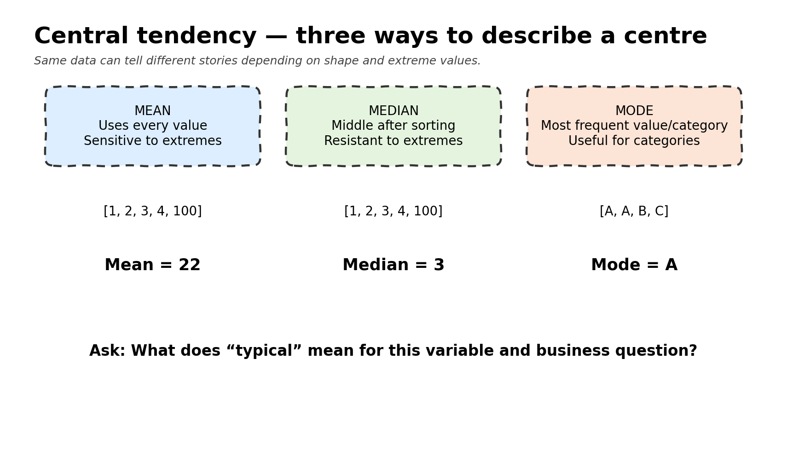

# Measures of Central Tendency

[← Back to Descriptive Statistics Repository](https://github.com/Priya200227/statistics/tree/main/02-descriptive-statistics)

## 1. Purpose

Central tendency describes the centre or typical location of a distribution. It helps answer: **what value best represents a typical observation?**

The three common measures are the **mean, median, and mode**. They answer related but different questions, so the right choice depends on the variable type, distribution shape, outliers, and business context.



## 2. The three measures

| Measure | Meaning | Best suited to |
|---|---|---|
| Mean | Arithmetic average | Numerical data without influential extreme values |
| Median | Middle value after sorting | Skewed numerical data or data with influential outliers |
| Mode | Most frequent value/category | Categorical data or most common outcome |

## 3. Choosing a measure

- Use the **mean** when every numerical observation should contribute and extreme values are not distorting the summary.
- Use the **median** when the distribution is skewed or extreme values make the mean unrepresentative.
- Use the **mode** when the question is about the most common value or category.
- Inspect the distribution when there are multiple peaks or segments. A single centre can hide important subgroups.

## 4. Business examples

- Mean order value: average transaction amount.
- Median delivery time: typical delivery time when a few orders take unusually long.
- Mode payment method: most frequently used payment category.
- Weighted mean conversion rate: combine group rates using their denominators rather than averaging group percentages blindly.

## 5. Important cautions

1. Mean and median are not interchangeable.
2. The mean is sensitive to extreme values.
3. The median is resistant, not completely immune, to changes in the data.
4. A mode may not be unique.
5. A single central-tendency measure may hide a multimodal distribution.

## 6. Python quick check

```python
import pandas as pd

values = pd.Series([1, 1, 2, 2, 3, 3, 4, 5, 5, 6])

print("Mean:", values.mean())
print("Median:", values.median())
print("Mode(s):", values.mode().tolist())
```

`Series.mode()` can return multiple values.


## References

- [Krish Naik - Complete Statistics for Data Science](https://www.youtube.com/watch?v=LZzq1zSL1bs)
- [Pandas descriptive statistics](https://pandas.pydata.org/docs/user_guide/basics.html#descriptive-statistics)

---
**NEXT:** [02-Mean, Median, Mode](../02-mean-median-mode/README.md)

