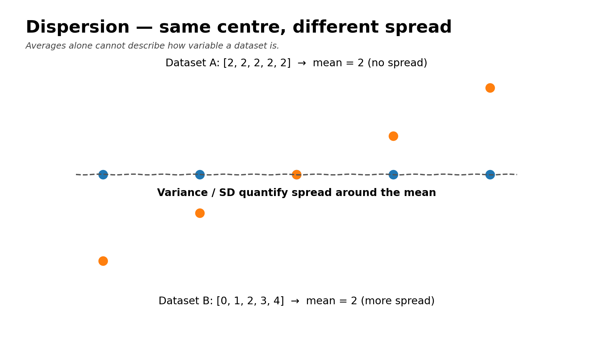

# Measures of Dispersion

## 1. Purpose

Measures of dispersion quantify how spread out observations are. A centre alone does not describe a dataset: two datasets can have the same mean but very different variability.

For example:

- A: `[1, 1, 2, 2, 4]` has mean 2.
- B: `[2, 2, 2, 2, 2]` has mean 2.

Dataset A varies; dataset B has no variation.

## 2. Main measures

| Measure | What it describes | Sensitivity |
|---|---|---|
| Range | Distance between minimum and maximum | Very sensitive to extremes |
| Variance | Average squared deviation from the mean | Sensitive to extremes |
| Standard deviation | Spread in original units | Sensitive to extremes |
| Mean absolute deviation | Average absolute distance from the mean | Less weight to extremes than squared deviations |
| Interquartile range | Spread of the middle 50% | More resistant to extremes |
| Coefficient of variation | Relative spread compared with the mean | Unstable when mean is near zero |

## 3. Choosing a dispersion measure

- Use **standard deviation** alongside the mean when data are reasonably symmetric and extreme values are not dominating.
- Use **IQR** alongside the median for skewed data or when robust summaries are needed.
- Use **range** for a quick minimum-to-maximum span, not as the only variability measure.
- Use **coefficient of variation** only when a relative comparison is meaningful (ratio-scale data and nonzero mean).

## 4. Why dispersion matters in analytics

Imagine two delivery regions with the same average delivery time. Region A may deliver consistently near the average, while Region B may have many very early and very late deliveries. The average alone hides the operational difference.

Dispersion helps assess:
- Consistency of delivery times.
- Variation in customer spending.
- Stability of process measurements.
- Risk and volatility in business metrics.

## 5. Practical workflow

1. Identify the variable and its units.
2. Inspect a histogram or boxplot.
3. Calculate a centre.
4. Choose a compatible spread measure.
5. Investigate extreme observations.
6. Explain the result in the original business context.

## References

- [Krish Naik - Complete Statistics for Data Science](https://www.youtube.com/watch?v=LZzq1zSL1bs)
- [NIST/SEMATECH e-Handbook](https://www.itl.nist.gov/div898/handbook/)

