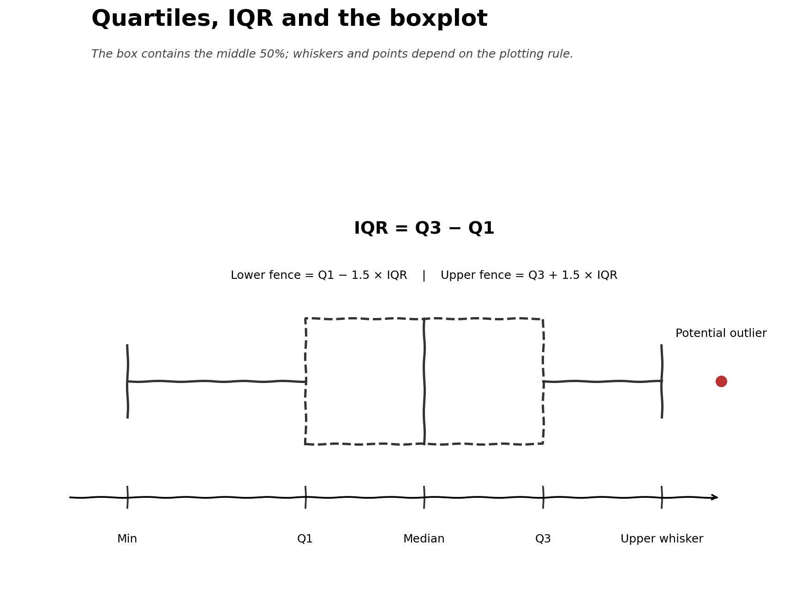

# Interquartile Range (IQR)

[← Back to Descriptive Statistics Repository](https://github.com/Priya200227/statistics/tree/main/02-descriptive-statistics)

---

## 1. Definition

The interquartile range measures the spread of the middle 50% of observations.

$$
IQR=Q3-Q1
$$

- Q1: 25th percentile.
- Q3: 75th percentile.



Because IQR focuses on the middle half of the data, it is more resistant to extreme values than range or standard deviation.

## 2. IQR and outlier screening

Tukey's fences are commonly used to flag potential outliers.

$$
\mathrm{LowerFence}=Q1-1.5(IQR)
$$

$$
\mathrm{UpperFence}=Q3+1.5(IQR)
$$

An observation is flagged when:

$$
x<\mathrm{LowerFence}
\quad\text{or}\quad
x>\mathrm{UpperFence}
$$

The 1.5 × IQR rule is a screening convention, not proof that a value is invalid.

## 3. Worked example

Data:

`[1, 2, 2, 3, 3, 4, 5, 5, 5, 6, 6, 6, 6, 7, 8, 8, 9, 27]`

Using the quartiles selected in the lecture example:

- Q1 = 3
- Q3 = 7
- IQR = 7 − 3 = 4
- Lower fence = 3 − 1.5(4) = −3
- Upper fence = 7 + 1.5(4) = 13

27 is above 13, so it is flagged as a potential outlier.

**Quartile-method note:** Quartiles can differ by convention, especially for small datasets. Calculate Q1 and Q3 consistently using a stated method.

## 4. What to do with a flagged value

Do not automatically delete it.

1. Check for data-entry, unit, parsing, or sensor errors.
2. Determine whether it is a valid rare event.
3. Compare it with domain limits and business context.
4. Assess its impact on summary statistics and conclusions.
5. Choose a justified treatment: correct, retain, cap/winsorize, transform, use robust statistics, or exclude with documented reasoning.

## 5. Python implementation

```python
import pandas as pd

data = pd.Series([1, 2, 2, 3, 3, 4, 5, 5, 5, 6,
                  6, 6, 6, 7, 8, 8, 9, 27])

q1 = data.quantile(0.25)
q3 = data.quantile(0.75)
iqr = q3 - q1

lower_fence = q1 - 1.5 * iqr
upper_fence = q3 + 1.5 * iqr

outliers = data[(data < lower_fence) | (data > upper_fence)]

print("Q1:", q1, "Q3:", q3, "IQR:", iqr)
print("Fences:", lower_fence, upper_fence)
print("Potential outliers:", outliers.tolist())
```

## 6. Common mistakes

- Treating every flagged observation as an error.
- Forgetting that quartile conventions can change IQR.
- Comparing fences calculated using different quantile methods.
- Removing outliers without documenting the reason.

## References

- [Krish Naik - Complete Statistics for Data Science](https://www.youtube.com/watch?v=LZzq1zSL1bs)
- [NIST/SEMATECH e-Handbook](https://www.itl.nist.gov/div898/handbook/)

