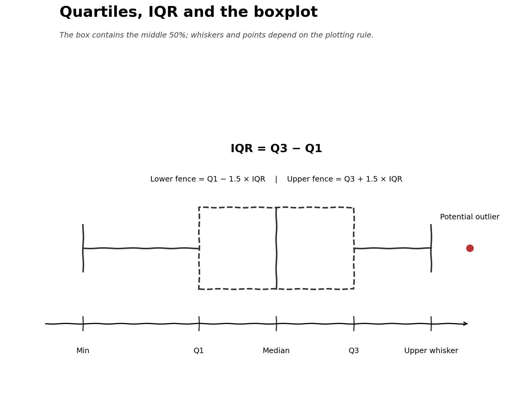

# Five-Number Summary

## 1. Definition

The five-number summary is a compact description of a numerical distribution:

1. Minimum.
2. First quartile (Q1).
3. Median (Q2).
4. Third quartile (Q3).
5. Maximum.



Together, these values describe the range and central spread of the data.

## 2. Connection to a boxplot

A conventional boxplot displays:

- **Box:** Q1 to Q3 (the IQR).
- **Line inside the box:** median.
- **Whiskers:** extend to the most extreme observations within the plotting rule, commonly the 1.5 × IQR fences.
- **Individual points beyond whiskers:** potential outliers.

Important: in a modified boxplot, whisker endpoints are often the most extreme non-outlier observations, not necessarily the raw minimum and maximum. Therefore, do not automatically equate whisker tips with the five-number summary's minimum and maximum.

## 3. Python implementation

```python
import pandas as pd

data = pd.Series([1, 2, 2, 3, 3, 4, 5, 5, 5, 6,
                  6, 6, 6, 7, 8, 8, 9, 27])

summary = {
    "minimum": data.min(),
    "Q1": data.quantile(0.25),
    "median": data.median(),
    "Q3": data.quantile(0.75),
    "maximum": data.max()
}

print(pd.Series(summary))
```

## 4. Compare groups

The five-number summary and boxplots are useful when comparing:
- Delivery time by region.
- Revenue by product category.
- Customer spending by segment.
- Test scores across classrooms.

A boxplot is compact but does not reveal every feature. Pair it with a histogram or raw-data view when multimodality, sample size, or distribution shape matters.

## 5. Common mistakes

- Confusing the IQR with the full range.
- Assuming whiskers always reach the minimum and maximum.
- Comparing boxplots without considering group sample sizes.
- Treating a boxplot as a complete representation of the distribution.


## References

- [Krish Naik - Complete Statistics for Data Science](https://www.youtube.com/watch?v=LZzq1zSL1bs)
- [Pandas descriptive statistics](https://pandas.pydata.org/docs/user_guide/basics.html#descriptive-statistics)

