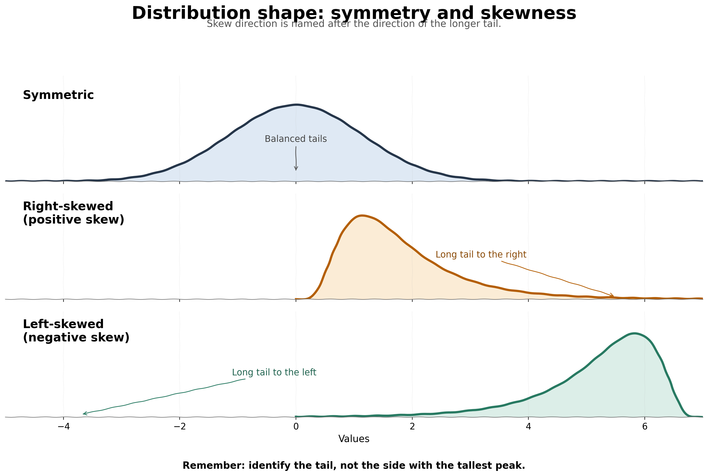

# Skewness and Kurtosis

[← Back to Descriptive Statistics Repository](https://github.com/Priya200227/statistics/tree/main/02-descriptive-statistics)

---

## 1. Distribution shape

A distribution describes how observations are spread across possible values. Inspect shape before deciding which summary statistics are representative.



## 2. Symmetry and skewness

- **Approximately symmetric:** left and right sides have similar shape.
- **Right-skewed (positive skew):** the longer tail extends toward larger values. A few large observations may pull the mean rightward.
- **Left-skewed (negative skew):** the longer tail extends toward smaller values. A few small observations may pull the mean leftward.

For many unimodal distributions:

- Right skew: mean is often greater than median.
- Left skew: mean is often less than median.
- Symmetric distribution: mean and median are often close.

These are tendencies, not universal laws. Identify skew direction from the **tail**, not merely the side with the tallest bars.

## 3. Skewness

Skewness describes asymmetry in a distribution. Sample estimators and bias corrections differ across software.

Interpretation:
- Near zero: little measured skewness.
- Positive: right-skewed.
- Negative: left-skewed.

Do not interpret a single skewness value without examining a plot and considering sample size.

## 4. Kurtosis

Kurtosis describes aspects of tail heaviness and extremity relative to a normal distribution. It is not simply a measure of peak height.

Many libraries report **excess kurtosis**, for which:
- Normal distribution: 0 excess kurtosis.
- Normal distribution: 3 ordinary kurtosis.

Always state which convention is being reported.

## 5. Visual inspection

A histogram and KDE can help reveal:
- Symmetry or skewness.
- Multiple peaks.
- Long tails.
- Gaps or clusters.

KDE depends on bandwidth. Excessive smoothing can hide structure; insufficient smoothing can create false bumps.

## 6. Python implementation

```python
import pandas as pd
import seaborn as sns
import matplotlib.pyplot as plt

data = pd.Series([1, 2, 2, 3, 3, 4, 5, 5, 5, 6,
                  6, 6, 6, 7, 8, 8, 9, 27])

print("Skewness:", data.skew())
print("Excess kurtosis:", data.kurt())

sns.histplot(data, kde=True)
plt.title("Distribution shape")
plt.show()
```

Pandas reports Fisher/excess kurtosis by default. Different packages may use different estimator corrections.

## 7. Common mistakes

- Calling a distribution right-skewed because its peak is on the left without checking the tail.
- Treating mean-greater-than-median as a universal proof of right skew.
- Describing kurtosis only as peak height.
- Comparing kurtosis values without checking whether the library reports ordinary or excess kurtosis.
- Relying on a numeric statistic without plotting the data.

## References

- [Krish Naik - Complete Statistics for Data Science](https://www.youtube.com/watch?v=LZzq1zSL1bs)
- [Pandas descriptive statistics](https://pandas.pydata.org/docs/user_guide/basics.html#descriptive-statistics)

---

**NEXT:** [09-Covariance & Correlation ](../09-covariance-and-correlation/README.md)
