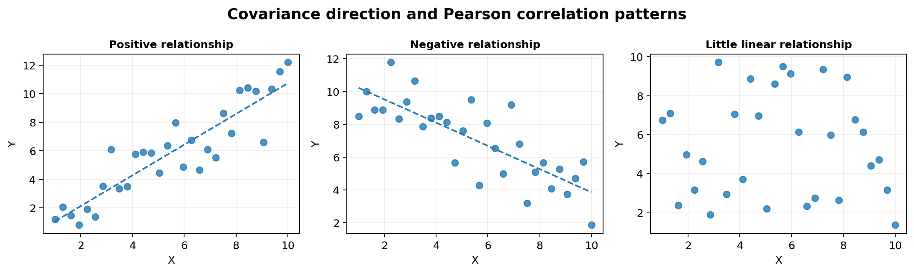

# Covariance and Correlation

> **Source note:** The supplied Module 02 README does not contain the detailed lecture explanation for covariance and correlation. This file adds the standard definitions and Python workflow for the topic you requested. Compare it with your Chapter 27 transcript before treating it as a transcript-faithful final note.

## 1. Why measure relationships?

Covariance and correlation describe how two numerical variables vary together.

Examples:
- Advertising spend and sales.
- Product price and units sold.
- Study time and exam score.
- Delivery distance and delivery duration.

A relationship does not, by itself, establish causation.



## 2. Covariance

Covariance indicates the direction in which two variables vary together.

### Population covariance

$$
\mathrm{Cov}(X,Y)=
\frac{\sum_{i=1}^{N}(x_i-\mu_X)(y_i-\mu_Y)}{N}
$$

### Sample covariance

$$
s_{XY}=
\frac{\sum_{i=1}^{n}(x_i-\bar{x})(y_i-\bar{y})}{n-1}
$$

Interpretation:
- Positive covariance: values above the mean of X tend to occur with values above the mean of Y, and below with below.
- Negative covariance: values above the mean of X tend to occur with values below the mean of Y.
- Near-zero covariance: little linear co-movement is indicated, but a nonlinear relationship may still exist.

Covariance depends on the units and scales of both variables. Its magnitude is therefore difficult to compare across differently scaled variable pairs.

## 3. Pearson correlation

Pearson's correlation standardizes covariance by the standard deviations of both variables.

$$
r_{XY}=\frac{s_{XY}}{s_Xs_Y}
$$

The population version is:

$$
\rho_{XY}=\frac{\mathrm{Cov}(X,Y)}{\sigma_X\sigma_Y}
$$

The coefficient lies between -1 and +1.

| Value | Interpretation |
|---|---|
| +1 | Perfect positive linear relationship |
| Between 0 and +1 | Positive linear association |
| 0 | No linear association |
| Between -1 and 0 | Negative linear association |
| -1 | Perfect negative linear relationship |

A correlation near zero does not rule out a strong nonlinear relationship.

<LearningViz type_id="CORRELATION" initial_values={{"pattern":"positive"}} />

## 4. Pearson vs Spearman correlation

| Feature | Pearson | Spearman |
|---|---|---|
| Measures | Linear association | Monotonic association using ranks |
| Input | Original numerical values | Ranks of values |
| Sensitive to outliers | Can be strongly affected | Often less affected, but not immune |
| Detects | Linear patterns | Monotonic patterns, including nonlinear monotonic relationships |

Spearman's rank correlation is useful when the relationship is monotonic but not necessarily linear, or when rank-based analysis is appropriate.

## 5. Correlation is not causation

A correlation can arise because:
- X influences Y.
- Y influences X.
- A third variable influences both.
- The relationship is coincidental.
- The sample or measurement process introduces bias.

Use domain knowledge, study design, and appropriate causal methods before making causal claims.

## 6. Python implementation

```python
import pandas as pd
import seaborn as sns
import matplotlib.pyplot as plt

df = pd.DataFrame({
    "advertising_spend": [10, 12, 15, 18, 20, 24],
    "sales": [22, 25, 29, 31, 38, 42]
})

# Pearson correlation
print(df["advertising_spend"].corr(df["sales"], method="pearson"))

# Spearman rank correlation
print(df["advertising_spend"].corr(df["sales"], method="spearman"))

# Correlation matrix
print(df.corr(numeric_only=True))

sns.scatterplot(data=df, x="advertising_spend", y="sales")
plt.title("Advertising spend vs sales")
plt.show()
```

Always inspect a scatterplot. A single coefficient can conceal clusters, nonlinear patterns, or influential observations.

## 7. Common mistakes

1. Claiming correlation proves causation.
2. Assuming zero Pearson correlation means no relationship of any kind.
3. Comparing covariance magnitudes across variables with different units.
4. Ignoring outliers and clusters.
5. Using Pearson when the question is about a monotonic rank relationship without considering Spearman.


## References

- [Krish Naik - Complete Statistics for Data Science](https://www.youtube.com/watch?v=LZzq1zSL1bs)
- [Pandas correlation documentation](https://pandas.pydata.org/docs/reference/api/pandas.DataFrame.corr.html)
- [SciPy statistics](https://docs.scipy.org/doc/scipy/reference/stats.html)

