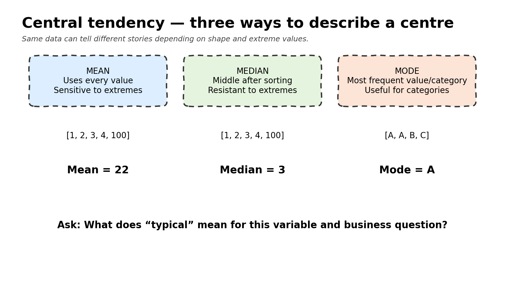
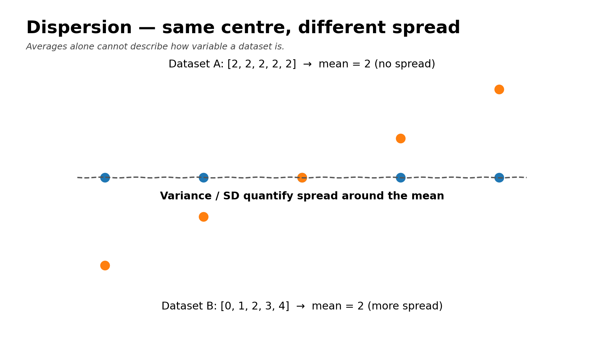
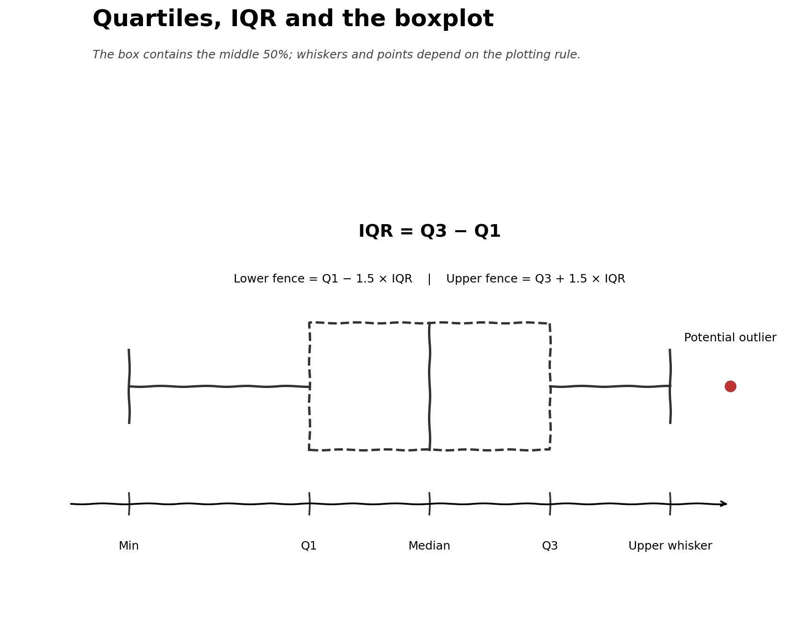
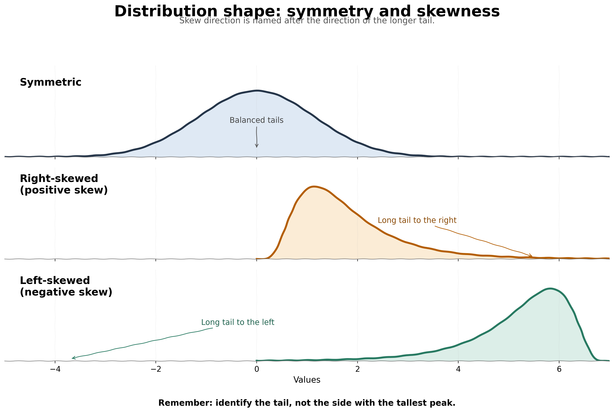
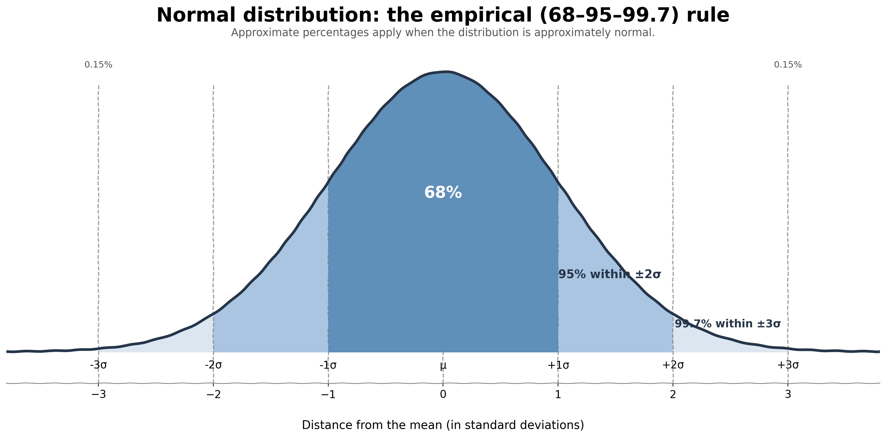
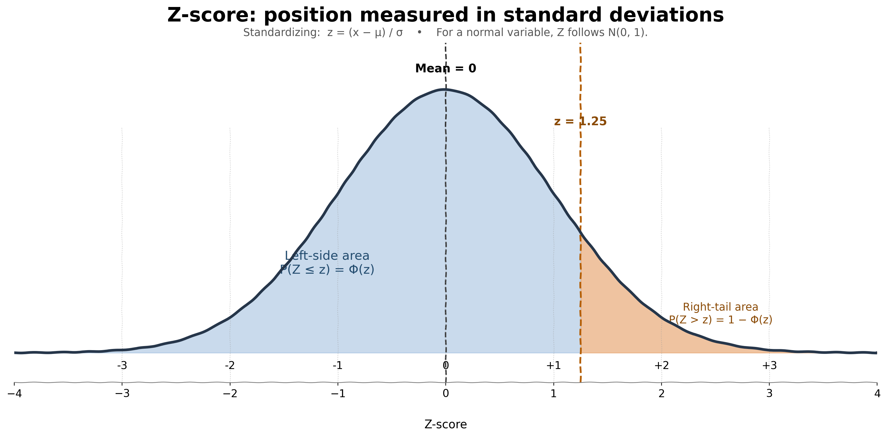
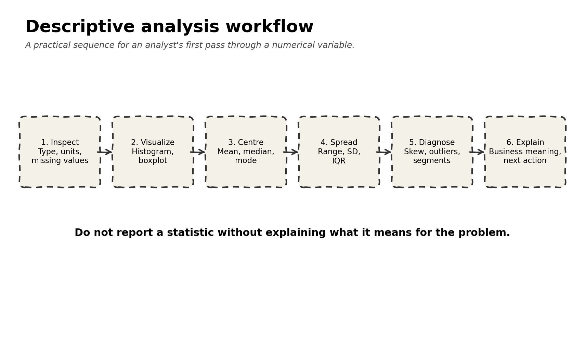

# Module 02 - Descriptive Statistics

> [!NOTE]
>
> **Section:** Krish Naik - [Complete Statistics for Data Science](https://www.youtube.com/watch?v=LZzq1zSL1bs)
>
> **Purpose:** Learn how to summarize and describe the main characteristics of a dataset. This module focuses on the centre, spread, position, shape, and unusual observations in numerical data, then applies these ideas using Python.

---

Descriptive statistics helps answer: **What does the data look like? Where is its centre? How much does it vary? Is it skewed? Are there unusual observations?**

This module follows the descriptive-statistics portions of the course, especially Chapters 10–16, with selected distribution concepts from Chapter 29. It keeps probability rules and inferential methods in separate modules.

---

# 1. Measures of Central Tendency




Central tendency describes the centre or typical location of a distribution. The three common measures are **mean, median, and mode**.

## 1.1 Arithmetic mean

The arithmetic mean is the sum of all observations divided by the number of observations.

### Population mean

$$
\mu = \frac{\sum_{i=1}^{N} x_i}{N}
$$

- $\mu$: population mean
- $x_i$: the $i$-th observation
- $N$: population size

### Sample mean

$$
\bar{x} = \frac{\sum_{i=1}^{n} x_i}{n}
$$

- $\bar{x}$: sample mean
- $n$: sample size

**Example**

Dataset: `[1, 1, 2, 2, 3, 3, 4, 5, 5, 6]`

$$
\bar{x} = \frac{32}{10} = 3.2
$$

The population/sample formulas differ in notation and the set being summarized. If the same ten observations are treated as either the whole population or a sample, the numerical average is the same.

### Weighted mean

A weighted mean gives some observations more influence than others.

$$
\bar{x}_w = \frac{\sum_{i=1}^{k} w_i x_i}{\sum_{i=1}^{k} w_i}
$$

Example: A course grade has assignments worth 30% and an exam worth 70%. If the scores are 80 and 90:

$$
0.30(80) + 0.70(90) = 87
$$

Use a weighted mean when observations have different importance, exposure, frequency, or denominators. Do not use a simple average of subgroup averages unless subgroup sizes/weights are equal.

### Strengths and limitations

- Uses every numerical observation.
- Useful for symmetric distributions without influential extreme values.
- Sensitive to outliers because every value contributes to the sum.
- Can produce a value that is not an actual observation.

## 1.2 Median

The median is the middle observation after sorting the data.

1. Sort observations in ascending order.
2. If $n$ is odd, select the observation at position $(n+1)/2$.
3. If $n$ is even, average the observations at positions $n/2$ and $n/2+1$.

For an odd sample:

$$
\text{Median} = x_{((n+1)/2)}
$$

For an even sample:

$$
\text{Median} = \frac{x_{(n/2)} + x_{(n/2+1)}}{2}
$$

**Outlier illustration from the lecture**

Original data: `[1, 1, 2, 2, 3, 3, 4, 5, 5, 6]`

- Mean = 3.2
- Median = (3 + 3) / 2 = 3

Add 100:

`[1, 1, 2, 2, 3, 3, 4, 5, 5, 6, 100]`

- Mean = 132 / 11 = 12
- Median = 3

The mean moves substantially, while the median remains 3. The median is therefore more resistant to extreme values.

Add another extreme value, 112:

`[1, 1, 2, 2, 3, 3, 4, 5, 5, 6, 100, 112]`

- Median = (3 + 4) / 2 = 3.5

The median can change when the order or central positions change, but it is generally less sensitive to extreme magnitudes than the mean.

**Use median:** income, house prices, customer wait times, transaction values, or other skewed data where a typical observation is more useful than an outlier-sensitive average.

## 1.3 Mode

The mode is the most frequently occurring value or category.

- **Unimodal:** one mode
- **Bimodal:** two modes
- **Multimodal:** more than two modes
- **No unique mode:** all values occur equally often, or the frequency pattern does not identify a useful single mode

Example: `[1, 2, 3, 4, 5, 6, 6, 6, 7, 8]` → mode = 6.

Mode is particularly useful for categorical variables, such as most common product category, payment method, or flower species. It can be used for categorical missing-value imputation, but replacing every missing value with the mode can distort category proportions and should be justified.

## 1.4 Choosing the measure

| Situation | Usually useful | Reason |
|---|---|---|
| Roughly symmetric numerical data, no major outliers | Mean | Uses all values |
| Strongly skewed numerical data or influential outliers | Median | Resistant to extreme magnitudes |
| Categorical data | Mode | Works with categories |
| Weighted observations or unequal group sizes | Weighted mean | Respects weights |
| Multiple peaks or segments | Inspect full distribution | One centre may hide subgroups |

**Do not choose by habit.** Check the variable type, distribution, outliers, business question, and domain context.

---

# 2. Measures of Dispersion




A centre alone does not describe a dataset. Two datasets can have the same mean but very different spreads.

Example:

- A: `[1, 1, 2, 2, 4]` → mean = 2
- B: `[2, 2, 2, 2, 2]` → mean = 2

Dataset A varies; dataset B has no variation. Dispersion measures quantify this spread.

## 2.1 Range

$$
\text{Range} = x_{\max} - x_{\min}
$$

Simple to calculate, but it depends only on the two extremes and is highly sensitive to outliers.

## 2.2 Variance

Variance measures the average squared deviation from the mean.

### Population variance

$$
\sigma^2 = \frac{\sum_{i=1}^{N}(x_i-\mu)^2}{N}
$$

### Sample variance

$$
s^2 = \frac{\sum_{i=1}^{n}(x_i-\bar{x})^2}{n-1}
$$

The sample formula uses $n-1$, known as **Bessel's correction**, when estimating population variance from a sample using the sample mean. It corrects the downward bias of the corresponding $n$-denominator estimator under the usual random-sampling assumptions.

### Why square deviations?

- Positive and negative deviations do not cancel.
- Larger deviations receive more weight.
- Variance is expressed in squared units (e.g., dollars²), which can be less intuitive to interpret.

**Calculation sequence**

1. Calculate the mean.
2. Subtract the mean from each observation.
3. Square each deviation.
4. Sum squared deviations.
5. Divide by $N$ for a population or $n-1$ for a sample.

Lecture example: `[1, 2, 2, 3, 4, 5]`

Population mean:

$$
\mu = \frac{17}{6} \approx 2.8333
$$

Population variance:

$$
\sigma^2 = \frac{\sum(x_i-\mu)^2}{6} \approx 1.8056
$$

Population standard deviation:

$$
\sigma = \sqrt{1.8056} \approx 1.3437
$$

The transcript rounds intermediate values, so its displayed result is approximately 1.81 variance and 1.345 standard deviation.

## 2.3 Standard deviation

Standard deviation is the square root of variance.

$$
\sigma = \sqrt{\sigma^2}
\qquad
s = \sqrt{s^2}
$$

It describes the typical scale of deviations from the mean and is expressed in the original variable's units.

- Small SD: observations tend to be closer to the mean.
- Large SD: observations are more spread out around the mean.

**Caution:** Standard deviation is not a guarantee that every observation lies within one SD of the mean. The familiar 68–95–99.7 rule applies to an approximately normal distribution, not every dataset.

## 2.4 Mean absolute deviation (MAD)

Mean absolute deviation around the mean is:

$$
\text{MAD}_{\text{mean}} = \frac{1}{n}\sum_{i=1}^{n}|x_i-\bar{x}|
$$

It measures average absolute distance and remains in the original units. Some software and literature use “MAD” to mean **median absolute deviation** instead; always state which definition is being used.

Median absolute deviation (robust version):

$$
\text{MAD}_{\text{median}} = {median}(|x_i-\operatorname{median}(x)|)
$$

## 2.5 Coefficient of variation (CV)

$$
CV = \frac{s}{|\bar{x}|}\times100\%
$$

CV expresses standard deviation relative to the mean. It can help compare relative variability across measurements with different units or scales, but is meaningful mainly for ratio-scale data with a nonzero mean. It is unstable or misleading when the mean is near zero, and should not be used for interval-scale values such as Celsius temperatures.

---

# 3. Percentiles and Quartiles




## 3.1 Percentile

The $p$-th percentile is a value at or below which approximately $p\%$ of observations lie, according to the chosen quantile convention.

Examples:

- 25th percentile = first quartile (Q1)
- 50th percentile = median (Q2)
- 75th percentile = third quartile (Q3)
- 90th percentile = a threshold at or below which approximately 90% of observations fall

**Interpretation:** If a candidate's score is at the 80th percentile, the candidate scored at or above approximately 80% of the comparison group under the percentile-rank convention being used. It does not mean the candidate scored 80%.

## 3.2 Percentile rank vs percentile value

These are different questions:

- **Percentile rank:** What percentage of observations are below (or at/below) a particular value?
- **Percentile value/quantile:** What value marks a specified percentage of the distribution?

A simple empirical percentile-rank calculation is:

$$
\text{Percentile rank}(x)=
\frac{\#\{x_i < x\}}{n}\times100
$$

This is one convention. Ties and alternative definitions (less-than vs less-than-or-equal, midrank, interpolation) produce different results. Do not treat the transcript's simple formula as a universal software standard.

## 3.3 Quartiles

Quartiles divide ordered data into four parts:

- Q1: 25th percentile
- Q2: 50th percentile (median)
- Q3: 75th percentile

Quantile algorithms differ in how they interpolate between observations. Python/NumPy/Pandas may use a particular method by default; report the method when exact reproducibility matters.

## 3.4 Interquartile range (IQR)

$$
IQR = Q3-Q1
$$

IQR measures the spread of the middle 50% of observations. Because it ignores the most extreme quarters, it is more resistant to outliers than range or standard deviation.

---

# 4. Five-Number Summary and Boxplots

## 4.1 Five-number summary

A compact summary of a distribution:

1. Minimum
2. First quartile (Q1)
3. Median (Q2)
4. Third quartile (Q3)
5. Maximum

When describing a boxplot with potential outliers, be precise: the whisker endpoints are often the most extreme **non-outlier** observations, not necessarily the raw minimum and maximum.

## 4.2 Boxplot anatomy

- Box: Q1 to Q3 (the IQR)
- Line inside box: median
- Whiskers: extend to the most extreme observations within the plotting rule (commonly 1.5 × IQR)
- Individual points beyond whiskers: potential outliers

A boxplot is useful for comparing distributions across groups, such as delivery time by region or revenue by product category. It does not show every detail of the distribution; pair it with a histogram or raw-data view when necessary.

---

# 5. Outlier Detection with the IQR Rule

An outlier is an observation that is unusually far from the rest of the data under a specified rule or model. An outlier is not automatically an error.

## 5.1 Tukey fences

$$
\text{Lower fence}=Q1-1.5(IQR)
$$

$$
\text{Upper fence}=Q3+1.5(IQR)
$$

Flag observations:

$$
x < \text{Lower fence}
\quad \text{or} \quad
x > \text{Upper fence}
$$

The 1.5 × IQR rule is a screening convention, not proof that an observation is invalid.

### Worked example from the lecture

Data:

`[1, 2, 2, 3, 3, 4, 5, 5, 5, 6, 6, 6, 6, 7, 8, 8, 9, 27]`

Using the quartiles selected in the lecture's calculation:

- Q1 = 3
- Q3 = 7
- IQR = 7 − 3 = 4
- Lower fence = 3 − 1.5(4) = −3
- Upper fence = 7 + 1.5(4) = 13

27 is above 13 and is flagged as a potential outlier.

**Quartile-method caveat:** The transcript's dataset count and quartile-index arithmetic contain inconsistencies in places. Quartiles can vary by convention, especially for small datasets. The fence method is correct; always calculate Q1 and Q3 consistently with a stated method. The numerical example above follows the intended Q1/Q3 values from the lecture.

## 5.2 What to do after flagging an outlier

Do not automatically delete it.

1. Check whether it is a data-entry, unit, parsing, or sensor error.
2. Check whether it is a valid rare event (e.g., unusually large order).
3. Compare it with domain limits and business context.
4. Assess its impact on mean, SD, model performance, and business conclusions.
5. Choose a justified treatment: correct, retain, cap/winsorize, transform, use robust statistics, or exclude with documented reasoning.

Outlier treatment should be driven by the question and data-generating process, not merely by a plotting rule.

---

# 6. Distribution Shape and Visualization




A distribution describes how observations are spread across possible values. In EDA, inspect shape before deciding which summary statistics are representative.

## 6.1 Histogram

A histogram groups numerical observations into adjace+
nt bins and displays the count or density in each bin.

- X-axis: numerical intervals (bins)
- Y-axis: count, frequency, or density
- Adjacent bars touch because bins represent continuous intervals

Bin width and bin boundaries affect the appearance. A poorly chosen binning can hide clusters or exaggerate noise.

## 6.2 Bar chart vs histogram

| Bar chart | Histogram |
|---|---|
| Usually categorical or discrete categories | Numerical data grouped into intervals |
| Bars are separated | Bars typically touch |
| Category order may be rearranged | Bin order follows the numerical scale |
| Bar height represents category value/count | Bar area represents count or density when bins have unequal widths |

## 6.3 Density curve and KDE

A density curve is a smooth representation of a distribution. Kernel density estimation (KDE) estimates a continuous density from observations.

- A density curve's total area is 1.
- Density height is not the probability at a single exact continuous value.
- Probability over an interval corresponds to area under the density curve over that interval.
- KDE depends on bandwidth; excessive smoothing can hide structure, while insufficient smoothing can create false bumps.

## 6.4 Symmetry and skewness

- **Approximately symmetric:** left and right sides have similar shape.
- **Right-skewed (positive skew):** longer tail extends toward larger values; a few large observations may pull the mean rightward.
- **Left-skewed (negative skew):** longer tail extends toward smaller values; a few small observations may pull the mean leftward.

For many unimodal distributions:
- Right skew: mean often > median
- Left skew: mean often < median
- Symmetric distribution: mean and median often close

These are tendencies, not universal laws.

## 6.5 Skewness

Skewness describes asymmetry in a distribution. It can be estimated using moment-based formulas, but sample estimators and bias corrections differ across software.

Interpretation:
- Near zero: little measured skewness
- Positive: right-skewed
- Negative: left-skewed

Do not interpret a single skewness value without examining a plot and sample size.

## 6.6 Kurtosis

Kurtosis describes aspects of tail heaviness and extremity relative to a normal distribution; it is not simply a measure of peak height.

Many libraries report **excess kurtosis**, where the normal distribution has value 0 (ordinary kurtosis = 3). State the convention when reporting it.

---

# 7. Normal (Gaussian) Distribution




A normal distribution is a continuous, symmetric, bell-shaped probability distribution described by its mean $\mu$ and standard deviation $\sigma$.

$$
X \sim \mathcal{N}(\mu,\sigma^2)
$$

Properties:

- Symmetric around the mean.
- Mean = median = mode.
- Total area under the probability density curve = 1.
- The tails extend indefinitely in both directions.
- The mean determines the centre; standard deviation determines the spread.

A real dataset need not be perfectly normal. Assess normality with plots and context rather than assuming every bell-like histogram is normal.

## 7.1 Empirical rule: 68–95–99.7

For a normal distribution:

| Interval | Approximate proportion |
|---|---:|
| $\mu \pm 1\sigma$ | 68% |
| $\mu \pm 2\sigma$ | 95% |
| $\mu \pm 3\sigma$ | 99.7% |

These percentages are approximate and apply to a normal distribution. They are not a general rule for arbitrary data.

---

# 8. Z-Scores and the Standard Normal Distribution




A z-score expresses how many standard deviations an observation is from the mean.

For a population with known parameters:

$$
z = \frac{x-\mu}{\sigma}
$$

For a sample-based standardized score, one commonly uses:

$$
z = \frac{x-\bar{x}}{s}
$$

Interpretation:
- $z=0$: at the mean
- $z=+1$: one SD above the mean
- $z=-2$: two SDs below the mean

A positive z-score is above the mean; a negative z-score is below it.

## 8.1 Standard normal distribution

$$
Z \sim \mathcal{N}(0,1)
$$

The standard normal distribution has mean 0 and standard deviation 1. Standardizing a normally distributed variable produces a standard normal variable.

A z-table or software CDF gives cumulative probability:

$$
P(Z \le z)=\Phi(z)
$$

Right-tail probability:

$$
P(Z>z)=1-\Phi(z)
$$

Probability between two values:

$$
P(a<Z<b)=\Phi(b)-\Phi(a)
$$

**Lecture example:** If $X$ is normal with mean 4 and SD 1, then for $x=4.25$:

$$
z=\frac{4.25-4}{1}=0.25
$$

The probability above 4.25 is:

$$
P(X>4.25)=1-\Phi(0.25)\approx 0.4013
$$

So approximately 40.13% of the distribution lies above 4.25.

**Important correction to the transcript:** It contains a few inconsistent labels and arithmetic statements around z-tables. Always identify whether the table reports left-tail cumulative area, right-tail area, or area between 0 and z. The CDF notation above removes ambiguity.

## 8.2 Z-score as an outlier flag

Large absolute z-scores can indicate unusual observations, but a fixed cutoff such as $|z|>3$ is not a universal outlier rule. Z-scores are sensitive to the mean and SD, so they can be misleading for skewed distributions or datasets already containing extreme values. Consider robust methods such as IQR or median absolute deviation.

---

# 9. Log-Normal, Pareto, and the Central Limit Theorem — Orientation

These ideas appear later in the course transcript. They connect distribution shape to real-world data, but they should not be confused with the core descriptive-statistics calculations above.

## 9.1 Log-normal distribution

A positive random variable $X$ is log-normal when $\ln(X)$ follows a normal distribution.

$$
\ln(X)\sim\mathcal{N}(\mu,\sigma^2)
$$

Log-normal data are positive and typically right-skewed. Examples can include some income, transaction-size, duration, and biological measurement variables, depending on the data-generating process.

A log transformation may make a right-skewed variable more symmetric, but it does not guarantee normality. Check the transformed distribution.

## 9.2 Pareto / power-law behaviour

Pareto-like distributions have heavy right tails: a relatively small number of observations can account for a large share of the total.

The 80/20 principle is a heuristic often associated with Pareto-style concentration, not a universal mathematical law. Examples to investigate include sales concentration across customers or revenue concentration across products.

## 9.3 Central Limit Theorem (CLT)

The CLT concerns the distribution of sample means, not the shape of the raw observations.

Under suitable conditions (including independent observations with finite variance), as sample size increases, the sampling distribution of the sample mean approaches a normal distribution:

$$
\bar{X}\ \approx\ \mathcal{N}\left(\mu,\frac{\sigma^2}{n}\right)
$$

The standard error is:

$$
SE(\bar{X})=\frac{\sigma}{\sqrt{n}}
$$

The transcript mentions $n\geq30$ as a rule of thumb. **Thirty is not a universal threshold.** Required sample size depends on skewness, tail behaviour, dependence, and the accuracy needed. The CLT does not say the original data become normally distributed.

---

# 10. Python Implementation




Use one notebook for this module:

`python-implementations/02_descriptive_statistics.ipynb`

## 10.1 Imports and example data

```python
import numpy as np
import pandas as pd
import matplotlib.pyplot as plt
import seaborn as sns
from scipy import stats

data = pd.Series([1, 2, 2, 3, 3, 4, 5, 5, 5, 6, 6, 6, 6, 7, 8, 8, 9, 27])
```

## 10.2 Central tendency

```python
mean_value = data.mean()
median_value = data.median()
mode_values = data.mode()

print("Mean:", mean_value)
print("Median:", median_value)
print("Mode(s):", mode_values.tolist())
```

`Series.mode()` can return more than one mode. Do not assume the result is always a single scalar.

## 10.3 Dispersion

```python
population_variance = data.var(ddof=0)
sample_variance = data.var(ddof=1)

population_sd = data.std(ddof=0)
sample_sd = data.std(ddof=1)

data_range = data.max() - data.min()
mean_absolute_deviation = (data - data.mean()).abs().mean()

print(population_variance, sample_variance)
print(population_sd, sample_sd)
print(data_range, mean_absolute_deviation)
```

In NumPy/Pandas, `ddof=0` divides by $n$; `ddof=1` divides by $n-1$. Pandas `Series.var()` and `Series.std()` default to `ddof=1`, while NumPy's `np.var()` and `np.std()` default to `ddof=0`. Set it explicitly.

## 10.4 Quantiles, IQR, and fences

```python
q1 = data.quantile(0.25)
median = data.quantile(0.50)
q3 = data.quantile(0.75)

iqr = q3 - q1
lower_fence = q1 - 1.5 * iqr
upper_fence = q3 + 1.5 * iqr

potential_outliers = data[
    (data < lower_fence) | (data > upper_fence)
]

print({"Q1": q1, "Median": median, "Q3": q3, "IQR": iqr})
print({"Lower fence": lower_fence, "Upper fence": upper_fence})
print("Potential outliers:", potential_outliers.tolist())
```

Pandas quantile interpolation can be selected with the `interpolation` argument. Keep the method consistent when comparing calculations.

## 10.5 Five-number summary

```python
five_number_summary = {
    "minimum": data.min(),
    "Q1": data.quantile(0.25),
    "median": data.median(),
    "Q3": data.quantile(0.75),
    "maximum": data.max(),
}

pd.Series(five_number_summary)
```

## 10.6 Histogram, KDE, and boxplot

```python
fig, axes = plt.subplots(1, 2, figsize=(12, 4))

sns.histplot(data, kde=True, ax=axes[0])
axes[0].set_title("Distribution of observations")

sns.boxplot(x=data, ax=axes[1])
axes[1].set_title("Boxplot and potential outliers")

plt.tight_layout()
plt.show()
```

## 10.7 Skewness and kurtosis

```python
print("Skewness:", data.skew())
print("Excess kurtosis:", data.kurt())
```

Pandas reports Fisher/excess kurtosis by default (normal distribution is 0). Different packages may use different estimator corrections.

## 10.8 Z-scores and normal probabilities

```python
mu = 4
sigma = 1
x = 4.25

z = (x - mu) / sigma
right_tail_probability = stats.norm.sf(z)  # More stable than 1 - cdf for extreme tails

print("Z-score:", z)
print("P(X > 4.25):", right_tail_probability)
```

For a dataset-based standardized value:

```python
z_scores = stats.zscore(data, ddof=1)
```

Use the population/sample convention that matches the question.

## 10.9 Dataset-level EDA summary

```python
df = sns.load_dataset("tips")

numeric_summary = df.select_dtypes(include="number").describe().T
numeric_summary["variance_sample"] = df.select_dtypes(include="number").var()
numeric_summary["skewness"] = df.select_dtypes(include="number").skew()

numeric_summary
```

Interpret the output instead of merely printing it. Ask:
- Which variables are skewed?
- Where is mean far from median?
- Which variables have high dispersion?
- Are extreme values valid business events?
- Do groups have different distributions?

---

# 11. Business Applications for a Data Analyst

| Business problem | Statistical tool | Example interpretation |
|---|---|---|
| Typical delivery time | Median, percentiles | Median delivery time is 2 days; 90th percentile is 5 days |
| Revenue consistency | Mean, SD, CV | Compare average revenue and relative variation across stores |
| Customer spending | Median, quartiles, histogram | Identify skewed spend and high-value customers |
| Detect unusually large orders | IQR, boxplot, domain rules | Flag orders for review, not automatic deletion |
| Compare service wait times | Distribution plots, median, IQR | Compare typical wait and variability across branches |
| Monitor operational variation | Mean and SD over time | Detect changes in process consistency |
| Missing categorical values | Mode, domain rules | Consider most frequent category, while checking category imbalance |

---

# 12. Common Mistakes to Avoid

1. Treating mean and median as interchangeable.
2. Assuming the mean is always the best measure of a typical value.
3. Forgetting to sort data before manually finding the median.
4. Confusing population variance with sample variance.
5. Using $n$ instead of $n-1$ for the usual unbiased sample-variance estimator.
6. Interpreting variance as being in the original units.
7. Assuming every observation lies within one standard deviation.
8. Treating percentile rank and percentile value as the same thing.
9. Assuming every library calculates quartiles identically.
10. Deleting every IQR-flagged observation without investigating it.
11. Calling a histogram a bar chart, or treating KDE height as point probability.
12. Assuming every dataset follows a normal distribution.
13. Treating the 68–95–99.7 rule as valid for every distribution.
14. Treating $n=30$ as a guaranteed CLT threshold.
15. Confusing the distribution of raw data with the sampling distribution of the mean.

---

# 13. Revision Sheet — Formulas

| Concept | Formula |
|---|---|
| Population mean | $\mu=\frac{\sum x_i}{N}$ |
| Sample mean | $\bar{x}=\frac{\sum x_i}{n}$ |
| Weighted mean | $\bar{x}_w=\frac{\sum w_ix_i}{\sum w_i}$ |
| Range | $\max(x)-\min(x)$ |
| Population variance | $\sigma^2=\frac{\sum(x_i-\mu)^2}{N}$ |
| Sample variance | $s^2=\frac{\sum(x_i-\bar{x})^2}{n-1}$ |
| Standard deviation | Square root of variance |
| Mean absolute deviation | $\frac{1}{n}\sum|x_i-\bar{x}|$ |
| IQR | $Q3-Q1$ |
| Lower fence | $Q1-1.5(IQR)$ |
| Upper fence | $Q3+1.5(IQR)$ |
| Z-score | $\frac{x-\mu}{\sigma}$ |
| Coefficient of variation | $\frac{s}{|\bar{x}|}\times100\%$ |
| Standard error of mean | $\frac{\sigma}{\sqrt n}$ |

---

# 14. Practice and Completion Checklist

Before moving to the next module, complete these tasks:

- [ ] Explain mean, median, and mode without reading notes.
- [ ] Calculate population and sample mean.
- [ ] Explain why outliers affect mean more than median.
- [ ] Calculate population and sample variance by hand.
- [ ] Explain the difference between variance and standard deviation.
- [ ] Calculate quartiles and IQR, stating the quantile convention.
- [ ] Calculate IQR fences and explain why flagged values are not automatically errors.
- [ ] Interpret a boxplot and histogram.
- [ ] Identify symmetric, right-skewed, and left-skewed distributions.
- [ ] Explain the normal distribution and empirical rule.
- [ ] Calculate z-scores and interpret a normal CDF.
- [ ] Implement the calculations in Python and explain the outputs.
- [ ] Complete one small EDA exercise on a real dataset.

## Suggested practical exercise

Use the Seaborn `tips` dataset or a retail/orders dataset. Choose at least three numerical columns and one categorical column.

For each numerical column:
- Calculate mean, median, mode, range, variance, SD, Q1, Q3, IQR, skewness, and potential outliers.
- Plot a histogram with KDE and a boxplot.
- Write 2–3 sentences interpreting the distribution.

For the categorical column:
- Calculate frequencies and identify the mode.
- Explain whether mode is a useful summary.

**Deliverable:** a notebook with reproducible code, visualizations, and written business interpretations.

---

## References

- [Krish Naik — Complete Statistics for Data Science](https://www.youtube.com/watch?v=LZzq1zSL1bs)
- [NumPy — Descriptive statistics routines](https://numpy.org/doc/stable/reference/routines.statistics.html)
- [Pandas — Descriptive statistics](https://pandas.pydata.org/docs/user_guide/basics.html#descriptive-statistics)
- [SciPy — Statistical functions](https://docs.scipy.org/doc/scipy/reference/stats.html)
- [NIST/SEMATECH e-Handbook of Statistical Methods](https://www.itl.nist.gov/div898/handbook/)

---

**Module 02 status:** Documentation baseline complete. Work through the practice checklist and notebook before considering the module mastered.
