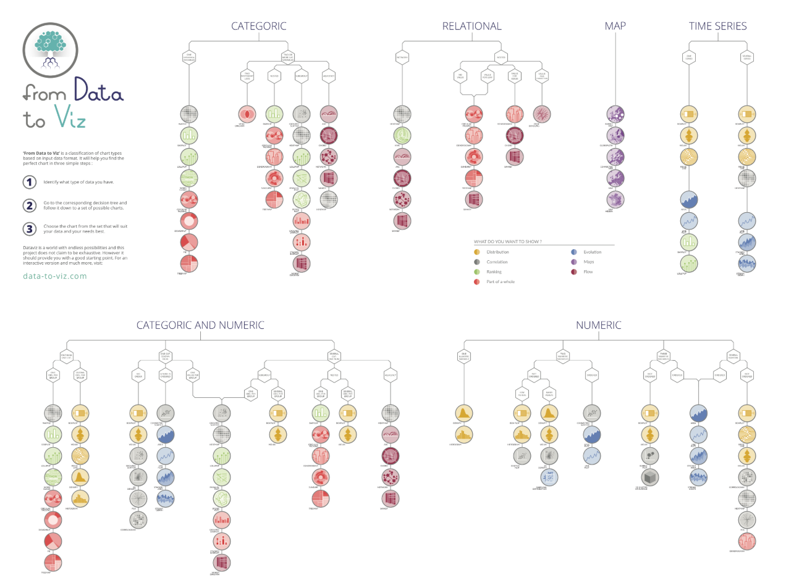
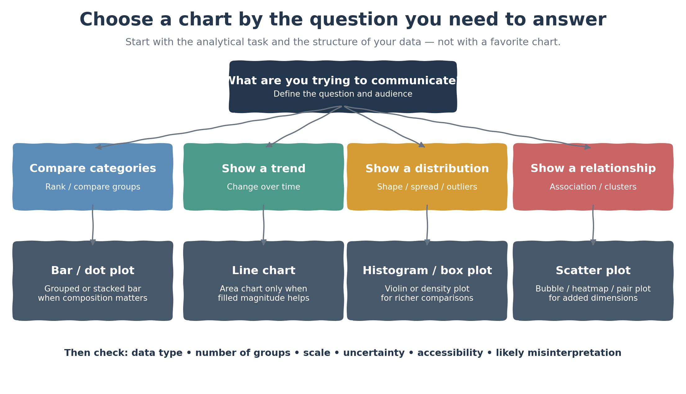
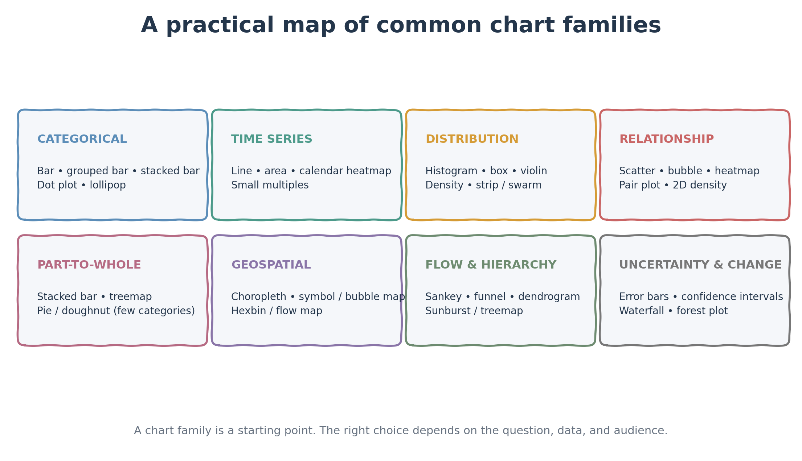
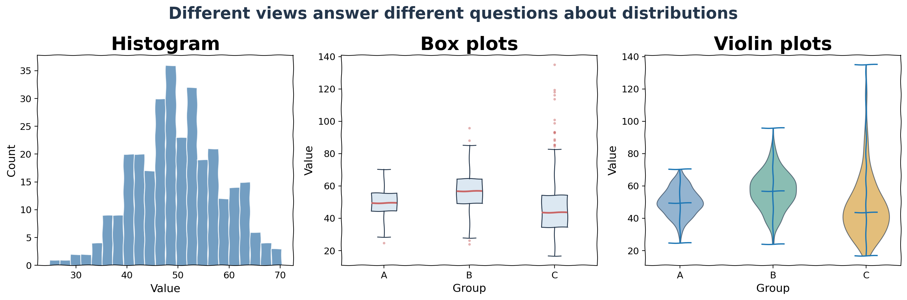
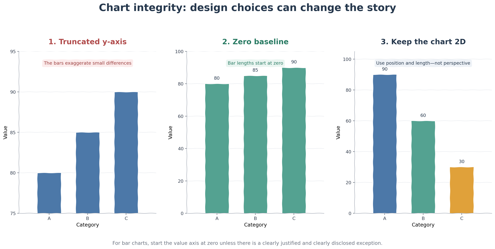

# Module 03 - Data Visualization

>[!NOTE]
> **Purpose:** Learn to select, build, critique, and communicate visualizations that answer analytical and business questions.

---

## Contents

- [Learning objectives](#learning-objectives)
- [How to use the From Data to Viz reference](#how-to-use-the-from-data-to-viz-reference)
- [Chart selection framework](#chart-selection-framework)
- [Chart families and coverage checklist](#chart-families-and-coverage-checklist)
- [Chart selection matrix](#chart-selection-matrix)
- [Chart design principles](#chart-design-principles)
- [Common misleading practices](#common-misleading-practices)
- [Python visualization toolkit](#python-visualization-toolkit)
- [Practical business exercises](#practical-business-exercises)
- [How to document each chart](#how-to-document-each-chart)
- [Completion checklist](#completion-checklist)
- [References](#references)

---

## How to use the From Data to Viz reference

The following image was supplied as the chart-selection reference for this module. It classifies chart types by data structure and analytical purpose. Use it as a navigation aid, not as a rule that one chart is always correct.



**How to read it:**

1. Identify the type of data available.
2. Identify what you want to show: distribution, correlation, ranking, part-to-whole, evolution, maps, or flow.
3. Follow the corresponding branch and compare candidate charts.
4. Check whether the chart makes the intended comparison easy for the intended audience.

The reference is not exhaustive. Specialized charts should be used only when their structure genuinely helps answer the question.

Source: [From Data to Viz](https://www.data-to-viz.com/).

---

## Chart selection framework



Start with the question, not the chart.

| Analytical question | Typical chart choices | Example |
|---|---|---|
| How do categories compare? | Bar, dot plot, lollipop | Revenue by product category |
| How does a measure change over time? | Line, area, calendar heatmap | Monthly revenue |
| How is a numerical variable distributed? | Histogram, density, box, violin | Order-value distribution |
| Are two variables associated? | Scatter, bubble, 2D density | Discount vs. profit margin |
| How does a total break into components? | Stacked bar, treemap; pie for very few categories | Revenue share by channel |
| Where do values occur? | Choropleth, symbol/bubble map | Sales by state |
| How do quantities move through stages? | Funnel, Sankey | Website conversion or supply-chain flow |
| How uncertain is an estimate? | Error bars, interval/forest plot | Experiment effect with confidence interval |

### A practical decision sequence

- **Step 1 - Define the task:** comparison, trend, distribution, relationship, composition, geography, flow, or uncertainty.
- **Step 2 - Identify the fields:** categorical, numerical, date/time, geographic, or network/entity fields.
- **Step 3 - Count the groups:** many categories can make stacked bars, pie charts, and legends unreadable.
- **Step 4 - Choose an encoding:** position and length are usually easier to compare accurately than angle, area, or color intensity.
- **Step 5 - Check the scale:** units, zero baseline where relevant, linear/log scale, time interval, and missing values.
- **Step 6 - Test the interpretation:** can a reader answer the original question without guessing?

---

## Chart families and coverage checklist

The coverage below is deliberately prioritized. Learn the essential charts deeply; understand specialized charts well enough to recognize when they are useful. Do not treat the checklist as a requirement to create every chart in a portfolio.



### 1. Categorical comparison

**Core charts**
- [ ] Bar chart (vertical/column and horizontal)
- [ ] Grouped bar chart
- [ ] Stacked bar chart
- [ ] 100% stacked bar chart
- [ ] Dot plot
- [ ] Lollipop chart

**Specialized/optional**
- [ ] Circular bar chart - usually less precise for comparisons than a conventional bar chart.


> [!IMPORTANT]
> Comparing values across categories, ranking products, comparing departments, or comparing composition across a small number of groups.

>[!NOTE]
> Too many categories, inconsistent sorting, crowded labels, and stacked bars where middle segments are difficult to compare.

### 2. Numerical distributions

**Core charts**
- [ ] Histogram
- [ ] Density plot / kernel density estimate (KDE)
- [ ] Box plot
- [ ] Violin plot

**Additional charts**
- [ ] Strip plot
- [ ] Swarm plot
- [ ] Ridgeline plot

> [!IMPORTANT]
> Understanding spread, shape, skew, concentration, outliers, and differences between groups.

>[!NOTE]
> Histogram appearance depends on bin width and bin boundaries.
> KDE bandwidth affects smoothness and can hide local structure.
> A box plot compresses distribution detail; it does not show every observation.
> Violin width represents estimated density, not the number of observations unless the plot is configured to encode sample size.



**Connection to Module 02:** mean, median, variance, standard deviation, quartiles, IQR, skewness, and outlier concepts are descriptive-statistics topics. Here, learn how charts communicate those properties and how to compare groups visually.

### 3. Time-series visualization

**Core charts**
- [ ] Line chart
- [ ] Area chart
- [ ] Stacked area chart

**Additional charts**
- [ ] Calendar heatmap
- [ ] Small multiples / faceted time-series charts
- [ ] Streamgraph - specialized; use only when its composition-focused design is appropriate.

> [!IMPORTANT]
> Showing trends, seasonality, changes, peaks, dips, and comparisons over time.

>[!NOTE]
> Irregular time intervals, missing dates, misleading aggregation, inappropriate interpolation, and stacked areas that make individual series hard to compare.

### 4. Relationships between variables

**Core charts**
- [ ] Scatter plot
- [ ] Scatter plot with a fitted trend line (when justified)
- [ ] Correlation heatmap

**Additional charts**
- [ ] Bubble chart
- [ ] Pair plot
- [ ] 2D density / hexbin plot
- [ ] Parallel coordinates plot

> [!IMPORTANT]
> Examining association, clusters, non-linear patterns, unusual observations, or relationships among multiple variables.

>[!NOTE]
> Correlation does not prove causation; overplotting can hide observations; bubble area must be scaled carefully; and a correlation heatmap can hide non-linear relationships or be distorted by outliers.

### 5. Part-to-whole and hierarchical composition

**Core charts**
- [ ] Stacked bar chart
- [ ] 100% stacked bar chart
- [ ] Treemap

**Additional charts**
- [ ] Pie chart
- [ ] Doughnut chart
- [ ] Sunburst chart

> [!IMPORTANT]
> Showing how components contribute to a whole or how categories nest within a hierarchy.

>[!NOTE]
> Pie/Doughnut charts are difficult to compare when there are many slices or similar proportions. Do not use them when precise ranking is the goal; use a sorted bar chart instead. A 100% stacked chart compares proportions, not absolute totals.

### 6. Geospatial visualization

**Core concepts**
- [ ] Choropleth map
- [ ] Proportional-symbol / bubble map

**Specialized**
- [ ] Hexbin map
- [ ] Connection/flow map
- [ ] Cartogram

> [!IMPORTANT]
> The location itself is analytically meaningful, such as regional rates, store locations, or movement between places.

>[!NOTE]
> Choropleth maps should generally use normalized rates or ratios when geographic areas have different population sizes. Large regions can visually dominate small ones. Include a clear legend, units, geographic boundary source, and date.

### 7. Flow, funnel, hierarchy, and network

**Useful charts**
- [ ] Funnel chart - conversion or drop-off through ordered stages.
- [ ] Sankey diagram - quantities moving between stages or nodes.
- [ ] Dendrogram - hierarchical clustering output.
- [ ] Network graph - nodes and edges representing connections.
- [ ] Sunburst/circle packing - hierarchical composition.
- [ ] Chord diagram / arc diagram / edge bundling - specialized relationship or flow structures.

> [!IMPORTANT]
> The structure is inherently sequential, hierarchical, or network-based.

>[!NOTE]
> These charts can become visually dense. Use them only when the flow, hierarchy, or network is the question; otherwise a bar chart or table may be clearer.

### 8. Uncertainty, effects, and changes

These are important additions for analytical reporting and experimentation.

- [ ] Error-bar chart - variability or uncertainty around a point estimate; define exactly what the bars represent.
- [ ] Confidence-interval / forest plot - compares estimates and intervals across groups or studies.
- [ ] Waterfall chart - explains sequential contributions to a total change.
- [ ] Bullet chart - compares performance with a target and qualitative ranges.

> [!IMPORTANT]
> An error bar is not self-explanatory. State whether it represents standard deviation, standard error, a confidence interval, or another interval.

---

## Chart selection matrix

| Data / task | Recommended starting point | Alternative |
|---|---|---|
| One categorical field + one numeric measure | Sorted bar chart | Dot plot |
| Two categorical fields + one numeric measure | Grouped bar | Faceted bars / heatmap |
| One numeric variable | Histogram | KDE |
| Numeric variable across groups | Box plot | Violin + strip plot |
| One time field + one measure | Line chart | Area chart |
| Two numeric variables | Scatter plot | Hexbin / 2D density |
| Many numeric variables | Correlation heatmap | Pair plot |
| Composition across groups | 100% stacked bar | Treemap |
| Geographic rates | Choropleth | Symbol map |
| Ordered conversion stages | Funnel | Stage-by-stage bar chart |
| Flow between nodes | Sankey | Flow table |
| Estimate with uncertainty | Point + interval / forest plot | Error bars |

No matrix can replace judgment. Consider sample size, missingness, audience, accessibility, and whether the chart preserves the comparison you want the reader to make.

---

## Chart design principles

1. **Use a clear title:** prefer a conclusion-oriented title when the analysis supports one.
2. **Label units:** revenue in ₹, time in days, conversion in %, etc.
3. **Use honest axes:** bar charts should generally start at zero because bar length encodes magnitude. If a non-zero axis is necessary for another chart, make the truncation obvious and avoid exaggerating differences.
4. **Choose readable scales:** use a log scale only when justified and label it clearly.
5. **Sort categories intentionally:** rank bars when ranking is the task; preserve a meaningful order for time or ordinal categories.
6. **Use color with purpose:** highlight a key group, distinguish meaningful categories, or encode a continuous scale. Avoid decorative rainbow palettes.
7. **Avoid clutter:** remove unnecessary borders, 3D effects, redundant legends, and excessive gridlines.
8. **Make comparisons easy:** align baselines and use consistent scales across panels.
9. **Show context:** include time period, population, denominator, and filters where they affect interpretation.
10. **Design for accessibility:** do not rely on color alone; use adequate contrast and direct labels where practical.



### Common misleading practices

- Using a truncated bar axis without clearly signaling it.
- Comparing raw counts when group sizes differ substantially.
- Using pie charts with many categories.
- Using dual axes that imply a relationship between unrelated scales.
- Connecting time-series points when the time ordering or intervals are not meaningful.
- Treating a smoothed KDE curve as observed data.
- Hiding missing data or silently dropping records.
- Presenting correlation as causation.
- Using 3D effects that distort visual comparison.
- Omitting units, date range, denominator, or source.

---

## Python visualization toolkit

| Library | Role in this module |
|---|---|
| [Matplotlib](https://matplotlib.org/stable/) | Core plotting, axes, annotations, layouts, and customization |
| [Seaborn](https://seaborn.pydata.org/) | Statistical graphics, categorical plots, distributions, and relationships |
| [Plotly](https://plotly.com/python/) | Interactive charts, hover details, and exploratory dashboards |
| [GeoPandas](https://geopandas.org/) | Working with geographic data and maps |
| [NetworkX](https://networkx.org/) | Graph and network structures |

### Suggested learning order

1. Learn Matplotlib figures, axes, labels, legends, subplots, and annotations.
2. Use Seaborn for distribution, categorical, and relational plots.
3. Learn Plotly after static charts are understood.
4. Use GeoPandas and NetworkX only when a project requires spatial or network analysis.

### Basic examples

```python
import matplotlib.pyplot as plt
import seaborn as sns

# Bar chart: compare category totals
sns.barplot(data=df, x="category", y="revenue", estimator="sum")
plt.title("Revenue by product category")
plt.xlabel("Product category")
plt.ylabel("Revenue (₹)")
plt.xticks(rotation=30, ha="right")
plt.tight_layout()
plt.show()

# Histogram: inspect a numerical distribution
sns.histplot(data=df, x="order_value", bins=30, kde=True)
plt.title("Distribution of order values")
plt.xlabel("Order value (₹)")
plt.ylabel("Number of orders")
plt.show()

# Scatter plot: inspect the relationship between two measures
sns.scatterplot(data=df, x="discount", y="profit_margin", alpha=0.6)
plt.title("Discount vs. profit margin")
plt.xlabel("Discount")
plt.ylabel("Profit margin")
plt.show()

# Box plot: compare distributions across categories
sns.boxplot(data=df, x="region", y="order_value")
plt.title("Order value by region")
plt.xlabel("Region")
plt.ylabel("Order value (₹)")
plt.xticks(rotation=30, ha="right")
plt.tight_layout()
plt.show()
```

These are templates. Confirm column names, aggregation logic, missing-value handling, and units before using them on a real dataset. For aggregated business metrics, calculate the aggregation explicitly when the metric definition is more complex than a simple sum or mean.

---

## Practical business exercises

Use an e-commerce, retail, SaaS, or customer analytics dataset. For each question, choose a chart, create it, and write a short interpretation.

| # | Business question | Possible chart |
|---|---|---|
| 1 | Which product categories generate the highest revenue? | Sorted bar chart |
| 2 | How does monthly revenue change over time? | Line chart |
| 3 | What share of revenue comes from each sales channel? | 100% stacked bar / treemap |
| 4 | How does order value vary by customer segment? | Box / violin plot |
| 5 | Are discounts associated with lower profit margins? | Scatter plot |
| 6 | Which regions have the highest revenue per customer? | Bar chart or choropleth if geographic data is available |
| 7 | At which funnel stage do customers drop off? | Funnel chart or stage bar chart |
| 8 | How do product-category sales change month by month? | Heatmap or small-multiple line charts |
| 9 | How much did each factor contribute to the change in profit? | Waterfall chart |
| 10 | How uncertain is the estimated conversion-rate difference? | Point + confidence interval |

### Required interpretation for every exercise

Answer these questions in your notebook:

1. What business question does the chart answer?
2. Why is this chart appropriate for the data and task?
3. What is the main pattern or finding?
4. What limitations or alternative explanations exist?
5. What decision or follow-up analysis could this support?

Do not claim causation from a descriptive chart. A visualization can reveal a pattern; causal claims require an appropriate research design and analysis.

---

## How to document each chart

Use this template in your notes:

```text
Chart name:
Analytical purpose:
Required data types:
What each visual element represents:
When to use:
When not to use:
Strengths:
Limitations:
Common mistakes:
Python implementation:
Business example:
Interpretation:
```

## References

### Chart selection and design
- [From Data to Viz](https://www.data-to-viz.com/) - chart selection by data structure and analytical objective.
- [Data Visualization Catalogue](https://datavizcatalogue.com/) - visual reference for chart types and their functions.
- [Data-to-Viz: avoid common pitfalls](https://www.data-to-viz.com/caveat.html) - chart caveats and alternatives.
- [Storytelling with Data](https://www.storytellingwithdata.com/) - communicating analytical findings.

### Python documentation
- [Matplotlib tutorials](https://matplotlib.org/stable/tutorials/index.html)
- [Matplotlib gallery](https://matplotlib.org/stable/gallery/index.html)
- [Seaborn examples](https://seaborn.pydata.org/examples/index.html)
- [Seaborn tutorial](https://seaborn.pydata.org/tutorial.html)
- [Plotly Python documentation](https://plotly.com/python/)
- [GeoPandas gallery](https://geopandas.org/en/stable/gallery/index.html)
- [NetworkX examples](https://networkx.org/documentation/stable/auto_examples/index.html)

---

**NEXT:** [Module 04 - Probability](../04-probability/README.md)

