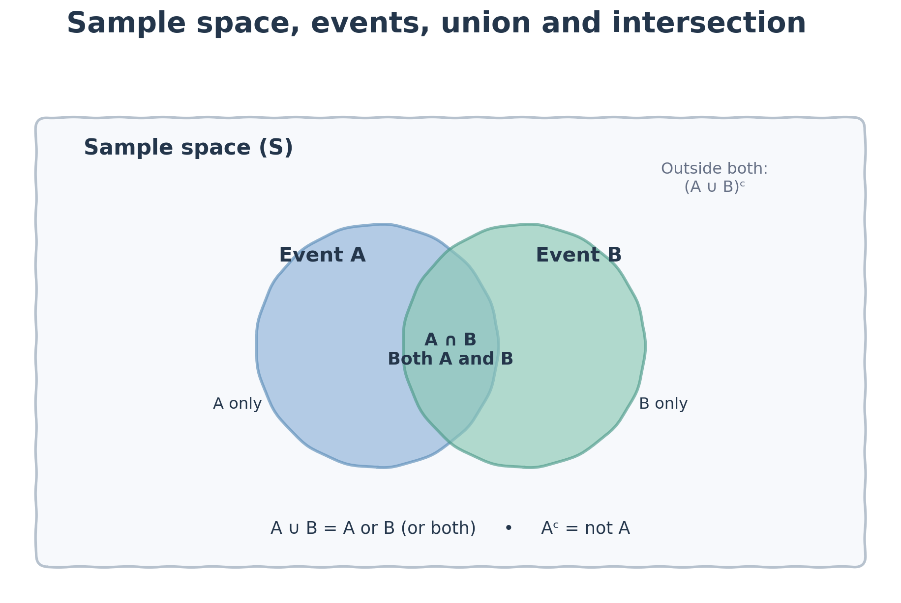
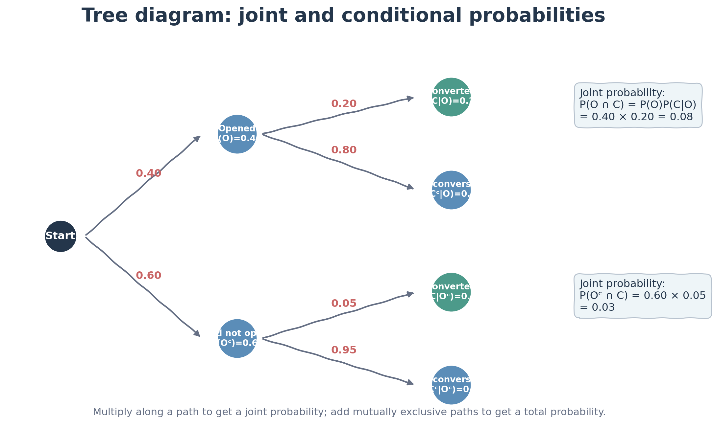
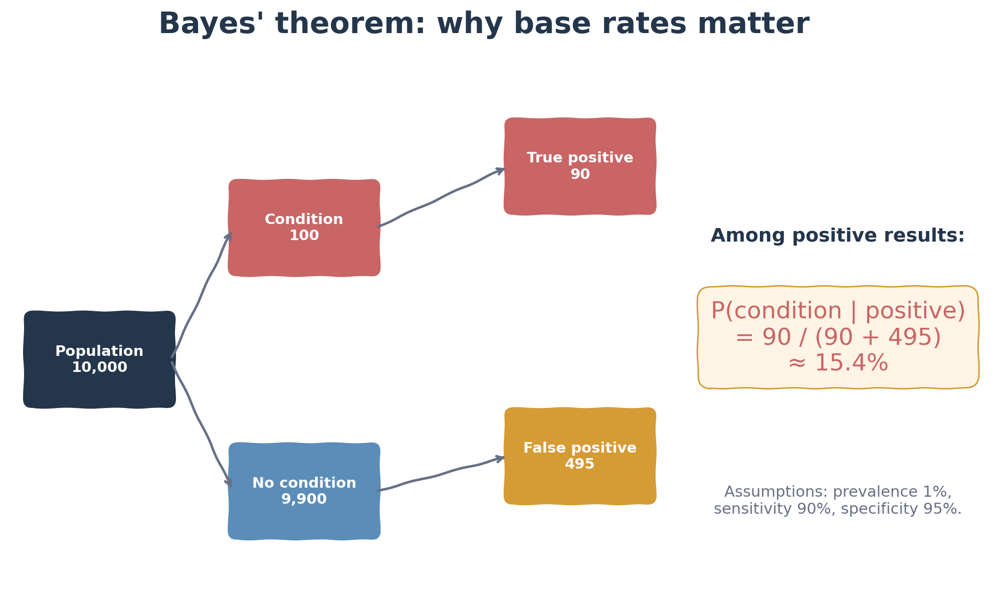
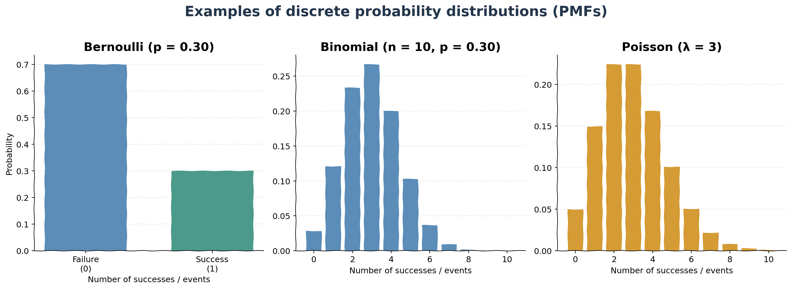
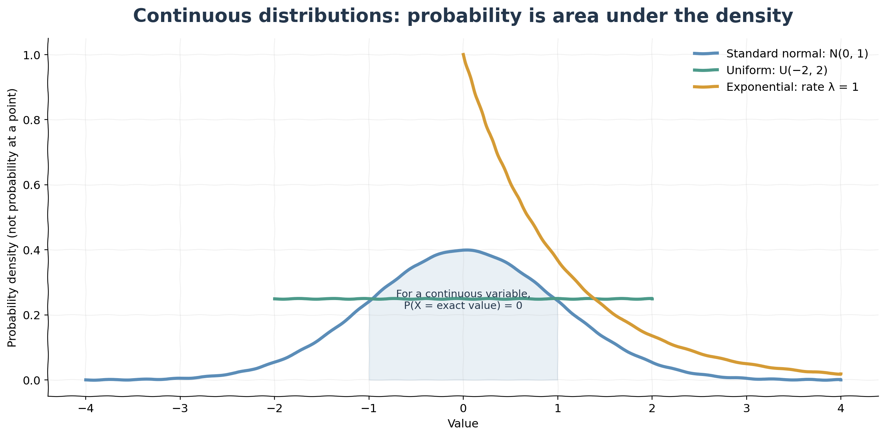
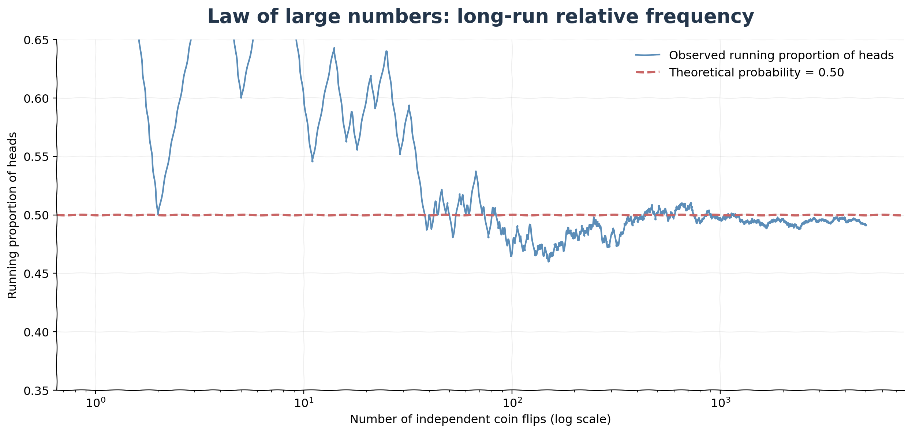

# Module 04 - Probability

> [!NOTE]
> **Purpose:** Build a rigorous understanding of chance, events, conditional reasoning, random variables, and probability distributions - the foundation for statistical inference, experimentation, and machine learning.

---

## Contents

- [Learning objectives](#learning-objectives)
- [1. Probability foundations](#1-probability-foundations)
- [2. Sample spaces and events](#2-sample-spaces-and-events)
- [3. Probability rules](#3-probability-rules)
- [4. Counting: permutations and combinations](#4-counting-permutations-and-combinations)
- [5. Conditional probability and independence](#5-conditional-probability-and-independence)
- [6. Bayes' theorem](#6-bayes-theorem)
- [7. Random variables](#7-random-variables)
- [8. Expected value and variance](#8-expected-value-and-variance)
- [9. Discrete probability distributions](#9-discrete-probability-distributions)
- [10. Continuous probability distributions](#10-continuous-probability-distributions)
- [11. Probability calculations with Python](#11-probability-calculations-with-python)
- [12. Simulation and the law of large numbers](#12-simulation-and-the-law-of-large-numbers)
- [13. Business applications](#13-business-applications)
- [14. Common mistakes](#14-common-mistakes)
- [15. Formula revision sheet](#15-formula-revision-sheet)
- [16. Practical exercises](#16-practical-exercises)
- [Completion checklist](#completion-checklist)
- [References](#references)

---

# 1. Probability foundations

Probability quantifies uncertainty about the outcome of a random experiment.

A probability lies between 0 and 1:

$$
0 \leq P(A) \leq 1
$$

- $P(A)=0$: event $A$ is impossible under the model.
- $P(A)=1$: event $A$ is certain under the model.
- Values between 0 and 1 represent degrees of likelihood.

### Three useful perspectives

| Perspective | Meaning | Example |
|---|---|---|
| Theoretical probability | Derived from a probability model and its assumptions | Fair die: $P(6)=1/6$ |
| Empirical probability | Estimated from observed relative frequency | 42 conversions from 200 visits: 0.21 |
| Subjective probability | A degree of belief based on available information | An analyst's forecast under uncertainty |

Empirical relative frequency:

$$
\widehat P(A)=\frac{\text{Number of times A occurs}}{\text{Number of trials}}
$$

An empirical estimate is not automatically the true long-run probability. Its reliability depends on the sampling process, number of observations, and whether the process is stable.

### Random experiment

A process with an uncertain outcome, such as:
- Tossing a coin.
- Rolling a die.
- Selecting an order at random.
- Observing whether a customer converts within seven days.

A probability model describes possible outcomes and assigns probabilities to them.

---

# 2. Sample spaces and events

- **Outcome:** one possible result of an experiment.
- **Sample space $S$:** the set of all possible outcomes.
- **Event:** a subset of the sample space.

Example: rolling a fair six-sided die.

$$
S=\{1,2,3,4,5,6\}
$$

Let:
- $A=\{\text{even result}\}=\{2,4,6\}$
- $B=\{\text{result greater than 3}\}=\{4,5,6\}$

### Set operations

| Operation | Meaning | Example |
|---|---|---|
| $A \cup B$ | A or B or both (union) | $\{2,4,5,6\}$ |
| $A \cap B$ | A and B (intersection) | $\{4,6\}$ |
| $A^c$ | Not A (complement) | $\{1,3,5\}$ |
| $A \setminus B$ | A but not B | $\{2\}$ |



### Mutually exclusive events

Two events are mutually exclusive if they cannot occur together:

$$
P(A \cap B)=0
$$

For one roll of a die, getting a 2 and getting a 5 are mutually exclusive.

**Do not confuse mutually exclusive with independent.** Mutually exclusive events with positive probabilities are not independent: if one happens, the other cannot happen.

---

# 3. Probability rules

## 3.1 Complement rule

$$
P(A^c)=1-P(A)
$$

Example: if the probability an order is delayed is 0.08, the probability it is not delayed is:

$$
1-0.08=0.92
$$

The complement rule is often useful for “at least one” questions.

## 3.2 Addition rule

General rule:

$$
P(A\cup B)=P(A)+P(B)-P(A\cap B)
$$

If A and B are mutually exclusive:

$$
P(A\cup B)=P(A)+P(B)
$$

**Why subtract the intersection?** Adding $P(A)$ and $P(B)$ counts outcomes in both events twice. Subtract the overlap once.

## 3.3 Multiplication rule

General rule:

$$
P(A\cap B)=P(A)P(B\mid A)
$$

If A and B are independent:

$$
P(A\cap B)=P(A)P(B)
$$

The general rule works whether events are independent or dependent. The simplified product is valid only when independence is justified.

---

# 4. Counting: permutations and combinations

Counting methods help calculate the number of possible outcomes without listing every outcome.

## 4.1 Factorial

$$
n!=n(n-1)(n-2)\cdots 2\cdot1
$$

By convention:

$$
0!=1
$$

## 4.2 Permutations - order matters

Number of ways to select and arrange $r$ objects from $n$ distinct objects:

$$
{}_{n}P_r=\frac{n!}{(n-r)!}
$$

Example: assigning first, second, and third place among 8 competitors:

$$
{}_{8}P_3=\frac{8!}{5!}=336
$$

## 4.3 Combinations - order does not matter

Number of ways to select $r$ objects from $n$ distinct objects:

$$
{n\choose r}=\frac{n!}{r!(n-r)!}
$$

Example: choosing 3 people from a team of 8:

$$
{8\choose3}=56
$$

### Decision rule

- Selecting a committee: combination.
- Assigning ranked positions: permutation.
- Creating a password or code: depends on whether position and repetition matter.

Always state whether repetition is allowed and whether order matters before selecting a formula.

---

# 5. Conditional probability and independence

Conditional probability is the probability of A occurring when B is already known to have occurred.

$$
P(A\mid B)=\frac{P(A\cap B)}{P(B)}, \quad P(B)>0
$$

Example:

- 100 customers visited a website.
- 40 opened a promotional email.
- Of those 40, 8 purchased.

$$
P(\text{Purchase}\mid\text{Opened})=\frac{8}{40}=0.20
$$

This is not the same as $P(\text{Opened}\mid\text{Purchase})$. Reversing the condition changes the question.

## Tree diagrams



For a tree:
- Multiply probabilities along a path to obtain a joint probability.
- Add probabilities of mutually exclusive paths to obtain a combined probability.

General multiplication rule:

$$
P(A\cap B)=P(A)P(B\mid A)
$$

## Independence

A and B are independent if knowing that one occurred does not change the probability of the other:

$$
P(A\mid B)=P(A)
$$

Equivalent condition:

$$
P(A\cap B)=P(A)P(B)
$$

Independence is an assumption about the process, not something to assume merely because two variables look unrelated in a small dataset.

### Independent vs. mutually exclusive

| Concept | Meaning |
|---|---|
| Independent | One event does not change the probability of the other |
| Mutually exclusive | The events cannot happen together |

If both events have positive probability, they cannot be both independent and mutually exclusive.

---

# 6. Bayes' theorem

Bayes' theorem reverses a conditional probability by incorporating prior information.

$$
P(A\mid B)=\frac{P(B\mid A)P(A)}{P(B)}
$$

Where:
- $P(A)$: prior probability.
- $P(B\mid A)$: likelihood of evidence B when A is true.
- $P(B)$: overall probability of observing B.
- $P(A\mid B)$: posterior probability after observing B.

For two possible states A and not-A:

$$
P(B)=P(B\mid A)P(A)+P(B\mid A^c)P(A^c)
$$

## Example: interpreting a positive test

Suppose:
- Prevalence = 1%.
- Sensitivity = 90%.
- Specificity = 95%.

Imagine 10,000 people:
- 100 have the condition; 90 test positive.
- 9,900 do not have the condition; 495 test positive falsely.

Therefore:

$$
P(\text{Condition}\mid\text{Positive})
=\frac{90}{90+495}\approx0.154
$$

So the probability of having the condition given a positive result is approximately **15.4%**, under these assumptions.



**Key lesson:** A high sensitivity does not automatically mean a positive result has a high probability of being correct. The prior prevalence and false-positive rate matter.

This is the base-rate effect. Do not interpret the example as medical advice or as a real diagnostic test estimate.

---

# 7. Random variables

A random variable maps each outcome of a random experiment to a numerical value.

Examples:
- Number of purchases in a day.
- Number of defective items in a batch.
- Delivery time in hours.
- Revenue from a randomly selected order.

## 7.1 Discrete random variable

Takes countable values, such as 0, 1, 2, 3, ...

Example: number of purchases from 10 website visitors.

## 7.2 Continuous random variable

Can take any value within an interval, such as:
- Delivery time.
- Product weight.
- Customer lifetime value when modeled continuously.

### Probability mass function (PMF)

For a discrete random variable:

$$
p(x)=P(X=x)
$$

Properties:

$$
p(x)\geq0,\qquad \sum_x p(x)=1
$$

### Probability density function (PDF)

For a continuous random variable, probabilities are areas under the density curve:

$$
P(a\leq X\leq b)=\int_a^b f(x)\,dx
$$

For a continuous variable:

$$
P(X=a)=0
$$

A PDF value is a density, not the probability of observing that exact value.

### Cumulative distribution function (CDF)

For either discrete or continuous variables:

$$
F(x)=P(X\leq x)
$$

The CDF gives the probability accumulated up to x.

---

# 8. Expected value and variance

Expected value is the probability-weighted long-run average of a random variable.

## 8.1 Discrete expected value

$$
E[X]=\sum_x xP(X=x)
$$

Example:

| X | P(X) | X × P(X) |
|---:|---:|---:|
| 0 | 0.2 | 0.0 |
| 1 | 0.5 | 0.5 |
| 2 | 0.3 | 0.6 |
| **Total** | **1.0** | **1.1** |

$$
E[X]=1.1
$$

This does not mean the variable must actually take the value 1.1. It is the long-run average under the model.

## 8.2 Variance

$$
Var(X)=E[(X-E[X])^2]
$$

Equivalent computational form:

$$
Var(X)=E[X^2]-(E[X])^2
$$

Standard deviation:

$$
SD(X)=\sqrt{Var(X)}
$$

Variance measures squared spread; standard deviation is in the same units as X.

### Useful expectation rules

For constants a and b:

$$
E[aX+b]=aE[X]+b
$$

For any two random variables:

$$
E[X+Y]=E[X]+E[Y]
$$

For variance:

$$
Var(X+Y)=Var(X)+Var(Y)+2Cov(X,Y)
$$

If X and Y are independent, their covariance is zero, so:

$$
Var(X+Y)=Var(X)+Var(Y)
$$

---

# 9. Discrete probability distributions

A probability distribution describes the possible values of a random variable and their probabilities.



## 9.1 Bernoulli distribution

One trial with two outcomes: success (1) or failure (0).

$$
P(X=x)=p^x(1-p)^{1-x}, \quad x\in\{0,1\}
$$

- Parameter: success probability p.
- Mean: $E[X]=p$.
- Variance: $Var(X)=p(1-p)$.

Example: whether one visitor converts or does not convert.

## 9.2 Binomial distribution

Counts the number of successes in n independent Bernoulli trials, each with the same success probability p.

$$
P(X=k)={n\choose k}p^k(1-p)^{n-k}
$$

Conditions:
1. Fixed number of trials n.
2. Two outcomes per trial.
3. Independent trials.
4. Same success probability p on every trial.

Mean and variance:

$$
E[X]=np,\qquad Var(X)=np(1-p)
$$

Example: number of conversions among 100 independent visitors, if each has the same conversion probability.

## 9.3 Geometric distribution

Counts the number of independent Bernoulli trials until the first success, under a fixed success probability p.

Using the convention that X includes the successful trial:

$$
P(X=k)=(1-p)^{k-1}p,\quad k=1,2,\ldots
$$

$$
E[X]=\frac{1}{p},\qquad Var(X)=\frac{1-p}{p^2}
$$

Be careful: some references define the geometric variable as the number of failures before the first success. State the convention.

## 9.4 Poisson distribution

Models the number of events in a fixed interval of time, space, or another exposure measure when events occur at a constant average rate and satisfy the model's independence assumptions.

$$
P(X=k)=\frac{e^{-\lambda}\lambda^k}{k!}
$$

- Parameter: $\lambda>0$, expected count in the interval.
- Mean: $\lambda$.
- Variance: $\lambda$.

Example: number of support tickets arriving per hour under a stable arrival-rate model.

## 9.5 Hypergeometric distribution

Models the number of successes in draws without replacement from a finite population.

Parameters:
- N: population size.
- K: number of successes in the population.
- n: number of draws.
- k: observed number of successes.

$$
P(X=k)=\frac{{K\choose k}{N-K\choose n-k}}{{N\choose n}}
$$

Use it when sampling without replacement makes trial outcomes dependent.

### Distribution selection guide

| Situation | Candidate distribution |
|---|---|
| One binary outcome | Bernoulli |
| Success count in fixed n independent trials | Binomial |
| Trials until first success | Geometric |
| Event count in a fixed exposure interval | Poisson |
| Success count in a sample drawn without replacement | Hypergeometric |

---

# 10. Continuous probability distributions



## 10.1 Uniform distribution

All values in a specified interval have the same density.

For $X\sim U(a,b)$:

$$
f(x)=\frac{1}{b-a},\quad a\leq x\leq b
$$

$$
E[X]=\frac{a+b}{2},\qquad Var(X)=\frac{(b-a)^2}{12}
$$

Example: a simplified model of a random arrival time within a fixed interval.

## 10.2 Exponential distribution

A continuous waiting-time model associated with a Poisson process.

For rate $\lambda>0$:

$$
f(x)=\lambda e^{-\lambda x},\quad x\geq0
$$

$$
E[X]=\frac{1}{\lambda},\qquad Var(X)=\frac{1}{\lambda^2}
$$

It has the memoryless property:

$$
P(X>s+t\mid X>s)=P(X>t)
$$

Use only when the constant-rate Poisson-process assumptions are reasonable.

## 10.3 Normal distribution

A symmetric, bell-shaped continuous distribution characterized by mean $\mu$ and standard deviation $\sigma$:

$$
X\sim N(\mu,\sigma^2)
$$

Standardization:

$$
Z=\frac{X-\mu}{\sigma}
$$

The empirical 68–95–99.7 rule is an approximation for normally distributed variables:
- About 68% within 1 standard deviation of the mean.
- About 95% within 2 standard deviations.
- About 99.7% within 3 standard deviations.

**Connection to Module 02:** the normal curve and empirical rule were introduced in Descriptive Statistics. Here, focus on probability calculations using the normal model, CDF, quantiles, and standardization.

### Important distinction: PDF, CDF, and survival function

- PDF: density at a point.
- CDF: $P(X\leq x)$.
- Survival function: $P(X>x)=1-F(x)$.

For a continuous variable, interval probability is an area under the PDF or a difference between CDF values.

---

# 11. Probability calculations with Python

Use:
- NumPy for simulation and numerical work.
- SciPy `scipy.stats` for probability distributions.
- Python's `math` module for factorials and combinations.

Install packages:

```bash
pip install numpy scipy pandas matplotlib seaborn
```

## 11.1 Permutations and combinations

```python
from math import factorial, perm, comb

# Number of ways to arrange 3 people from 8
print(perm(8, 3))  # 336

# Number of ways to select 3 people from 8
print(comb(8, 3))  # 56
```

## 11.2 Conditional probability

```python
# P(A and B) = 0.12
# P(B) = 0.30

p_a_and_b = 0.12
p_b = 0.30

p_a_given_b = p_a_and_b / p_b
print(p_a_given_b)  # 0.4
```

## 11.3 Binomial distribution

```python
from scipy.stats import binom

# 10 independent trials, success probability 0.30
n = 10
p = 0.30

# Probability of exactly 3 successes
exactly_3 = binom.pmf(3, n, p)

# Probability of at most 3 successes
at_most_3 = binom.cdf(3, n, p)

# Probability of more than 3 successes
more_than_3 = binom.sf(3, n, p)

print(exactly_3, at_most_3, more_than_3)
```

## 11.4 Poisson distribution

```python
from scipy.stats import poisson

# Average of 4 tickets per hour
rate = 4

# Probability of exactly 2 tickets in one hour
exactly_2 = poisson.pmf(2, mu=rate)

# Probability of 2 or fewer tickets
at_most_2 = poisson.cdf(2, mu=rate)

print(exactly_2, at_most_2)
```

## 11.5 Normal distribution

```python
from scipy.stats import norm

mu = 100
sigma = 15

# P(X <= 115)
left_probability = norm.cdf(115, loc=mu, scale=sigma)

# P(X > 115)
right_probability = norm.sf(115, loc=mu, scale=sigma)

# 95th percentile
ninety_fifth_percentile = norm.ppf(0.95, loc=mu, scale=sigma)

print(left_probability, right_probability, ninety_fifth_percentile)
```

## 11.6 Continuous distribution methods

In SciPy:
- `pdf()` - probability density function.
- `pmf()` - probability mass function.
- `cdf()` - cumulative distribution function.
- `sf()` - survival function (often more numerically accurate for upper-tail probabilities).
- `ppf()` - inverse CDF / quantile.
- `rvs()` - random samples.

Remember: use `pmf` for discrete distributions and `pdf` for continuous distributions.

---

# 12. Simulation and the law of large numbers

The law of large numbers says that, under suitable assumptions, the sample average or relative frequency approaches its expected value as the number of independent observations increases.

For a fair coin, the theoretical probability of heads is 0.5. The observed proportion will fluctuate, but over many independent flips it tends to settle closer to 0.5.



```python
import numpy as np

rng = np.random.default_rng(42)

n = 10_000
flips = rng.binomial(n=1, p=0.5, size=n)

running_proportion = np.cumsum(flips) / np.arange(1, n + 1)

print(running_proportion[-1])
```

### Simulation is useful when

- An exact calculation is difficult.
- You want to validate intuition.
- You want to understand variability across repeated experiments.
- You need to model a process under explicit assumptions.

Simulation does not fix a bad model. If the assumptions are wrong, a large simulation can produce a precise answer to the wrong question.

---

# 13. Business applications

| Business situation | Probability concept |
|---|---|
| Probability that a visitor converts | Bernoulli / empirical probability |
| Number of conversions from a fixed number of visitors | Binomial |
| Number of support tickets per hour | Poisson |
| Time until next customer arrival | Exponential, under Poisson-process assumptions |
| Probability a customer purchases given an email open | Conditional probability |
| Updating a fraud-risk estimate after new evidence | Bayes' theorem |
| Sampling defective products without replacement | Hypergeometric |
| Expected profit from alternative decisions | Expected value |
| Simulating demand or operational outcomes | Random sampling / Monte Carlo simulation |

### Example: expected revenue

Suppose an order has:
- 20% probability of a ₹1,000 purchase.
- 80% probability of no purchase.

Expected revenue per visitor:

$$
E[X]=1000(0.20)+0(0.80)=₹200
$$

This is a model-based expected value, not a guarantee that each visitor generates ₹200.

---

# 14. Common mistakes

1. Treating mutually exclusive events as independent.
2. Using $P(A)P(B)$ without establishing independence.
3. Reversing conditional probabilities: $P(A\mid B)\ne P(B\mid A)$ in general.
4. Forgetting to subtract the intersection in the general addition rule.
5. Using combinations when order matters, or permutations when it does not.
6. Applying a binomial model when trials are dependent or probabilities change.
7. Applying a Poisson model without checking the rate and process assumptions.
8. Treating a PDF value as the probability of an exact continuous value.
9. Confusing a PMF with a PDF.
10. Assuming the expected value must be a possible outcome.
11. Assuming a simulation result is exact.
12. Ignoring base rates when interpreting a positive test or risk signal.

---

# 15. Formula revision sheet

| Concept | Formula |
|---|---|
| Probability bounds | $0\leq P(A)\leq1$ |
| Complement | $P(A^c)=1-P(A)$ |
| Addition rule | $P(A\cup B)=P(A)+P(B)-P(A\cap B)$ |
| Conditional probability | $P(A\mid B)=P(A\cap B)/P(B)$ |
| General multiplication | $P(A\cap B)=P(A)P(B\mid A)$ |
| Independent events | $P(A\cap B)=P(A)P(B)$ |
| Bayes' theorem | $P(A\mid B)=P(B\mid A)P(A)/P(B)$ |
| Permutations | $n!/(n-r)!$ |
| Combinations | $n!/[r!(n-r)!]$ |
| Expected value | $E[X]=\sum_x xP(X=x)$ |
| Variance | $Var(X)=E[X^2]-(E[X])^2$ |
| Bernoulli mean | $p$ |
| Bernoulli variance | $p(1-p)$ |
| Binomial mean | $np$ |
| Binomial variance | $np(1-p)$ |
| Poisson mean and variance | $\lambda$ |
| Normal standardization | $Z=(X-\mu)/\sigma$ |

---

## References

### Learning and interactive explanations
- [Khan Academy - Statistics and Probability](https://www.khanacademy.org/computing/statistics-probability) - probability, counting, random variables, and distributions.
- [Seeing Theory](https://seeing-theory.brown.edu/) - interactive visual introduction to basic probability, compound probability, and probability distributions. The site is archived for reference.
- [Seeing Theory - GitHub](https://github.com/seeingtheory/Seeing-Theory) - source repository for the interactive learning project.

### Mathematical and software references
- [Khan Academy - Conditional probability and rules of probability](https://en.khanacademy.org/standards/CCSS.Math/HSS.CP)
- [SciPy - Probability distributions tutorial](https://docs.scipy.org/doc/scipy/tutorial/stats/probability_distributions.html)
- [SciPy - Statistical functions reference](https://docs.scipy.org/doc/scipy/reference/stats.html)
- [NumPy - Random sampling](https://numpy.org/doc/stable/reference/random/index.html)

---

 **NEXT:** [05-Inferential Statistics](../05-inferential-statistics/README.md)
