# 01 — Sampling Distributions

> **Statistics learning path · Inferential Statistics**
>
> Sampling distributions explain how a statistic changes from sample to sample. They are the foundation for understanding standard errors, confidence intervals and hypothesis tests.

## Learning outcomes

After this section, you should be able to:

- Distinguish population, sample and sampling distributions.
- Explain why a statistic changes across random samples.
- Define estimator bias using expected value.
- Explain the Central Limit Theorem (CLT) without relying on the misleading “n = 30 always works” shortcut.
- Calculate the mean and standard error of a sample mean.
- Distinguish standard deviation (SD) from standard error (SE).
- Calculate the mean and standard error of a sample proportion.
- Check the success–failure condition for a normal approximation.
- Solve and interpret a probability question involving a sample proportion.
- Explain when a finite population correction may be needed.

---

## 1. The core idea: what is a sampling distribution?

A **sampling distribution** is the probability distribution of a statistic calculated from all possible samples of the same size, selected using the same sampling method from the same population.

Imagine repeatedly selecting random samples of 100 customers and calculating the average order value for each sample. You will get many sample means:

`x̄₁, x̄₂, x̄₃, ..., x̄ₖ`

The distribution of those means is the **sampling distribution of the sample mean**.

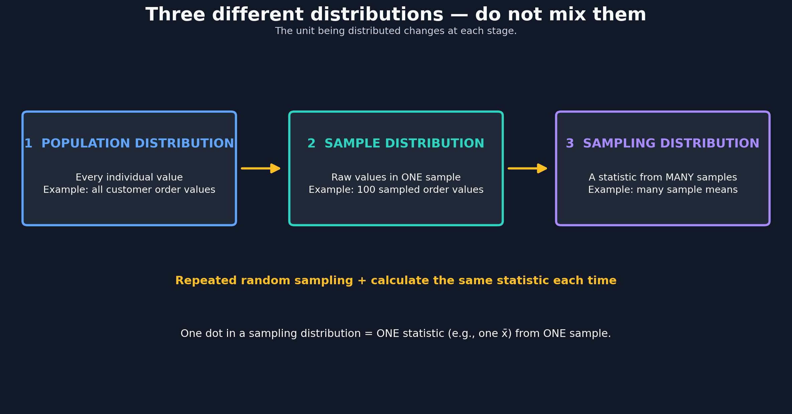

### Three distributions — the distinction matters

| Distribution | What is distributed? | Example |
|---|---|---|
| Population distribution | Raw values for every member of the population | Order values for all customers |
| Sample distribution | Raw values in one selected sample | Order values for 100 sampled customers |
| Sampling distribution | A statistic across repeated samples | Average order values from thousands of samples |

> **IMPORTANT — Do not confuse them:** A sampling distribution does not contain all the raw observations from one sample. Each value in it is a statistic (for example, one sample mean) calculated from one separate sample.

### How do we construct one?

1. Define the population and sampling method.
2. Select a random sample of size `n`.
3. Calculate the statistic of interest (mean, proportion, median, etc.).
4. Record that statistic.
5. Repeat the same process many times.
6. Plot the recorded statistics. Their distribution approximates the sampling distribution.

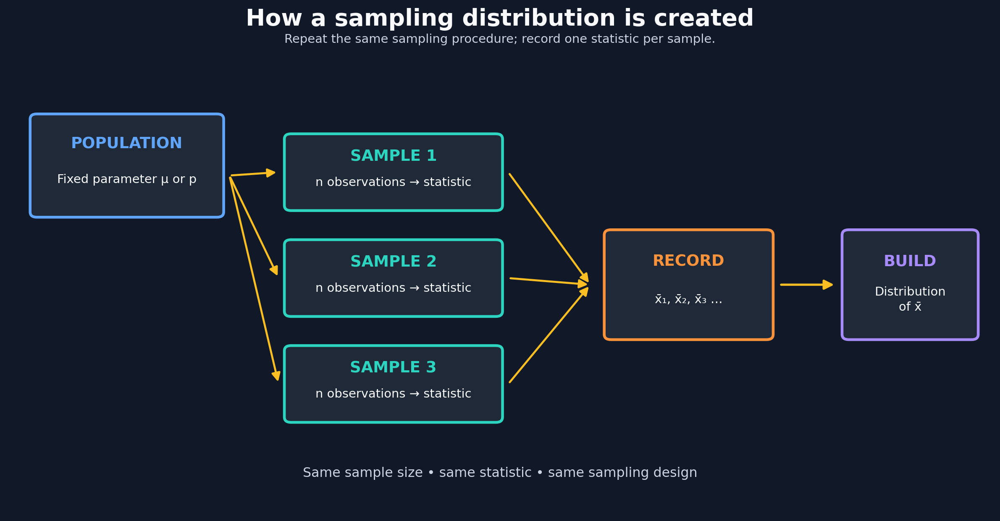

**Practical interpretation:** One sample gives one estimate. Repeated samples show how much that estimate naturally varies because of sampling.

---

## 2. Parameters, statistics and estimators

| Symbol / term | Meaning |
|---|---|
| `μ` | Population mean — a parameter |
| `p` | Population proportion — a parameter |
| `x̄` | Sample mean — a statistic |
| `p̂` | Sample proportion — a statistic |
| `θ` | Generic population parameter |
| `θ̂` | Estimator/statistic used to estimate `θ` |

A **parameter** describes a population. A **statistic** is calculated from a sample and is used to estimate a parameter.

An **estimator** is the rule or procedure used to estimate a parameter. An **estimate** is the numerical result obtained from a particular sample.

### Bias and unbiasedness

The bias of an estimator is:

$$
\\operatorname{Bias}(\\hat{\\theta})=E(\\hat{\\theta})-\\theta
$$

An estimator is **unbiased** if:

$$
E(\\hat{\\theta})=\\theta
$$

- **Unbiased:** its long-run expected value equals the true parameter.
- **Positively biased:** its expected value is above the true parameter.
- **Negatively biased:** its expected value is below the true parameter.

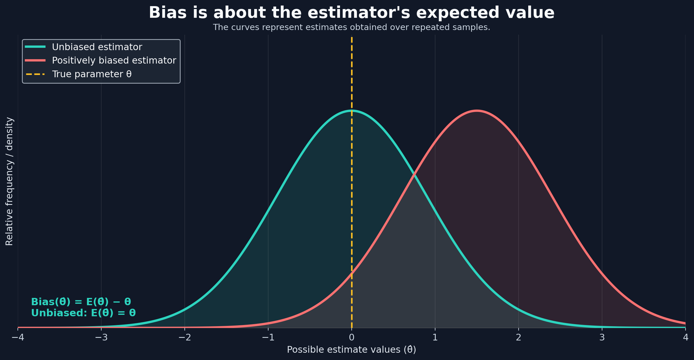

> **IMPORTANT:** Bias is about the estimator's expected value over repeated samples. It is not the same as skewness. A sampling distribution can be asymmetric and still be unbiased.

**Do not overclaim from a small simulation:** If 50 repeated samples produce estimates that look centred around the parameter, that is an illustration, not mathematical proof of unbiasedness. The definition is based on the expected value.

---

## 3. Central Limit Theorem (CLT)

The **Central Limit Theorem** says that, under suitable conditions, the sampling distribution of the sample mean becomes approximately normal as sample size increases — even if the original population distribution is not normal.

For independent, identically distributed observations with finite population mean `μ` and finite variance `σ²`:

$$
\\frac{\\bar X-\\mu}{\\sigma/\\sqrt n}
\\xrightarrow{d}N(0,1)
\\quad\\text{as }n\\to\\infty
$$

### What changes as sample size increases?

- The centre of the sampling distribution of `x̄` is `μ`.
- The spread of the sampling distribution is its standard error, `σ/√n`.
- Its shape becomes more nearly normal as `n` grows, under the CLT assumptions.

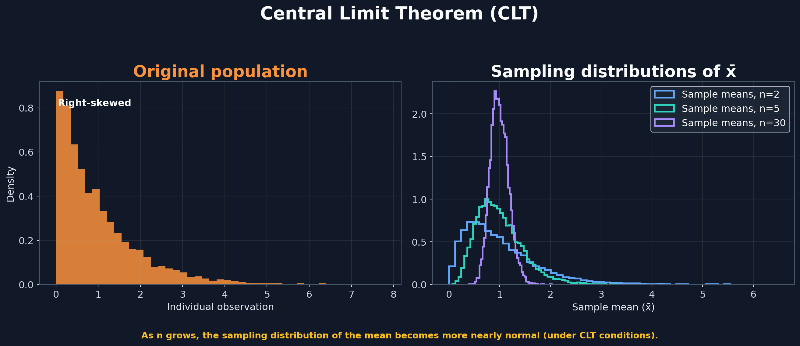

### The “n ≥ 30” misconception

> **WARNING:** `n ≥ 30` is a rough classroom rule of thumb, not a universal law or guarantee.

The sample size needed for a good normal approximation depends on the population distribution. Strong skewness, heavy tails, extreme outliers, dependence or unusual sampling designs can require a larger sample or a different method.

### CLT assumptions and cautions

The standard introductory CLT result is commonly presented for independent, identically distributed observations with finite mean and finite variance. In practical work, ask:

- Was the sample selected randomly from the target population?
- Are observations independent, or does the design create dependence?
- Are extreme values or heavy tails likely to slow convergence?
- Is the sample size adequate for this population and this statistic?

**Scope:** The statement above is about the sample mean. Do not automatically assume the same result applies to every statistic without checking the relevant theory.

---

## 4. Sampling distribution of the sample mean

Let `X₁, X₂, ..., Xₙ` be observations from a population with mean `μ` and standard deviation `σ`.

The sample mean is:

$$
\\bar X=\\frac{X_1+X_2+\\cdots+X_n}{n}
$$

Under independent sampling with a common population variance:

### Centre

$$
E(\\bar X)=\\mu
$$

### Variance

$$
\\operatorname{Var}(\\bar X)=\\frac{\\sigma^2}{n}
$$

### Standard error

$$
SE(\\bar X)=\\frac{\\sigma}{\\sqrt n}
$$

If `σ` is unknown, the standard error is commonly estimated using the sample standard deviation `s`:

$$
\\widehat{SE}(\\bar X)=\\frac{s}{\\sqrt n}
$$

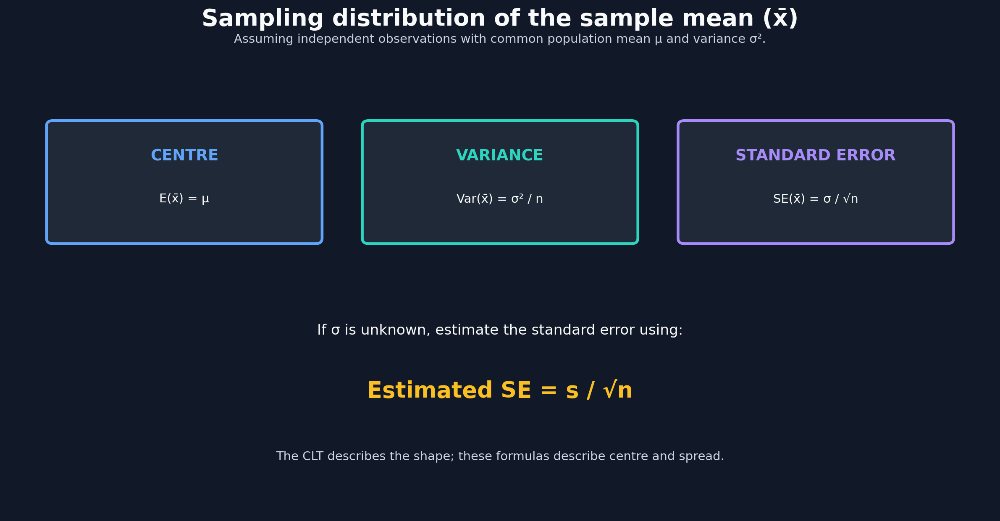

**Interpretation:** If we repeatedly take samples of size `n`, the sample means vary around `μ`. The standard error describes the typical spread of those sample means.

---

## 5. Standard deviation (SD) vs standard error (SE)

These two terms are related, but they answer different questions.

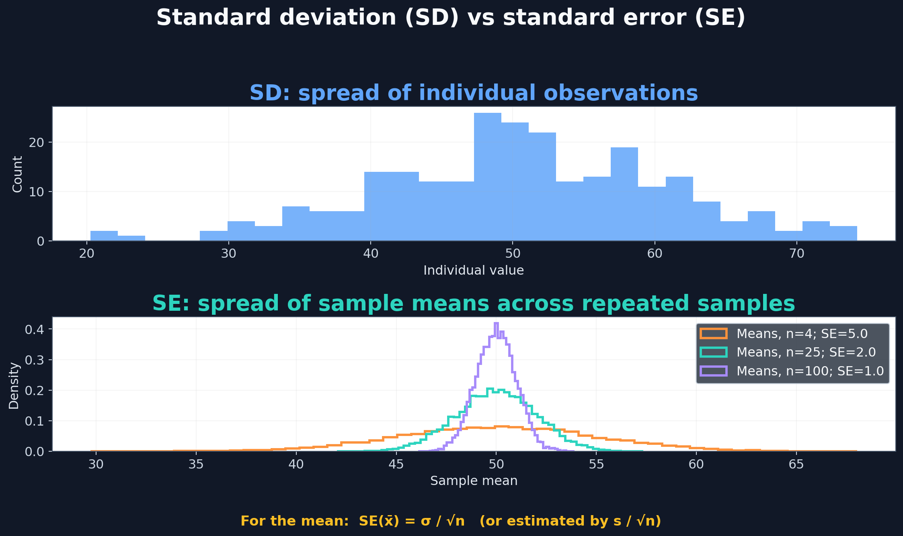

| Standard deviation (SD) | Standard error (SE) |
|---|---|
| How spread out are individual observations? | How spread out would the statistic be across repeated samples? |
| Describes variability in the raw data. | Describes sampling variability / precision of an estimate. |
| Sample SD is `s`. | For a mean, estimated SE is `s/√n`. |
| Does not automatically shrink just because more observations are collected. | Usually decreases as `n` increases, under the model assumptions. |

### Numerical example

Suppose population standard deviation `σ = 10`.

| Sample size `n` | Standard error `σ/√n` |
|---:|---:|
| 4 | 5 |
| 25 | 2 |
| 100 | 1 |

If sample size increases fourfold, the standard error is halved:

$$
SE\\propto\\frac{1}{\\sqrt n}
$$

> **TIP:** More data can improve precision by reducing standard error. It does not automatically fix bias, selection bias, measurement error or a poor sampling design.

---

## 6. Sampling distribution of a sample proportion

A sample proportion is the fraction of sample observations that have a particular characteristic.

$$
\\hat p=\\frac{x}{n}
$$

Where:

- `x` = number of successes (observations with the characteristic)
- `n` = sample size
- `p̂` = observed sample proportion
- `p` = true population proportion

Under the usual random-sampling conditions:

### Mean

$$
E(\\hat p)=p
$$

### Standard error

$$
SE(\\hat p)=\\sqrt{\\frac{p(1-p)}{n}}
$$

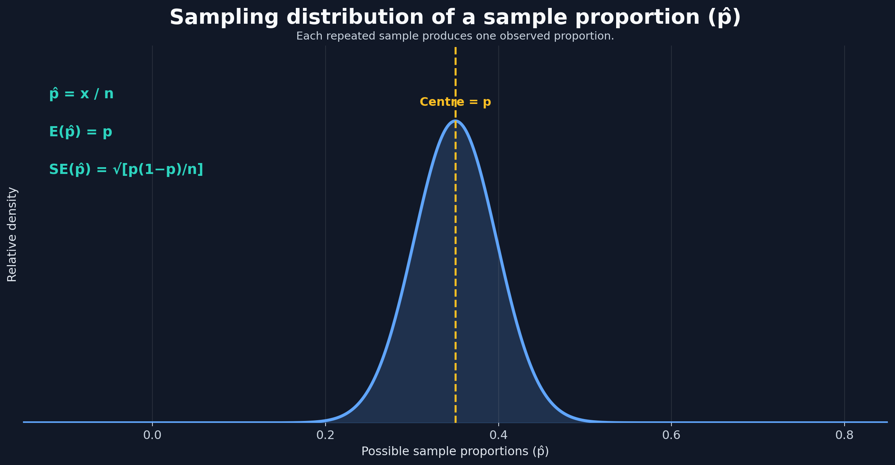

> **IMPORTANT:** The theoretical standard error formula uses the population proportion `p`. In actual inference, the appropriate standard-error formula depends on the procedure and assumptions. Do not replace `p` with `p̂` automatically in every context.

---

## 7. Normal approximation: success–failure condition

For an introductory normal approximation to the sampling distribution of `p̂`, a common rule of thumb checks whether the expected counts of successes and failures are both at least 10:

$$
np\\geq10
$$

$$
n(1-p)\\geq10
$$

**Both conditions must pass.**

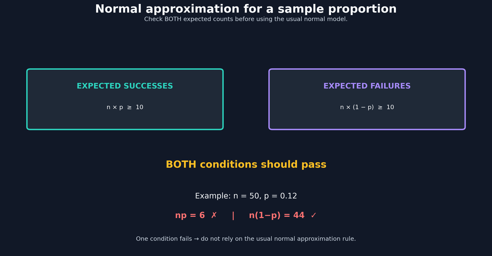

### Example A — overripe fruit

A shipment contains a sample of `n = 50` fruit. Assume the population proportion overripe is `p = 0.12`.

$$
np=50(0.12)=6
$$

$$
n(1-p)=50(0.88)=44
$$

- Expected successes: `6` — fails the condition.
- Expected failures: `44` — passes the condition.

**Conclusion:** The usual normal approximation is not supported by this rule because one condition fails.

### Example B — radio reach

Assume `p = 0.88` and `n = 125`.

$$
np=125(0.88)=110
$$

$$
n(1-p)=125(0.12)=15
$$

Both conditions pass. The normal approximation is supported by this rule of thumb, subject to the other sampling assumptions.

> **WARNING:** Passing the condition does not make the distribution perfectly normal. It only supports using the usual normal approximation in an appropriate setting.

---

## 8. Probability using the sampling distribution of a proportion

### Worked example — student stress survey

Assume a school has 1,750 students. The true population proportion who experienced extreme stress during the past month is `p = 0.15`. A simple random sample of `n = 160` students is selected.

**Question:** Assuming `p = 0.15`, what is the approximate probability that more than 10% of the sample reports extreme stress?

We want:

$$
P(\\hat p>0.10)
$$

### Step 1 — Check normal conditions

$$
np=160(0.15)=24\\geq10
$$

$$
n(1-p)=160(0.85)=136\\geq10
$$

Both conditions pass.

### Step 2 — Find the centre

$$
\\mu_{\\hat p}=p=0.15
$$

### Step 3 — Calculate the standard error

$$
SE(\\hat p)=\\sqrt{\\frac{p(1-p)}{n}}
$$

$$
=\\sqrt{\\frac{0.15(0.85)}{160}}
\\approx0.02824
$$

### Step 4 — Convert the threshold to a z-score

$$
z=\\frac{\\hat p-p}{SE(\\hat p)}
$$

At the threshold `p̂ = 0.10`:

$$
z=\\frac{0.10-0.15}{0.02824}\\approx-1.77
$$

### Step 5 — Calculate the right-tail probability

$$
P(\\hat p>0.10)=P(Z>-1.77)
$$

$$
\\boxed{P(\\hat p>0.10)\\approx0.961}
$$

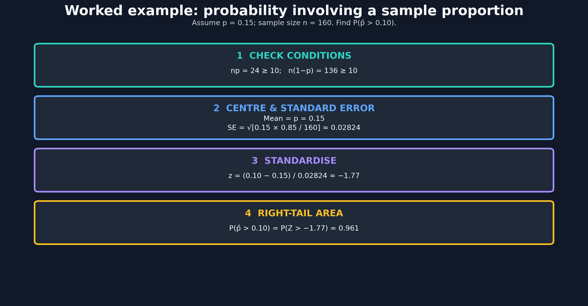

**Interpretation:** If the true population proportion is 15%, then under the normal approximation and stated sampling assumptions, a sample proportion greater than 10% would occur in about 96.1% of repeated samples of size 160.

This is a probability about the sample proportion across repeated samples — **not** the probability that the fixed population proportion is greater than 10%.

---

## 9. Finite population correction (FPC) — additional concept

When a simple random sample is drawn **without replacement** from a finite population, the observations are not fully independent. When the sample is a substantial fraction of the population, a finite population correction can reduce the standard error.

For the sample mean:

$$
FPC=\\sqrt{\\frac{N-n}{N-1}}
$$

$$
SE(\\bar X)=\\frac{\\sigma}{\\sqrt n}
\\times\\sqrt{\\frac{N-n}{N-1}}
$$

Where:

- `N` = population size
- `n` = sample size

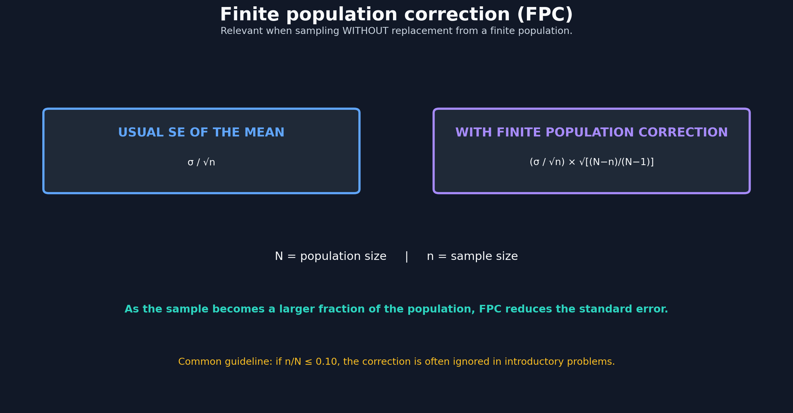

A common introductory guideline is that if `n/N ≤ 0.10`, the correction is often ignored. Follow the actual sampling design and the instructions of the problem.

---

## 10. How sampling distributions lead to inference

Sampling distributions connect sample data to population-level conclusions.

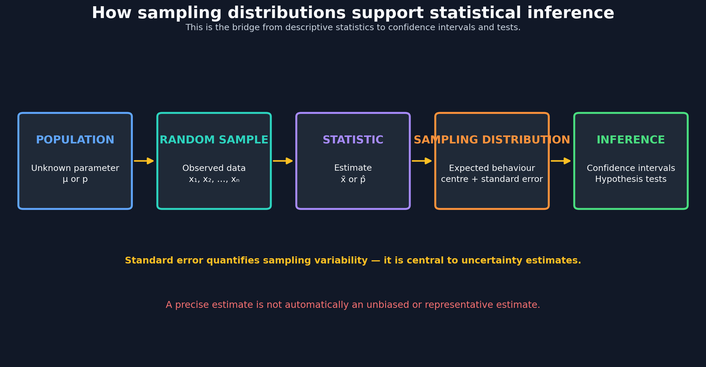

1. The population has an unknown parameter such as `μ` or `p`.
2. We draw a sample and calculate a statistic such as `x̄` or `p̂`.
3. The sampling distribution describes how that statistic behaves over repeated samples.
4. The standard error quantifies its sampling variability.
5. These ideas support confidence intervals and hypothesis tests.

**Next section:** `02 — Confidence Intervals`

---

## 11. Python practice

These simulations illustrate sampling variability. They do not replace checking the assumptions of a real study.

### 11.1 Simulate a sampling distribution of the mean

```python
import numpy as np
import matplotlib.pyplot as plt

rng = np.random.default_rng(42)

# Right-skewed population
population = rng.exponential(scale=10, size=200_000)

sample_size = 30
repetitions = 10_000

sample_means = np.array([
    rng.choice(population, size=sample_size, replace=True).mean()
    for _ in range(repetitions)
])

print("Population mean:", population.mean())
print("Mean of sample means:", sample_means.mean())
print("SD of sample means:", sample_means.std(ddof=1))

plt.hist(sample_means, bins=40, edgecolor="black")
plt.title("Sampling Distribution of the Sample Mean")
plt.xlabel("Sample mean")
plt.ylabel("Frequency")
plt.show()
```

Explore:

- Does the mean of the simulated sample means approach the population mean?
- Does the sampling distribution look more regular than the original population?
- What changes when you increase `sample_size`?
- What happens to the standard error?

### 11.2 Calculate standard error

```python
import numpy as np

population_sd = 10

for n in [4, 25, 100]:
    se = population_sd / np.sqrt(n)
    print(f"n={n:>3}: SE={se:.3f}")
```

### 11.3 Check success–failure conditions

```python
n = 160
p = 0.15

expected_successes = n * p
expected_failures = n * (1 - p)

normal_condition = (
    expected_successes >= 10
    and expected_failures >= 10
)

print("Expected successes:", expected_successes)
print("Expected failures:", expected_failures)
print("Both conditions pass:", normal_condition)
```

### 11.4 Calculate the probability

```python
import numpy as np
from scipy.stats import norm

n = 160
p = 0.15
threshold = 0.10

se = np.sqrt(p * (1 - p) / n)
z = (threshold - p) / se

probability = norm.sf(z)  # P(Z > z)

print("Standard error:", se)
print("Z-score:", z)
print("P(sample proportion > 0.10):", probability)
```

Expected probability: approximately `0.961`.

---

## 12. Common mistakes

- Confusing the sample distribution with the sampling distribution.
- Thinking the sampling distribution contains raw observations rather than statistics.
- Assuming a skewed sampling distribution must be biased.
- Treating `n = 30` as a universal CLT guarantee.
- Confusing SD with SE.
- Forgetting the square root in `σ/√n`.
- Checking `np` but forgetting `n(1−p)`.
- Using a normal approximation when one success–failure condition fails.
- Interpreting `P(p̂ > c)` as a probability about the fixed population proportion.
- Assuming a larger sample automatically removes bias or selection problems.

---

## 13. Formula revision sheet

| Concept | Formula |
|---|---|
| Sample mean | `x̄ = Σxᵢ / n` |
| Bias | `E(θ̂) − θ` |
| Unbiased estimator | `E(θ̂) = θ` |
| Variance of sample mean | `σ² / n` |
| SE of sample mean | `σ / √n` |
| Estimated SE of sample mean | `s / √n` |
| Sample proportion | `p̂ = x / n` |
| Mean of sample proportion | `p` |
| SE of sample proportion | `√[p(1−p)/n]` |
| Success–failure condition | `np ≥ 10` and `n(1−p) ≥ 10` |
| z-score for sample proportion | `(p̂ − p) / SE(p̂)` |
| Finite population correction | `√[(N−n)/(N−1)]` |

---

## 14. One-page revision map

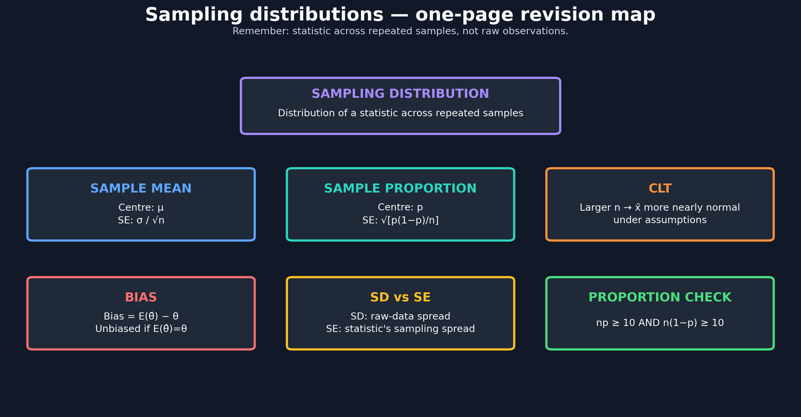

### Self-check before moving on

- [ ] I can distinguish population, sample, parameter, statistic and sampling distribution.
- [ ] I can explain how repeated sampling creates a sampling distribution.
- [ ] I can define bias using expected value.
- [ ] I understand why skewness is not the same as bias.
- [ ] I can explain the CLT and its assumptions.
- [ ] I know why `n = 30` is not a universal guarantee.
- [ ] I can calculate the mean, variance and SE of a sample mean.
- [ ] I can explain SD versus SE.
- [ ] I can calculate the SE of a sample proportion.
- [ ] I can check both success–failure conditions.
- [ ] I can calculate and interpret a z-score and right-tail probability.
- [ ] I understand when finite population correction may be relevant.

### Practice questions

1. A population has mean 80 and standard deviation 15. What are the mean and standard error of the sample mean for `n = 25`?
2. If sample size increases from 25 to 100, what happens to the standard error? Explain why.
3. For `n = 60` and `p = 0.08`, can the usual normal approximation be used under the success–failure rule? Show both calculations.
4. Explain why a sampling distribution can be skewed and still be unbiased.
5. In your own words, distinguish a population distribution from a sampling distribution.

---

## References

- [Khan Academy — Sampling distributions](https://www.khanacademy.org/math/statistics-probability/sampling-distributions-library)
- [Penn State — STAT 415](https://online.stat.psu.edu/stat415/)
- [NIST/SEMATECH e-Handbook of Statistical Methods](https://www.itl.nist.gov/div898/handbook/)
- [SciPy — Normal distribution](https://docs.scipy.org/doc/scipy/reference/generated/scipy.stats.norm.html)
- [NumPy — Random sampling](https://numpy.org/doc/stable/reference/random/index.html)

---

> **Learning rule:** Never memorise a sampling formula without knowing what statistic it describes, what assumptions it needs, and how to interpret its result in context.

