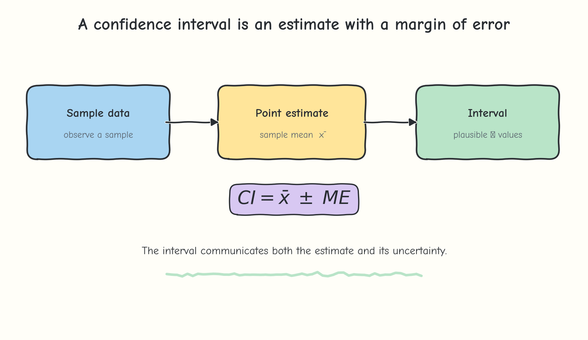
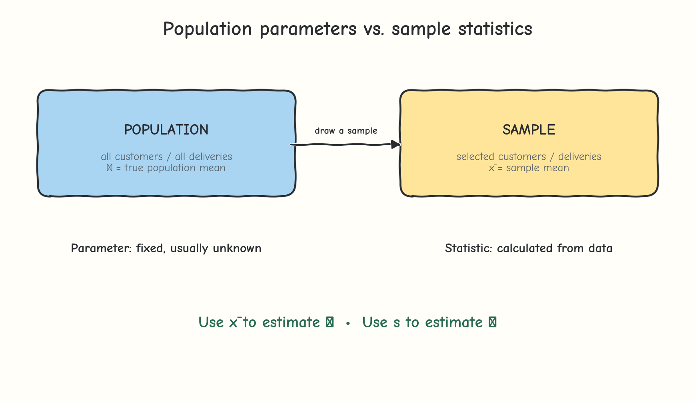
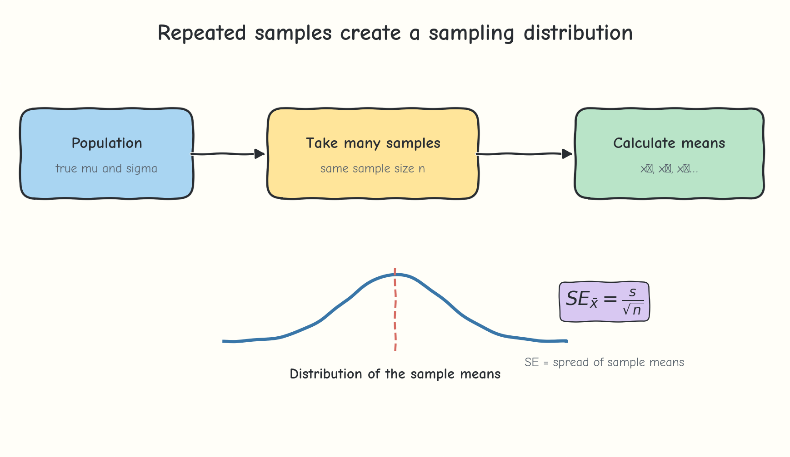
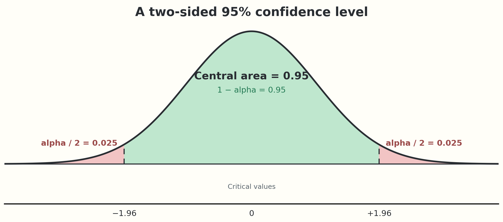
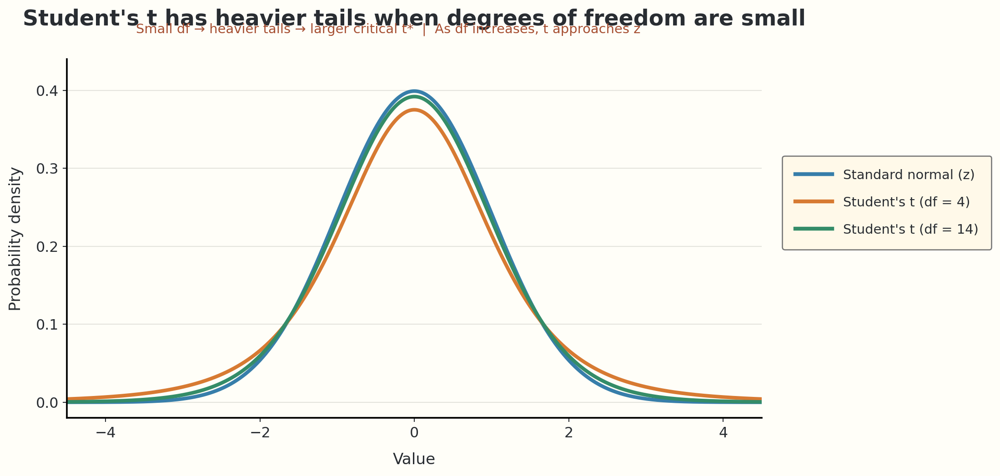
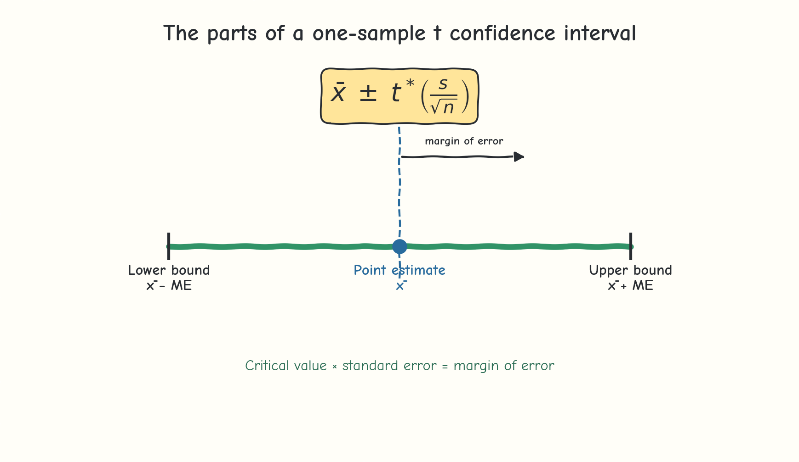
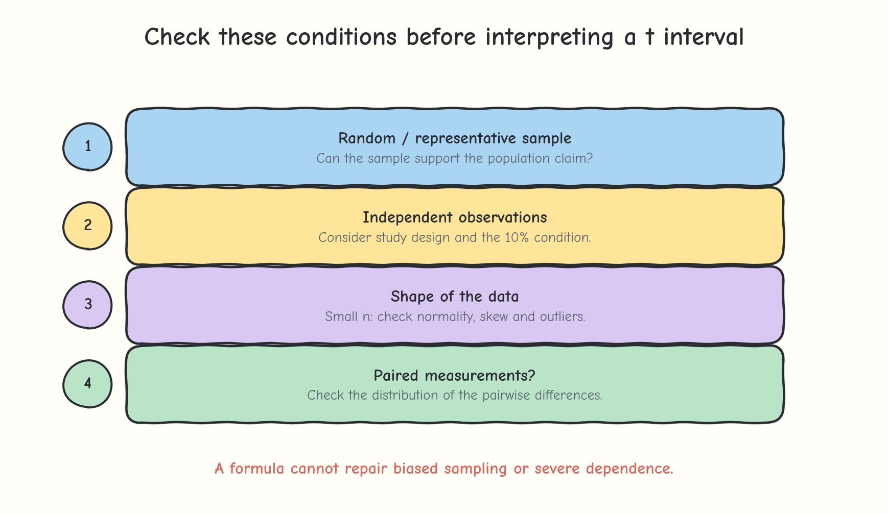
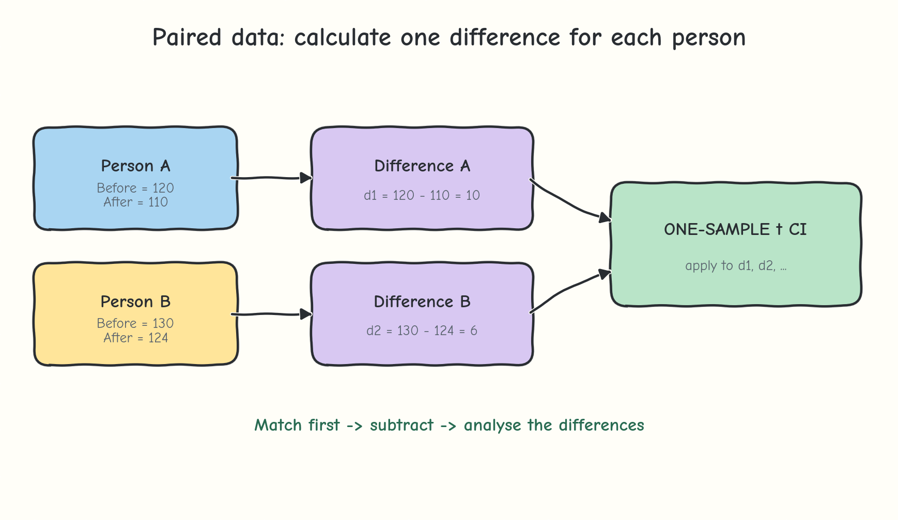
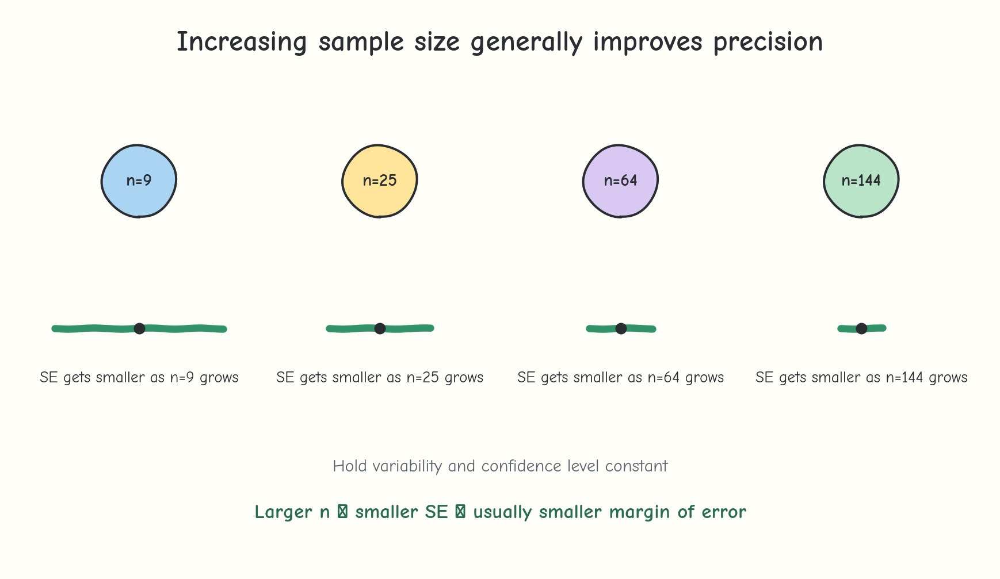

# Confidence Intervals

> [!NOTE]
> **Section:** Khan Academy - [Confidence Interval](https://www.khanacademy.org/math/statistics-probability/confidence-intervals-one-sample)
> > 
> **Purpose:** Estimate an unknown population mean from sample data and quantify uncertainty around that estimate.

[← Back to Inferential Statistics Repository](https://github.com/Priya200227/statistics/tree/main/05-inferential-statistics)

---

## 1. Why Confidence Intervals Matter



> [!NOTE]
> A confidence interval estimates a **population parameter**. It is not a range containing a stated percentage of individual observations.


In statistics, we often want to know a population value but cannot measure every member of that population. Collecting data from an entire population may be expensive, slow, or impossible. Instead, we select a sample and calculate a statistic.

A **confidence interval (CI)** uses sample data to produce a range of plausible values for an unknown population parameter.

Instead of reporting only:

> The sample average delivery time is 42 minutes.

We can report:

> The estimated population mean delivery time is between 39 and 45 minutes, using a 95% confidence-interval procedure.

The interval communicates both the estimate and its uncertainty.

$$
\text{Confidence Interval}=\text{Point Estimate}\pm\text{Margin of Error}
$$
For a population mean, the point estimate is usually the sample mean $\bar{x}$.

## 2. Population Parameters and Sample Statistics




| Term | Meaning | Symbol |
|---|---|---|
| Population mean | Average value in the entire population | $\mu$ |
| Population standard deviation | Spread of values in the population | $\sigma$ |
| Sample mean | Average value in the selected sample | $\bar{x}$ |
| Sample standard deviation | Spread of values in the sample | $s$ |
| Sample size | Number of observations | $n$ |

A population parameter is generally fixed but unknown. A sample statistic is calculated from the observed sample and can vary from sample to sample.

For estimating a population mean, $\bar{x}$ estimates $\mu$, while $s$ estimates $\sigma$.

## 3. Sampling Distribution and Standard Error




### 3.1 Sampling distribution

Imagine repeatedly taking random samples of the same size from a population and calculating the sample mean for every sample. The distribution of those sample means is the **sampling distribution of the sample mean**.

Under the usual independent-sampling assumptions:

$$
E(\bar{X})=\mu
$$
$$
SD(\bar{X})=\frac{\sigma}{\sqrt{n}}
$$
### 3.2 Standard error

The **standard error (SE)** measures the estimated variability of a statistic across repeated samples.

If the population standard deviation is known:

$$
SE_{\bar{x}}=\frac{\sigma}{\sqrt{n}}
$$
If it is unknown, estimate it using the sample standard deviation:

$$
SE_{\bar{x}}=\frac{s}{\sqrt{n}}
$$
The standard error is not the same as the sample standard deviation.

| Measure | What it describes |
|---|---|
| Standard deviation | Spread of individual observations |
| Standard error | Variability of a sample statistic across repeated samples |

As sample size increases, standard error generally decreases. However, a large sample does not automatically remove bias. A very large biased sample can still produce a misleading estimate.

## 4. Confidence Level, Alpha, and Critical Values




### 4.1 Confidence level

The confidence level describes the long-run success rate of the interval-building procedure.

| Confidence level | Significance level $\alpha$ | Area in each tail |
|---:|---:|---:|
| 90% | 0.10 | 0.05 |
| 95% | 0.05 | 0.025 |
| 98% | 0.02 | 0.01 |
| 99% | 0.01 | 0.005 |

For a two-sided interval:

$$
\alpha=1-C
$$
$$
\text{Area in each tail}=\frac{\alpha}{2}
$$
For a 95% interval, $\alpha=0.05$, so 0.025 lies in each tail and the central area is 0.95.

### 4.2 Critical value

A **critical value** determines how many standard errors we extend on either side of the point estimate. It depends on the confidence level and reference distribution; for a t interval, it also depends on degrees of freedom.

A higher confidence level generally requires a larger critical value and produces a wider interval.

## 5. Z-Interval vs. T-Interval
> [!IMPORTANT]
> For the standard one-sample mean interval, when the population SD is unknown, use the **t-distribution** and sample SD $s$.


The choice depends primarily on whether the population standard deviation is known.

### 5.1 Z-interval for a population mean

When the population standard deviation $\sigma$ is known:

$$
\boxed{\bar{x}\pm z^*\frac{\sigma}{\sqrt{n}}}
$$
### 5.2 T-interval for a population mean

When $\sigma$ is unknown, we estimate it using the sample standard deviation $s$:

$$
\boxed{\bar{x}\pm t^*\frac{s}{\sqrt{n}}}
$$
### 5.3 Comparison

| Feature | Z-interval | T-interval |
|---|---|---|
| Population SD | Known | Unknown |
| SD used | $\sigma$ | $s$ |
| Reference distribution | Standard normal | Student's t |
| Critical value depends on | Confidence level | Confidence level and degrees of freedom |
| Typical use | Population SD genuinely known | Common real-world mean estimation |

Do not replace an unknown population SD with $s$ and automatically keep using the z critical value. That ignores the extra uncertainty from estimating the standard deviation and can make the interval too narrow. The t-distribution accounts for this uncertainty.

## 6. Student's t-Distribution




Student's t-distribution resembles the standard normal distribution but has heavier tails, especially with few degrees of freedom.

### 6.1 Degrees of freedom

For a one-sample t interval:

$$
\boxed{df=n-1}
$$
For a sample of 14 observations, $df=13$.

### 6.2 Why heavier tails?

When $\sigma$ is unknown, we estimate it using $s$. This introduces additional uncertainty. The t-distribution accounts for that uncertainty with larger critical values, particularly for small samples.

### 6.3 What happens as sample size increases?

As degrees of freedom increase, the t-distribution approaches the standard normal distribution.

- Small degrees of freedom: heavier tails and larger critical values.
- Large degrees of freedom: t critical values become closer to z critical values.

**T is not only for small samples.** When estimating a mean with an unknown population SD using the standard one-sample procedure, use t. A large sample does not automatically make z the correct choice.

## 7. One-Sample t Confidence Interval




A one-sample t interval estimates a population mean using one sample when the population standard deviation is unknown.

$$
\boxed{
\bar{x}\pm t^*_{1-\alpha/2,\;n-1}\left(\frac{s}{\sqrt{n}}\right)
}
$$
| Symbol | Meaning |
|---|---|
| $\bar{x}$ | Sample mean |
| $t^*$ | Two-sided critical t-value |
| $\alpha$ | Significance level, $1-C$ |
| $n$ | Sample size |
| $n-1$ | Degrees of freedom |
| $s$ | Sample standard deviation |
| $s/\sqrt{n}$ | Estimated standard error |

### Margin of error

$$
\boxed{ME=t^*\times SE}
\qquad
SE=\frac{s}{\sqrt{n}}
$$
$$
\text{Lower bound}=\bar{x}-ME
$$
$$
\text{Upper bound}=\bar{x}+ME
$$
### Calculation workflow

1. Identify sample size $n$, sample mean $\bar{x}$, and sample SD $s$.
2. Calculate degrees of freedom: $df=n-1$.
3. Determine the confidence level and $\alpha$.
4. Find the two-sided critical value $t^*$.
5. Calculate $SE=s/\sqrt{n}$.
6. Calculate $ME=t^*\times SE$.
7. Calculate the lower and upper bounds.
8. Interpret the interval and check the assumptions.

## 8. Finding a Critical t-Value
> [!TIP]
> For a two-sided interval, split alpha across both tails: use $\alpha/2$ in each tail. Check whether your t-table is labelled by one-tail or two-tail probability.


For a two-sided confidence interval, the critical value leaves $\alpha/2$ in each tail.

Suppose we need a 98% interval with sample size 15.

**Step 1 — Alpha**

$$
\alpha=1-0.98=0.02
$$
**Step 2 — Area in each tail**

$$
\frac{\alpha}{2}=0.01
$$
**Step 3 — Degrees of freedom**

$$
df=15-1=14
$$
**Step 4 — Critical value**

For $df=14$ and 0.01 in the upper tail:

$$
\boxed{t^*\approx2.624}
$$
The central 98% of the t-distribution lies approximately between $-2.624$ and $+2.624$.

> **Transcript correction:** The critical value is approximately **2.624**, not 2.264.

Always check whether a t-table reports one-tail or two-tail probabilities.

## 9. Worked Example: Burrito Calories


A sample of 14 burritos has a sample mean of 700 calories and sample SD of 50 calories. Construct a 95% confidence interval for the population mean.

Given:

- $n=14$
- $\bar{x}=700$
- $s=50$
- Confidence level = 95%

**Step 1 — Method:** The population SD is unknown, so use a one-sample t interval.

**Step 2 — Degrees of freedom:**

$$
df=14-1=13
$$
For a 95% two-sided interval with 13 degrees of freedom:

$$
t^*\approx2.160
$$
**Step 3 — Standard error:**

$$
SE=\frac{50}{\sqrt{14}}\approx13.36
$$
**Step 4 — Margin of error:**

$$
ME=2.160\times13.36\approx28.86
$$
**Step 5 — Interval:**

$$
700\pm28.86
$$
$$
\boxed{(671.14,\;728.86)\text{ calories}}
$$
**Interpretation:** Using this sampling method, we are 95% confident that the population mean calorie count lies between approximately 671 and 729 calories, assuming the sampling and t-interval conditions are reasonably satisfied.

## 10. Conditions for a Valid t-Interval




> [!WARNING]
> A correct formula cannot rescue a biased or dependent sample. Check the sampling design and assumptions before interpreting the interval.


A confidence interval is only as reliable as the data collection process and the assumptions behind the method.

### 10.1 Random sampling

The sample should be collected using a suitable random sampling process if the goal is to generalise to a population. A convenience sample may not represent the population, even if it is large.

### 10.2 Independence

Observations should be independent. When sampling without replacement from a finite population, a common check is the **10% condition**:

$$
n\leq0.10N
$$
where $N$ is the population size.

### 10.3 Nearly normal population or a well-behaved sampling distribution

For a small sample, the population distribution should be approximately normal. Inspect the data for strong skewness and extreme outliers.

For larger samples, the Central Limit Theorem often makes the sampling distribution of the mean more nearly normal, provided observations are independent and the population distribution is not too extreme.

**There is no universal rule that $n=30$ guarantees a valid t interval.** The required sample size depends on distribution shape, outliers, dependence, and sampling quality.

### 10.4 Paired data

For a paired t interval, the normality condition applies to the **within-pair differences**, not to each original measurement separately.

## 11. Confidence Intervals with Paired Data



> [!IMPORTANT]
> In paired analysis, calculate one difference per matched pair. Build the t interval from the **differences**, not from two unrelated samples.


Paired data occurs when two measurements are naturally linked:

- Before-and-after measurements for the same customer.
- Blood pressure before and after treatment for each patient.
- Test scores from the same students before and after training.
- Measurements from matched subjects or related conditions.

The two observations in a pair are not treated as independent samples.

### 11.1 Paired-data approach

1. Match the two observations belonging to each subject or unit.
2. Calculate one difference per pair.
3. Treat the differences as a single sample.
4. Construct a one-sample t interval for the mean difference.

Define the difference consistently. For example:

$$
d_i=\text{Measurement A}_i-\text{Measurement B}_i
$$
Calculate the mean difference $\bar d$, SD of differences $s_d$, and number of pairs $n$.

### 11.2 Paired t confidence interval

$$
\boxed{
\bar{d}\pm t^*_{1-\alpha/2,\;n-1}
\left(\frac{s_d}{\sqrt{n}}\right)
}
$$
The interval estimates the population mean of the paired differences.

The paired approach accounts for the relationship between measurements within each pair. It focuses on each subject's difference rather than treating the two sets of measurements as unrelated groups.

## 12. Worked Example: Paired Finger-Snapping Data

Suppose five participants measure how many more times they can snap their fingers using their dominant hand than their non-dominant hand.

Define:

$$
d=\text{Dominant hand}-\text{Non-dominant hand}
$$
Observed differences:

$$
9,\;5,\;8,\;6,\;6
$$
Given:

- $n=5$
- Mean difference: $\bar d=6.8$
- SD of differences: $s_d=1.64$
- Confidence level: 95%
- $df=5-1=4$
- $t^*=2.776$

**Step 1 — Standard error:**

$$
SE=\frac{1.64}{\sqrt{5}}\approx0.734
$$
**Step 2 — Margin of error:**

$$
ME=2.776\times0.734\approx2.036
$$
**Step 3 — Confidence interval:**

$$
6.8\pm2.036
$$
$$
\boxed{(4.764,\;8.836)}
$$
**Interpretation:** The 95% confidence interval for the mean difference is approximately 4.76 to 8.84 snaps. The interval is entirely above zero, indicating a positive mean difference for the population represented by the sampling process, subject to the assumptions.

**Scope limitation:** If the five participants were friends or volunteers rather than a random sample, this result does not justify a broad claim about all people. The interval calculation cannot repair a non-representative sampling method.

## 13. Interpreting a Confidence Interval
> [!NOTE]
> In the frequentist interpretation, 95% describes the long-run coverage of the **procedure** over repeated samples. It is not a 95% probability statement about the fixed parameter after this interval has been observed.


A 95% confidence interval does **not** mean there is a 95% probability that the fixed population mean is inside this particular interval.

In the frequentist interpretation:

- The population mean is fixed.
- The interval changes from sample to sample.
- If we repeatedly took samples and built intervals using the same valid method, approximately 95% of those intervals would contain the true population mean.

After one interval has been calculated, it either contains the fixed parameter or it does not. We do not know which, but the method has a 95% long-run coverage rate under its assumptions.

### What a confidence interval tells us

- An estimated range for a population parameter.
- The precision of the estimate.
- Uncertainty associated with sampling variability.
- Whether certain hypothesised values are compatible with the interval under the corresponding method.

### What it does not tell us

- It does not prove the estimate is unbiased.
- It does not fix selection bias or measurement errors.
- It does not establish causation.
- It does not guarantee that 95% of individual observations fall inside the interval.
- It does not mean that 95% of population values lie inside the interval.

### Zero in a paired-difference interval

For a two-sided confidence interval for a population mean difference:

- Entirely above zero: supports a positive mean difference.
- Entirely below zero: supports a negative mean difference.
- Includes zero: zero remains a plausible value at the corresponding confidence level.

An interval excluding zero is evidence of a non-zero mean difference under the assumptions. It does not by itself prove causation.

## 14. Choosing a Sample Size for a Desired Margin of Error



> [!TIP]
> Round the calculated sample size **up**. A rounded-down sample can miss the requested precision target.


Sometimes we plan a study before collecting the full sample. We may know the desired confidence level, maximum acceptable margin of error, and an estimate of the population SD from prior data or a pilot study.

An approximate planning formula using a z critical value is:

$$
\boxed{n\approx\left(\frac{z^*\sigma}{ME}\right)^2}
$$
| Symbol | Meaning |
|---|---|
| $n$ | Required sample size |
| $z^*$ | Standard normal critical value |
| $\sigma$ | Known or planning estimate of population SD |
| $ME$ | Desired margin of error |

### Worked example: Electric vehicle range

Suppose we want to estimate the mean driving range of an electric vehicle model.

- Confidence level: 90%
- Pilot estimate of population SD: 15 km
- Desired margin of error: at most 10 km
- 90% z critical value: $z^*=1.645$

$$
n\approx\left(\frac{1.645\times15}{10}\right)^2
$$
$$
n\approx(2.4675)^2\approx6.09
$$
Round up:

$$
\boxed{n=7}
$$
### Limitations

- This is an approximate planning calculation.
- A pilot-study SD is only an estimate of the population SD.
- The formula uses a z critical value and does not fully account for estimating SD with a small sample.
- A more rigorous t-based or iterative planning method may be appropriate, particularly when the proposed sample size is small.
- The calculation assumes the sampling design and interval conditions will be satisfied.

**Always round a required sample size up.** Rounding down can produce a margin of error larger than the target.

## 15. Python Implementation

Install the packages if they are not already available:

```bash
pip install numpy pandas scipy matplotlib
```

### 15.1 One-sample t interval from summary statistics

```python
import math
from scipy import stats

n = 14
sample_mean = 700
sample_sd = 50
confidence = 0.95

df = n - 1
alpha = 1 - confidence

t_critical = stats.t.ppf(1 - alpha / 2, df)
standard_error = sample_sd / math.sqrt(n)
margin_of_error = t_critical * standard_error

lower = sample_mean - margin_of_error
upper = sample_mean + margin_of_error

print(f"Degrees of freedom: {df}")
print(f"Critical t-value: {t_critical:.3f}")
print(f"Standard error: {standard_error:.2f}")
print(f"Margin of error: {margin_of_error:.2f}")
print(f"95% CI: ({lower:.2f}, {upper:.2f})")
```

Expected output (approximately):

```text
Degrees of freedom: 13
Critical t-value: 2.160
Standard error: 13.36
Margin of error: 28.86
95% CI: (671.14, 728.86)
```

### 15.2 T interval from raw observations

> [!NOTE]
> This is a separate illustrative raw dataset; its computed interval will not equal the summary-statistics burrito example above.

```python
import numpy as np
from scipy import stats

calories = np.array([
    680, 720, 695, 710, 730, 690, 705,
    715, 685, 700, 725, 690, 710, 700
])

confidence = 0.95

n = len(calories)
sample_mean = np.mean(calories)
sample_sd = np.std(calories, ddof=1)

df = n - 1
alpha = 1 - confidence
t_critical = stats.t.ppf(1 - alpha / 2, df)

standard_error = sample_sd / np.sqrt(n)
margin_of_error = t_critical * standard_error

ci = (
    sample_mean - margin_of_error,
    sample_mean + margin_of_error
)

print("Sample size:", n)
print("Sample mean:", round(sample_mean, 2))
print("Sample SD:", round(sample_sd, 2))
print("Confidence interval:", ci)
```

`ddof=1` calculates the sample standard deviation.

### 15.3 Paired t confidence interval

```python
import numpy as np
from scipy import stats

dominant = np.array([20, 18, 22, 19, 21])
non_dominant = np.array([11, 13, 14, 13, 15])

# One difference per participant
differences = dominant - non_dominant

n = len(differences)
mean_difference = np.mean(differences)
sd_difference = np.std(differences, ddof=1)

confidence = 0.95
df = n - 1
alpha = 1 - confidence

t_critical = stats.t.ppf(1 - alpha / 2, df)
standard_error = sd_difference / np.sqrt(n)
margin_of_error = t_critical * standard_error

ci = (
    mean_difference - margin_of_error,
    mean_difference + margin_of_error
)

print("Differences:", differences)
print("Mean difference:", mean_difference)
print("95% CI for mean difference:", ci)
```

For a paired hypothesis test, SciPy provides:

```python
stats.ttest_rel(dominant, non_dominant)
```

The paired t-test and paired t confidence interval use the same within-pair differences but answer different questions:

- The confidence interval estimates a range for the population mean difference.
- The hypothesis test evaluates a specified null hypothesis, commonly that the population mean difference is zero.

### 15.4 SciPy interval helper

```python
from scipy import stats
import math

n = 14
sample_mean = 700
sample_sd = 50
confidence = 0.95

standard_error = sample_sd / math.sqrt(n)

lower, upper = stats.t.interval(
    confidence=confidence,
    df=n - 1,
    loc=sample_mean,
    scale=standard_error
)

print(lower, upper)
```

This uses the t-distribution to calculate the interval. Check the SciPy version and function documentation if the function signature differs in your environment.

## 16. Common Mistakes and Clarifications

| Mistake | Correct understanding |
|---|---|
| Using z whenever sample size is above 30 | For a mean with unknown population SD, the standard procedure uses t. |
| Assuming $n\geq30$ guarantees normality | 30 is a rough heuristic, not a universal guarantee. |
| Treating SD and SE as the same | SD describes variation among observations; SE describes variation of a statistic across samples. |
| Using independent-sample methods for paired measurements | Calculate within-pair differences and analyse those differences. |
| Forgetting degrees of freedom | For a one-sample t interval, $df=n-1$. |
| Putting all alpha in one tail for a two-sided interval | Split alpha equally: $\alpha/2$ in each tail. |
| Rounding sample size to the nearest integer | Round up to meet the target margin of error in the planning calculation. |
| Saying there is a 95% probability that this fixed parameter is inside the observed interval | 95% refers to the long-run coverage of the interval procedure. |
| Assuming a t interval fixes biased sampling | Intervals do not remove selection bias, measurement error, or dependence. |
| Assuming t intervals handle any outlier or skew | Severe skewness and outliers can undermine the method, especially with small samples. |

### Corrections to remember

- For a 98% two-sided t interval with $df=14$, the critical value is approximately **2.624**.
- A simulation result such as 92.2% coverage for a particular z-based procedure is a result from that simulation run, not a universal coverage rate.
- A sample size of 30 is not a magic boundary between invalid and valid inference.
- With paired data, inspect the distribution of the differences.
- A sample-size calculation using a pilot SD and z critical value is an approximation, not a guarantee of the final interval width.

## 17. Practical Applications in Data Analytics

Confidence intervals help analysts communicate uncertainty instead of presenting a point estimate alone.

| Business scenario | Parameter to estimate | Example use |
|---|---|---|
| E-commerce | Mean order value | Estimate average customer order value |
| Logistics | Mean delivery time | Estimate delivery performance |
| SaaS | Mean onboarding time | Estimate time for new customers to activate |
| Marketing | Mean campaign spend per conversion | Quantify uncertainty around campaign efficiency |
| Product analytics | Mean task completion time | Estimate time users take to complete a workflow |
| Healthcare analytics | Mean change in a measurement | Estimate average before-and-after change |
| Manufacturing | Mean product lifetime | Estimate average product durability |

### Example: Delivery-time reporting

A useful report based on a sample of deliveries should include:

1. Sample size.
2. Sample mean delivery time.
3. Sample standard deviation.
4. Confidence level.
5. Confidence interval.
6. Sampling method and important limitations.

A point estimate alone can hide substantial uncertainty. The interval helps decision-makers understand how precise the estimate is.

**Analyst's responsibility:** communicate the interval together with sampling limitations. A mathematically correct interval from a biased sample can still lead to a bad business conclusion.

## 18. Quick Revision Sheet

### Core formulas

| Concept | Formula |
|---|---|
| SE when $\sigma$ is known | $\displaystyle SE=\frac{\sigma}{\sqrt n}$ |
| Estimated SE | $\displaystyle SE=\frac{s}{\sqrt n}$ |
| Degrees of freedom | $\displaystyle df=n-1$ |
| Z interval for a mean | $\displaystyle \bar{x}\pm z^*\frac{\sigma}{\sqrt n}$ |
| One-sample t interval | $\displaystyle \bar{x}\pm t^*\frac{s}{\sqrt n}$ |
| t-interval margin of error | $\displaystyle ME=t^*\frac{s}{\sqrt n}$ |
| Paired t interval | $\displaystyle \bar d\pm t^*\frac{s_d}{\sqrt n}$ |
| Approximate sample-size planning | $\displaystyle n\approx\left(\frac{z^*\sigma}{ME}\right)^2$ |

### Standard normal critical values

| Confidence level | $z^*$, approximately |
|---:|---:|
| 90% | 1.645 |
| 95% | 1.960 |
| 98% | 2.326 |
| 99% | 2.576 |

For a t interval, do not use this z table as a substitute for the t critical value. The t critical value also depends on degrees of freedom.

### One-sample t interval workflow

```text
Sample data
    ↓
Calculate n, x̄ and s
    ↓
Calculate df = n - 1
    ↓
Choose confidence level
    ↓
Find t*
    ↓
Calculate SE = s / √n
    ↓
Calculate ME = t* × SE
    ↓
Construct x̄ ± ME
    ↓
Interpret in context and check assumptions
```

### Paired t interval workflow

```text
Matched observations
    ↓
Calculate one difference per pair
    ↓
Calculate n, d̄ and sd
    ↓
Calculate df = n - 1
    ↓
Find t*
    ↓
Calculate SE = sd / √n
    ↓
Construct d̄ ± t* × SE
    ↓
Interpret the mean difference
```

## 19. Knowledge Check

Try answering without looking at the explanations above.

1. What is the difference between a population parameter and a sample statistic?
2. What does standard error measure, and how is it different from standard deviation?
3. Why is t generally preferred when the population SD is unknown?
4. A sample contains 20 observations. What are the degrees of freedom for a one-sample t interval?
5. For a 95% two-sided interval, what is alpha and what is the area in each tail?
6. What happens to the t-distribution as degrees of freedom increase?
7. Why is $n=30$ not a universal guarantee that a t interval is valid?
8. When should you use a paired t interval?
9. For a small paired sample, which values need to be approximately normal?
10. What does a 95% confidence level mean in the long-run frequentist interpretation?
11. If a confidence interval for a mean difference includes zero, what can you conclude?
12. Why must a required sample size be rounded up?
13. Can a confidence interval correct selection bias in a convenience sample? Explain.
14. A sample has $\bar{x}=50$, $s=8$, and $n=16$. What is the estimated standard error?
15. If the confidence level increases while the sample data remain the same, what generally happens to the interval width?

### Practical exercise

Use a dataset of your choice:

1. Select a numeric variable.
2. Define the population you want to make an inference about.
3. Draw an appropriate sample.
4. Calculate $n$, $\bar{x}$, and $s$.
5. Construct a 95% one-sample t interval in Python.
6. Check the sampling and distribution assumptions.
7. Write a plain-English interpretation.
8. Explain what the interval does **not** allow you to claim.

---

## Key Takeaway

A confidence interval is not just a range around an average. It is an estimate produced by a statistical procedure with assumptions and a measurable long-run coverage property.

For a population mean when the population standard deviation is unknown, the central method in this module is the **one-sample t confidence interval**:

$$
\boxed{\bar{x}\pm t^*_{n-1}\frac{s}{\sqrt n}}
$$
For paired observations, first calculate the within-pair differences and then apply the same one-sample t interval logic to those differences.

Always interpret the result in context, check the assumptions, and communicate the limitations of the sample.
