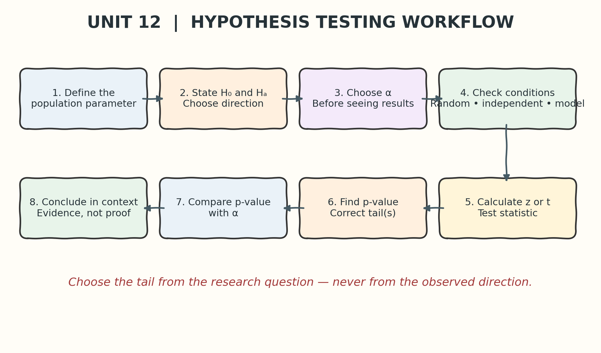
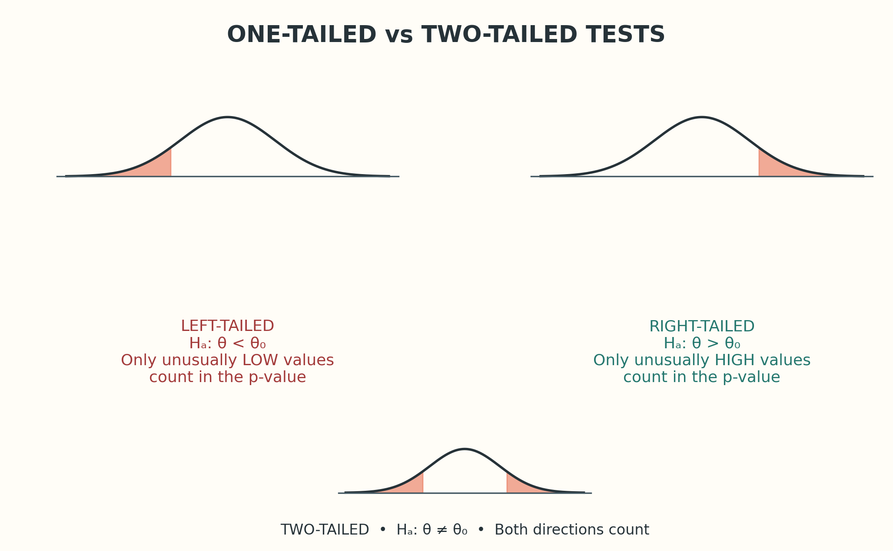
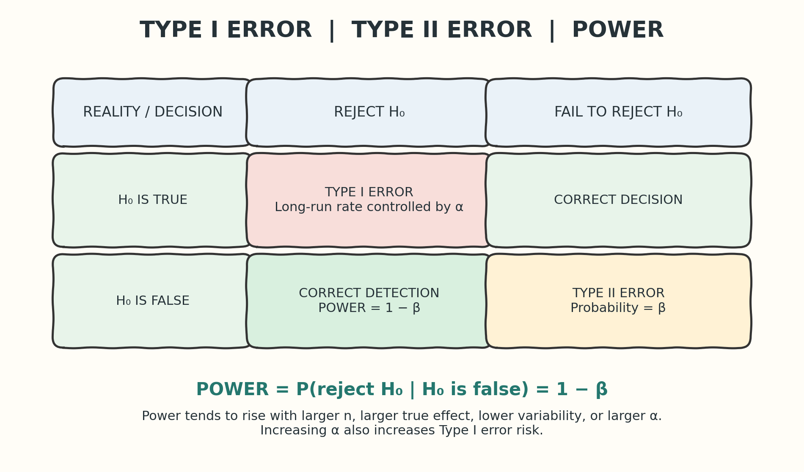
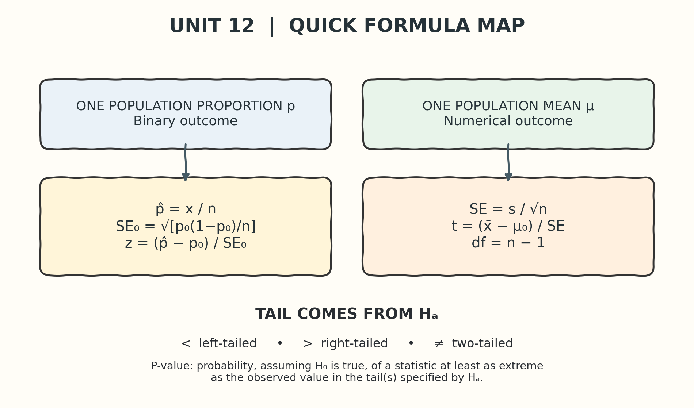
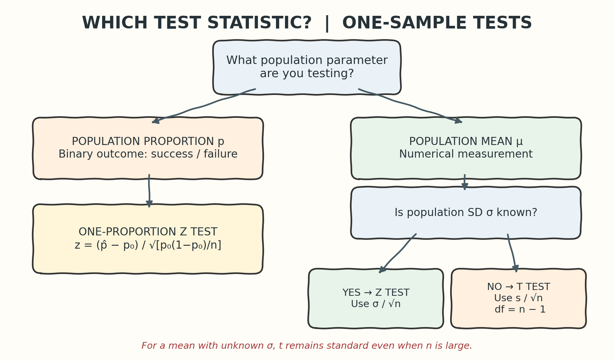

# Significance Tests (Hypothesis Testing)

> **Statistics learning notes | Khan Academy — Unit 12: Significance tests**  
> Topics consolidated from the lesson transcripts shared for this unit, with technical clarifications explicitly marked.

---

## 1. The logic of a significance test

A significance test asks whether the observed sample result would be unusual if a specified null hypothesis were true.

### The workflow

1. **Define the parameter.** Identify the population quantity being investigated.
2. **State hypotheses.** Write $H_0$ and $H_a$ using the population parameter.
3. **Choose $\alpha$.** Set the significance level before looking at the result.
4. **Check conditions.** Randomness, independence, and an appropriate distribution/normal approximation.
5. **Calculate the test statistic.** Express how far the sample result is from the null value in standard-error units.
6. **Find the p-value.** Use the tail or tails specified by $H_a$.
7. **Make the decision.** Compare the p-value with $\alpha$.
8. **State the contextual conclusion.** Say what the evidence supports, without claiming proof.



*Figure 1. The complete sequence of a significance test.*


### Decision rule

| Comparison | Decision | Interpretation |
|---|---|---|
| $p\text{-value} \leq \alpha$ | Reject $H_0$ | Statistically significant evidence against $H_0$, in the direction of $H_a$. |
| $p\text{-value} > \alpha$ | Fail to reject $H_0$ | Insufficient evidence against $H_0$. This does not prove $H_0$. |

Some course materials write the first rule as $p<\alpha$. If the p-value is exactly equal to alpha, follow the convention used by your course or assessment; the usual operational rule is reject when $p\leq\alpha$.

**Never write “accept the null hypothesis” as though it has been proven.** “Fail to reject” is the correct language.

---

## 2. Null and alternative hypotheses

- $H_0$: the null hypothesis — the status-quo/reference claim used to construct the test.
- $H_a$ (also written $H_1$): the alternative hypothesis — the direction or difference the study is looking for.

Hypotheses are statements about **population parameters**, not sample statistics.

### Tail selection

| Research question | Alternative hypothesis | Test |
|---|---|---|
| Is the population mean/proportion lower? | $H_a:\theta<\theta_0$ | Left-tailed |
| Is it higher? | $H_a:\theta>\theta_0$ | Right-tailed |
| Is it different / does it have an effect in either direction? | $H_a:\theta\ne\theta_0$ | Two-tailed |

Here $\theta$ represents the relevant population parameter, such as $\mu$ or $p$.

### Example: drug and response time

The known mean response time without the drug is 1.2 seconds.

- “Does the drug have an effect?”  
  $H_0:\mu=1.2$, $H_a:\mu\ne1.2$ — two-tailed. A substantially lower **or** higher mean counts as an effect.
- “Does the drug lower response time?”  
  $H_0:\mu=1.2$, $H_a:\mu<1.2$ — left-tailed.

**Important:** Choose the tail from the research question before examining the sample result. Do not switch to a one-tailed test after seeing which direction the data went.



*Figure 2. The alternative hypothesis determines which tail area(s) count toward the p-value.*


---

## 3. P-values

A **p-value** is the probability, assuming $H_0$ is true and the test assumptions hold, of obtaining a test statistic at least as extreme as the one observed, in the direction(s) specified by $H_a$.

### What a p-value is not

A p-value is **not**:

- the probability that $H_0$ is true;
- the probability that the alternative hypothesis is true;
- the probability that this particular decision is a Type I error;
- the size or practical importance of an effect;
- the probability that the result happened “by chance” without defining the null model and test.

A small p-value means the observed result would be relatively unusual under the null model. It is evidence against $H_0$, not a measure of the probability that $H_0$ is false.

### Tail calculations

For a standard normal statistic $Z$:

| Alternative | p-value |
|---|---|
| $H_a:\theta<\theta_0$ | $P(Z\le z_{\text{obs}})$ |
| $H_a:\theta>\theta_0$ | $P(Z\ge z_{\text{obs}})$ |
| $H_a:\theta\ne\theta_0$ | $2P(Z\ge |z_{\text{obs}}|)$ |

For a t statistic, replace $Z$ with $T_{df}$ and use the relevant degrees of freedom.

For a symmetric distribution, a two-sided p-value is twice the corresponding one-tail area beyond $|\text{statistic}|$.

---

## 4. Type I error, Type II error, and power

A hypothesis test makes a decision about $H_0$, but the truth about the population is unknown. This creates two possible error types.

| Reality | Reject $H_0$ | Fail to reject $H_0$ |
|---|---|---|
| $H_0$ is true | **Type I error** | Correct decision |
| $H_0$ is false | Correct decision (in the alternative direction) | **Type II error** |

### Definitions

- **Type I error:** Rejecting $H_0$ when $H_0$ is true.
- **Significance level $\alpha$:** The test's long-run Type I error probability/rate under the null model and its assumptions.
- **Type II error $\beta$:** Failing to reject $H_0$ when $H_0$ is false.
- **Power:** Probability of correctly rejecting $H_0$ for a specified true alternative value.

$$
\text{Power}=1-\beta
$$

### What tends to increase power?

Holding other factors constant:

- Larger sample size $n$ → usually higher power.
- Larger true effect / true parameter farther from the null value → higher power.
- Lower population variability → higher power.
- Larger significance level $\alpha$ → higher power, but also a higher Type I error rate.

Lowering $\alpha$ makes rejection harder. For a fixed sample size and effect, this generally lowers power and raises $\beta$.

**Power depends on a specified alternative effect size.** There is no single power value without specifying the true parameter value (or effect size), variability, sample size, test, and alpha.



*Figure 3. Decision outcomes when the null hypothesis is true or false.*


---

## 5. One-sample hypothesis test for a population proportion

Use a one-proportion z-test when the outcome is binary (success/failure) and the question concerns one population proportion $p$.

### Hypotheses

$$
H_0:p=p_0
$$

Choose the alternative based on the question:

$$
H_a:p<p_0,\qquad H_a:p>p_0,\qquad \text{or}\qquad H_a:p\ne p_0
$$

Even if the verbal null claim is $p\le p_0$, the calculation is performed at the boundary $p=p_0$. That boundary value is the least-favourable null value for the corresponding one-sided test.

### Formula sheet

Sample proportion:

$$
\hat p=\frac{x}{n}
$$

Null standard error:

$$
SE_0=\sqrt{\frac{p_0(1-p_0)}{n}}
$$

One-proportion z statistic:

$$
\boxed{z=\frac{\hat p-p_0}{\sqrt{p_0(1-p_0)/n}}}
$$

**Use $p_0$ in the standard error**, not $\hat p$. This is a hypothesis test under the null model.

### Conditions

1. **Random:** The data come from a random sample or an appropriate randomized process.
2. **Independence:** Observations are independent. For sampling without replacement, a common check is $n\le 0.10N$ (the 10% condition).
3. **Normal approximation under $H_0$:** Check expected successes and failures using the null proportion:
   $$
   np_0\quad\text{and}\quad n(1-p_0)
   $$
   Khan Academy's transcript uses both values greater than 5. Many courses/textbooks use the more conservative threshold of at least 10. Follow the threshold required by your course and state it; neither threshold should be confused with using $\hat p$.

### Worked example: internet access

A claim says more than 30% of U.S. households have internet access. A random sample of 150 households finds 57 with access. Test at $\alpha=0.05$.

**Step 1 — Parameter and hypotheses**

Let $p$ be the true proportion of U.S. households with internet access.

$$
H_0:p=0.30,\qquad H_a:p>0.30
$$

Right-tailed test.

**Step 2 — Sample proportion**

$$
\hat p=\frac{57}{150}=0.38
$$

**Step 3 — Conditions**

$$
np_0=150(0.30)=45,\quad n(1-p_0)=150(0.70)=105
$$

Both are comfortably above 10. Randomness and the 10% independence condition must also be justified from the sampling context.

**Step 4 — Test statistic**

$$
SE_0=\sqrt{\frac{0.30(0.70)}{150}}\approx0.03742
$$

$$
z=\frac{0.38-0.30}{0.03742}\approx2.14
$$

**Step 5 — P-value and decision**

Right-tail p-value $P(Z\ge2.14)\approx0.0162$.

Since $0.0162<0.05$, reject $H_0$.

**Conclusion:** The sample provides statistically significant evidence at the 5% level that more than 30% of U.S. households have internet access.

> The Khan Academy transcript rounds the standard error to about 0.037 and focuses on comparing the statistic with the 5% critical value $z^*\approx1.645$. The more precise p-value above is approximately 0.016.

---

## 6. One-sample hypothesis test for a population mean

Use a one-sample t-test when the question concerns one population mean $\mu$, the population standard deviation is unknown, and the sample standard deviation $s$ is used.

### Hypotheses

$$
H_0:\mu=\mu_0
$$

$$
H_a:\mu<\mu_0,\qquad H_a:\mu>\mu_0,\qquad \text{or}\qquad H_a:\mu\ne\mu_0
$$

### Formula sheet

Standard error:

$$
SE=\frac{s}{\sqrt n}
$$

One-sample t statistic:

$$
\boxed{t=\frac{\bar x-\mu_0}{s/\sqrt n}}
$$

Degrees of freedom:

$$
\boxed{df=n-1}
$$



*Figure 5. Quick visual summary of the one-proportion and one-mean test formulas.*


### Conditions

1. **Random:** Random sample or randomized experiment.
2. **Independence:** Observations are independent; if sampling without replacement, check the 10% condition.
3. **Nearly normal / large sample:** The population is approximately normal, or the sample is large enough for the sampling distribution of the mean to be approximately normal. For small samples, inspect the data for strong skewness and outliers.

The $n\ge30$ guideline is a heuristic, not a guarantee. A small sample from a strongly skewed population may not support a standard t-test.

### Z vs. t for a population mean — the correct rule

| Situation | Test statistic |
|---|---|
| Population SD $\sigma$ is known | z statistic: $(\bar x-\mu_0)/(\sigma/\sqrt n)$ |
| Population SD $\sigma$ is unknown and estimated with sample SD $s$ | t statistic: $(\bar x-\mu_0)/(s/\sqrt n)$, $df=n-1$ |

In real-world analysis, $\sigma$ is rarely known, so the one-sample t-test is common even with a large sample. For large degrees of freedom, the t distribution approaches the standard normal distribution, but that does not change the underlying choice when $\sigma$ is unknown.



*Figure 4. Select the test based on the population parameter and whether the population SD is known.*


### Worked example: engine emissions (small sample)

A new engine design meets the requirement if its population mean emission is below 20 ppm. Ten engines have $\bar x=17.17$ ppm and $s=2.98$ ppm. The significance level is $\alpha=0.01$.

**Step 1 — Parameter and hypotheses**

Let $\mu$ be the true mean emission level for engines of this design.

$$
H_0:\mu=20,\qquad H_a:\mu<20
$$

Left-tailed test.

**Step 2 — Conditions**

The transcript gives 10 test engines. The random/representative sampling basis and independence should be justified from the study design. With $n=10$, the normality of the population or a sufficiently well-behaved distribution is important; the transcript does not provide the raw data shape or explicitly establish population normality. Treat this condition as an assumption unless verified.

**Step 3 — Test statistic**

$$
t=\frac{17.17-20}{2.98/\sqrt{10}}\approx-3.00,\qquad df=9
$$

**Step 4 — Critical value / p-value**

For a left-tail test at $\alpha=0.01$, $t^*\approx-2.821$ for $df=9$.

Since $-3.00<-2.821$, reject $H_0$. The exact left-tail p-value is approximately 0.0075.

**Conclusion:** At the 1% significance level, the sample provides evidence that the population mean emission level is below 20 ppm, assuming the test conditions are met.

### Worked example: milk packaging compliance

A plant's milk containers are labelled 128 fl oz. A random sample of 12 containers has $\bar x=127.2$ oz and $s=2.1$ oz. The population is stated to be normally distributed. Test whether the plant is underfilling, using $\alpha=0.05$.

$$
H_0:\mu=128,\qquad H_a:\mu<128
$$

$$
t=\frac{127.2-128}{2.1/\sqrt{12}}\approx-1.32,\qquad df=11
$$

Left-tail p-value $\approx0.107$.

Since $0.107>0.05$, fail to reject $H_0$.

**Conclusion:** There is insufficient evidence at the 5% level to conclude that the plant's mean fill is below 128 fl oz. This does **not** prove the plant is compliant. The 10% independence condition also needs the sample to be no more than 10% of the population; the transcript assumes this rather than giving the population size.

---

## 7. Z-statistics vs. t-statistics: decision tree

```text
What population parameter are you testing?
|
+-- One population proportion p
|   |
|   +-- Binary outcome, conditions satisfied
|       -> One-proportion z-test
|
+-- One population mean mu
    |
    +-- Is population SD sigma known?
        |
        +-- Yes -> One-sample z-test for a mean
        |
        +-- No  -> One-sample t-test, df = n - 1
```

This unit focuses on one-sample tests. Two-sample tests, paired tests, chi-square tests, regression tests, and non-parametric alternatives require separate procedures.

---

## 8. Critical-value method vs. p-value method

These are two equivalent ways of making the same decision when they use the same test, assumptions, and significance level.

### P-value method

1. Calculate the test statistic.
2. Find the tail probability defined by $H_a$.
3. Compare p-value with $\alpha$.

### Critical-value method

1. Choose $\alpha$ and the tail direction.
2. Find the critical z or t value.
3. Compare the observed statistic with the rejection region.

For example, a right-tailed z-test at $\alpha=0.05$ has critical value approximately $1.645$. Reject when $z\ge1.645$.

---

## 9. Python implementations (SciPy)

Install the required packages:

```bash
python -m pip install scipy numpy
```

### A. One-proportion z-test (manual calculation)

```python
from math import sqrt
from scipy.stats import norm

# Example: 57 of 150 households; test whether p > 0.30
x = 57
n = 150
p0 = 0.30
alpha = 0.05

phat = x / n
se0 = sqrt(p0 * (1 - p0) / n)
z_stat = (phat - p0) / se0

# Right-tailed p-value
p_value = norm.sf(z_stat)

print(f"Sample proportion: {phat:.4f}")
print(f"Null standard error: {se0:.4f}")
print(f"z statistic: {z_stat:.4f}")
print(f"p-value: {p_value:.4f}")

decision = "Reject H0" if p_value <= alpha else "Fail to reject H0"
print(decision)
```

### B. One-sample t-test from summary statistics

```python
from math import sqrt
from scipy.stats import t

n = 10
sample_mean = 17.17
sample_sd = 2.98
mu0 = 20
alpha = 0.01

df = n - 1
se = sample_sd / sqrt(n)
t_stat = (sample_mean - mu0) / se

# Left-tailed alternative: population mean is below 20
p_value = t.cdf(t_stat, df=df)

print(f"Standard error: {se:.4f}")
print(f"t statistic: {t_stat:.4f}")
print(f"Degrees of freedom: {df}")
print(f"p-value: {p_value:.4f}")

decision = "Reject H0" if p_value <= alpha else "Fail to reject H0"
print(decision)
```

### C. One-sample t-test from raw observations

```python
from scipy import stats

sample = [/* insert observed values here */]

result = stats.ttest_1samp(
    sample,
    popmean=20,
    alternative="less"  # "less", "greater", or "two-sided"
)

print("t statistic:", result.statistic)
print("p-value:", result.pvalue)
```

### D. Two-sided, left-sided, and right-sided t-test p-values

```python
from scipy.stats import t

t_stat = -2.5
df = 24

p_left = t.cdf(t_stat, df)
p_right = t.sf(t_stat, df)
p_two_sided = 2 * t.sf(abs(t_stat), df)

print(p_left, p_right, p_two_sided)
```

Use `sf` (survival function) for upper-tail probabilities. It is often numerically more accurate than calculating `1 - cdf`.

**Implementation note:** SciPy's `ttest_1samp` is for a population mean. For a proportion, use the one-proportion z formula or a suitable proportion-test function; do not pass binary data to `ttest_1samp` as a substitute for a proportion test.

---

## 10. Common mistakes and corrections

| Mistake | Correct approach |
|---|---|
| Writing hypotheses about $\bar x$ or $\hat p$ | Write hypotheses about population parameters $\mu$ or $p$. |
| Choosing a tail after seeing the data | Choose it from the research question before analysing results. |
| Using $\hat p$ in the one-proportion null SE | Use $p_0$: $\sqrt{p_0(1-p_0)/n}$. |
| Assuming every test with $n>30$ uses z | For a mean with unknown $\sigma$, use t; large $df$ makes t close to z. |
| Assuming every small sample automatically makes a t-test valid | Check random sampling, independence, and the distribution/outliers. |
| Treating p-value as $P(H_0\text{ is true})$ | It is a probability of data at least as extreme under the assumption that $H_0$ is true. |
| Saying “there is a 0.5% chance this rejection is a Type I error” because p=.005 | Incorrect. The p-value is not the posterior probability of an error. |
| Saying “accept $H_0$” | Say “fail to reject $H_0$.” |
| Treating statistical significance as practical importance | Report effect size and context, not only the p-value. |
| Treating a significant result as proof of causation | Causation depends on study design, especially random assignment and control of confounding. |
| Forgetting degrees of freedom for a one-sample t-test | $df=n-1$. |
| Using a two-tailed p-value for a directional alternative | Match the p-value tail(s) to $H_a$. |

---

## 11. Exam / interview answer template

Use this structure for a written significance-test response:

1. **Parameter:** Define the population parameter in context.
2. **Hypotheses:** State $H_0$ and $H_a$.
3. **Significance level:** State $\alpha$.
4. **Conditions:** Address random, independence, and normal/large-count conditions with evidence from the prompt.
5. **Test and statistic:** Name the test, show the formula, statistic, and (for t) degrees of freedom.
6. **P-value:** State the correct tail and value.
7. **Decision:** Compare p-value with $\alpha$.
8. **Conclusion:** Answer the original question in context, using “evidence” language.

---

## 12. Quick revision sheet

| Item | Remember |
|---|---|
| One-proportion test | $z=(\hat p-p_0)/\sqrt{p_0(1-p_0)/n}$ |
| One-mean t-test | $t=(\bar x-\mu_0)/(s/\sqrt n)$ |
| Degrees of freedom | $n-1$ |
| Type I error | Reject true $H_0$ |
| Type II error | Fail to reject false $H_0$ |
| Power | $1-\beta$ |
| Small p-value | Evidence against $H_0$ |
| p-value $\le\alpha$ | Reject $H_0$ |
| p-value $>\alpha$ | Fail to reject $H_0$ |
| Direction of $H_a$ | Determines left/right/two tails |
| Proportion null SE | Uses $p_0$ |
| Mean test with unknown $\sigma$ | t statistic |

---

## Scope and source notes

These notes consolidate the Khan Academy Unit 12 lesson transcripts shared in this learning sequence, including:

- Hypothesis testing and p-values
- One-tailed and two-tailed tests
- Z-statistics vs. t-statistics
- Small-sample hypothesis testing
- Error probabilities and power
- Tests about a population proportion
- Tests about a population mean
- Large-sample proportion hypothesis testing
- Milk-packaging compliance free-response example

Where a transcript uses a simplified rule (for example, $n>30$ as a z/t shortcut), the notes flag the limitation and give the more general statistical rule. Condition thresholds for normal approximation can vary by course; use the threshold specified by the course or exam rubric.
