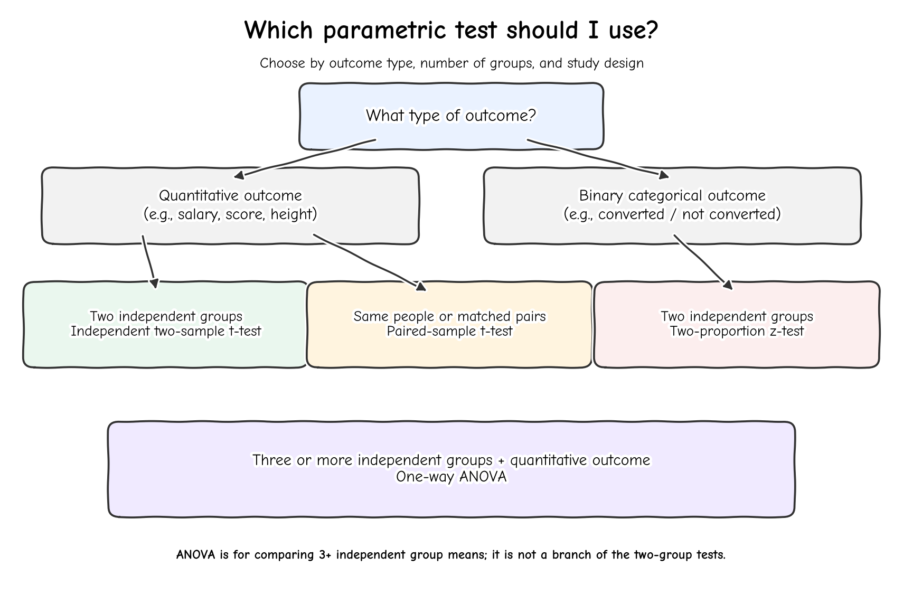
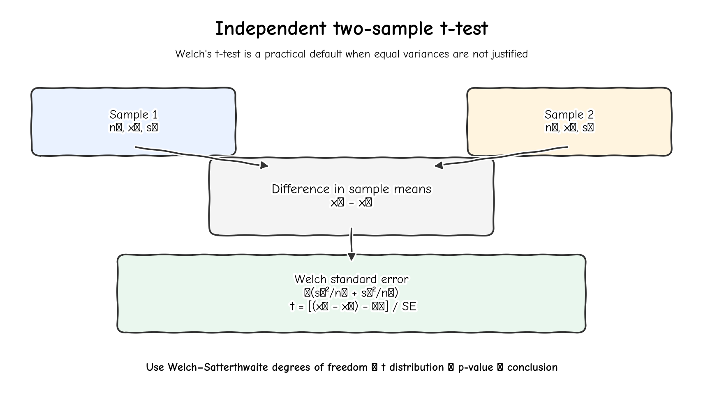
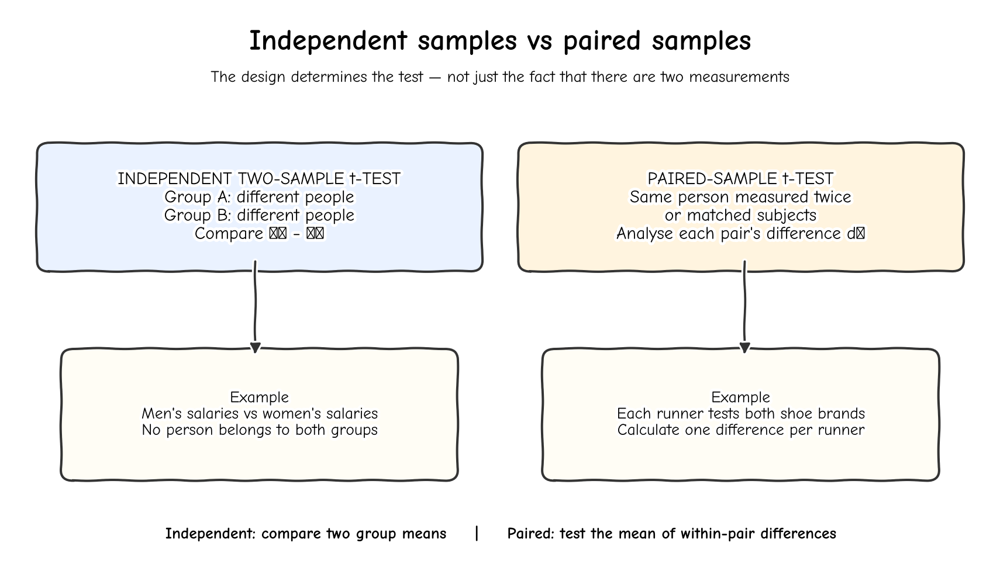
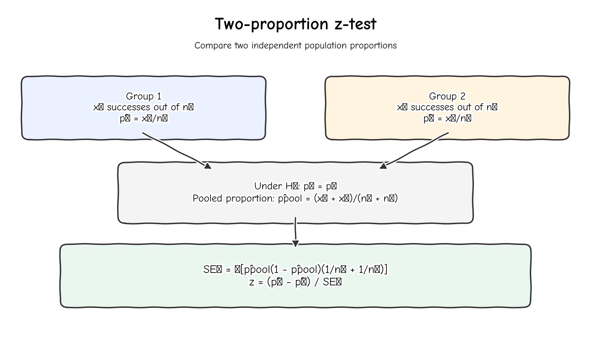
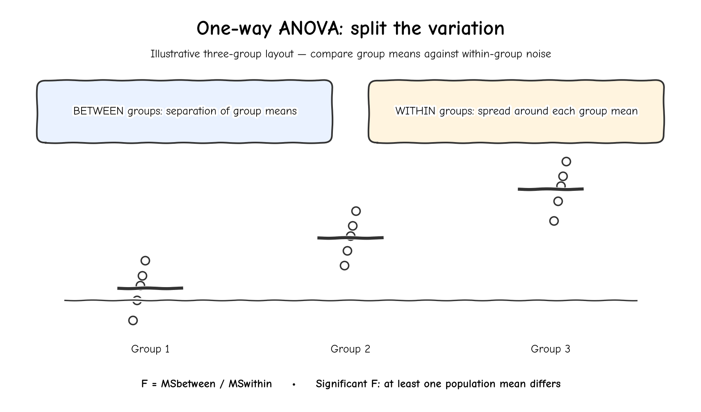

# 01 - Parametric Methods

> [!NOTE]
> **Section:** Khan Academy - [Parametric Methods](https://www.khanacademy.org/math/ap-statistics?utm_source=chatgpt.com)
>
> **Scope note:** The two-proportion z-test is included here because it is commonly taught alongside these parametric inference procedures. It tests categorical binary outcomes and population proportions, not a quantitative population mean.

[← Back to Statistical Tests Repository](https://github.com/Priya200227/statistics/tree/main/06-statistical-tests)

---

This folder is a practical reference for four commonly used inferential tests:

1. [Independent two-sample t-test](#3-independent-two-sample-t-test)
2. [Paired-sample t-test](#4-paired-sample-t-test)
3. [Two-proportion z-test](#5-two-proportion-z-test)
4. [One-way ANOVA](#6-one-way-anova)


---

## 1. Test-selection guide



| Research question / data structure | Appropriate test |
|---|---|
| Compare the means of two independent groups | Independent two-sample t-test |
| Compare two measurements from the same people, or matched pairs | Paired-sample t-test |
| Compare two independent population proportions | Two-proportion z-test |
| Compare means across three or more independent groups | One-way ANOVA |

### First identify the outcome

- **Quantitative:** salary, height, revenue, time, score, weight.
- **Binary categorical:** converted / not converted, clicked / not clicked, passed / failed.

Then identify the design:

- **Independent:** observations in one group are not paired with observations in the other.
- **Paired:** each observation in one condition has a meaningful partner in the other condition.

Do not choose a test just because the dataset has two columns or two categories. The sampling and assignment design matters.

---

## 2. Shared hypothesis-testing workflow

1. Define the population parameter(s).
2. Write the null hypothesis $H_0$ and alternative hypothesis $H_a$.
3. Set the significance level $\alpha$ before examining the test result.
4. Check the test's assumptions and conditions.
5. Calculate the test statistic and degrees of freedom, where applicable.
6. Obtain the p-value using the correct tail.
7. Compare the p-value with $\alpha$.
8. State the conclusion in the context of the original question.

Decision:

- If $p \leq \alpha$: reject $H_0$.
- If $p > \alpha$: fail to reject $H_0$.

**Interpretation discipline:** a p-value is calculated assuming the null hypothesis is true. It is not the probability that $H_0$ is true, nor the probability that the observed conclusion is wrong. Failing to reject $H_0$ does not prove that the null is true.

---

## 3. Independent two-sample t-test

### 3.1 Purpose

Use an independent two-sample t-test to compare the means of a quantitative outcome from **two independent populations or groups**.

Examples:

- Average salaries of two independently sampled employee groups.
- Mean plant height from two separate fields.
- Average order value for customers randomly assigned to two independent experiences.

### 3.2 Identify the parameters

Let:

- $\mu_1$ = population mean for group 1
- $\mu_2$ = population mean for group 2
- $\bar{x}_1,\bar{x}_2$ = sample means
- $s_1,s_2$ = sample standard deviations
- $n_1,n_2$ = sample sizes

The parameter of interest is the difference:

$$
\mu_1-\mu_2
$$

### 3.3 Hypotheses

No difference / two-sided:

$$
H_0:\mu_1-\mu_2=0
$$

$$
H_a:\mu_1-\mu_2\ne0
$$

Group 1 has a higher mean / right-sided:

$$
H_a:\mu_1-\mu_2>0
$$

Group 1 has a lower mean / left-sided:

$$
H_a:\mu_1-\mu_2<0
$$

The null is normally expressed as equality to zero. The direction comes from the research question and the order of subtraction.

### 3.4 Welch's two-sample t-test

Welch's test does not require equal population variances. It is a sensible default for comparing two independent means when equal variances cannot be justified.

Standard error:

$$
SE=\sqrt{\frac{s_1^2}{n_1}+\frac{s_2^2}{n_2}}
$$

Test statistic for $H_0:\mu_1-\mu_2=\Delta_0$:

$$
t=\frac{(\bar{x}_1-\bar{x}_2)-\Delta_0}
{\sqrt{\frac{s_1^2}{n_1}+\frac{s_2^2}{n_2}}}
$$

For the usual no-difference null, $\Delta_0=0$.

Welch–Satterthwaite degrees of freedom:

$$
df \approx
\frac{\left(\frac{s_1^2}{n_1}+\frac{s_2^2}{n_2}\right)^2}
{\frac{\left(s_1^2/n_1\right)^2}{n_1-1}
+\frac{\left(s_2^2/n_2\right)^2}{n_2-1}}
$$

Software may use fractional degrees of freedom. Do not automatically replace them with the smaller sample size minus one.

### 3.5 Pooled two-sample t-test

The pooled Student's t-test assumes equal population variances.

Pooled variance:

$$
s_p^2=
\frac{(n_1-1)s_1^2+(n_2-1)s_2^2}
{n_1+n_2-2}
$$

Standard error:

$$
SE=s_p\sqrt{\frac{1}{n_1}+\frac{1}{n_2}}
$$

Test statistic:

$$
t=\frac{(\bar{x}_1-\bar{x}_2)-\Delta_0}{SE}
$$

Degrees of freedom:

$$
df=n_1+n_2-2
$$

Use the pooled version only when the equal-variance assumption is appropriate and the analysis calls for it. Do not confuse the pooled and Welch standard errors.

### 3.6 Conditions / assumptions

- **Independent groups:** the two samples are independent of one another.
- **Randomisation / sampling:** data should come from a suitable random sampling or random assignment process for the intended inference.
- **Independence within samples:** observations should be independent; when sampling without replacement, a 10% condition is often used if applicable.
- **Normality / sample size:** each population is approximately normal, or sample sizes are sufficiently large for the t procedure to be reasonably robust. Inspect severe skew and outliers, especially with small samples.
- **Equal variances:** required for the pooled test, not for Welch's test.

A large sample does not repair dependence, selection bias, or extreme data problems.

### 3.7 Worked example - tomato plant heights

The supplied lesson example reports:

| Statistic | Field A | Field B |
|---|---:|---:|
| Sample mean | 1.3 | 1.6 |
| Sample SD | 0.5 | 0.3 |
| Sample size | 22 | 24 |

Question: do the population mean plant heights differ?

$$
H_0:\mu_A-\mu_B=0
\qquad
H_a:\mu_A-\mu_B\ne0
$$

Using the Welch standard error:

$$
SE=\sqrt{\frac{0.5^2}{22}+\frac{0.3^2}{24}}
$$

$$
t=\frac{1.3-1.6}{SE}\approx -2.44
$$

The Khan Academy transcript uses a conservative df approximation of $22-1=21$ and reports a two-sided p-value of approximately $0.024$. With $\alpha=0.05$, reject $H_0$.

**Conclusion:** there is statistically significant evidence that the population mean plant heights differ between the two fields.

*Technical note:* the transcript's standard-error formula is Welch's. Its smaller-sample-minus-one df is a conservative teaching approximation, not the Welch–Satterthwaite df formula shown above.

### 3.8 Interpretation example

If a separate test reports $p=0.13$ and $\alpha=0.05$:

$$
0.13>0.05
$$

Fail to reject $H_0$. There is insufficient evidence of a difference in the population means. This does **not** establish that the means are equal.



---

## 4. Paired-sample t-test

### 4.1 Purpose

Use a paired t-test when each value in one condition is naturally linked to a value in the other condition.

Common designs:

- Before-and-after measurements on the same person.
- The same customer measured under two experiences.
- Matched individuals, twins, or deliberately paired experimental units.
- Each runner tests both shoe brands.

A paired t-test is mathematically a **one-sample t-test on the within-pair differences**.

### 4.2 Calculate the differences

Choose and state an order:

$$
d_i=X_{i,1}-X_{i,2}
$$

Then calculate:

- $\bar d$ = mean of the sample differences
- $s_d$ = standard deviation of the differences
- $n$ = number of complete pairs

The sample size is the number of pairs, not the total number of individual measurements.

### 4.3 Hypotheses

For no average change:

$$
H_0:\mu_d=0
$$

Two-sided:

$$
H_a:\mu_d\ne0
$$

Right-sided:

$$
H_a:\mu_d>0
$$

Left-sided:

$$
H_a:\mu_d<0
$$

The direction depends on how $d$ was defined.

### 4.4 Test statistic

Standard error:

$$
SE_{\bar d}=\frac{s_d}{\sqrt n}
$$

Test statistic:

$$
t=\frac{\bar d-0}{s_d/\sqrt n}
$$

Degrees of freedom:

$$
df=n-1
$$

### 4.5 Conditions

- Observations are genuinely paired by person, unit, or matching rule.
- Different pairs are independent of one another.
- The pairs are sampled or assigned in a way that supports the intended inference.
- The distribution of the **differences** is approximately normal, or the number of pairs is sufficiently large for the t procedure to be reasonably robust.
- Check the differences for strong skew and outliers, especially for small samples.

Do not check normality only on the before values and after values separately. For a paired t-test, the relevant distribution is the distribution of the differences.

### 4.6 Worked example - running shoes

Six runners each run using both shoe brands. Define:

$$
d=\text{Zeppo time}-\text{Harpo time}
$$

The question is whether Harpo's shoes produce lower times. Lower Harpo times make $d$ positive.

$$
H_0:\mu_d=0
\qquad
H_a:\mu_d>0
$$

The test procedure is:

1. Calculate one difference per runner.
2. Find $\bar d$ and $s_d$.
3. Calculate $t=\bar d/(s_d/\sqrt 6)$.
4. Use $df=5$ and the right-tail p-value.
5. Compare the p-value with the preselected $\alpha$.

The transcript establishes the design and hypotheses but does not provide the six actual running-time pairs. Therefore, a numerical t-statistic or p-value cannot be calculated from that transcript alone.



---

## 5. Two-proportion z-test

### 5.1 Purpose

Use a two-proportion z-test to compare the proportions of a binary outcome in **two independent populations or groups**.

Examples:

- Conversion rate in control vs treatment.
- Click-through rate for two independent campaigns.
- Defect rate in two production processes.
- Pass rates for two independent training programmes.

Let:

- $x_1,x_2$ = number of successes in groups 1 and 2
- $n_1,n_2$ = sample sizes
- $\hat p_1=x_1/n_1$, $\hat p_2=x_2/n_2$ = sample proportions
- $p_1,p_2$ = population proportions

### 5.2 Hypotheses

No difference:

$$
H_0:p_1-p_2=0
$$

Two-sided:

$$
H_a:p_1-p_2\ne0
$$

Right-sided:

$$
H_a:p_1-p_2>0
$$

Left-sided:

$$
H_a:p_1-p_2<0
$$

### 5.3 Pooled proportion under the null

For the standard two-proportion z-test of $H_0:p_1=p_2$, pool the observed successes:

$$
\hat p_{\text{pool}}=
\frac{x_1+x_2}{n_1+n_2}
$$

The pooled estimate is used because the null hypothesis assumes one common population proportion.

### 5.4 Null standard error and z-statistic

$$
SE_0=
\sqrt{\hat p_{\text{pool}}(1-\hat p_{\text{pool}})
\left(\frac{1}{n_1}+\frac{1}{n_2}\right)}
$$

$$
z=
\frac{\hat p_1-\hat p_2}{SE_0}
$$

**Important:** use the pooled proportion in the standard error for this hypothesis test. Do not substitute $\hat p_1$ or $\hat p_2$ into the pooled null standard error.

### 5.5 Conditions

- Two independent groups / samples.
- Binary outcome: each observation is classified as success or failure.
- Random sampling or random assignment appropriate to the study.
- Independent observations within each group; apply the 10% condition when relevant for sampling without replacement.
- Large-count / normal approximation condition under $H_0$. A common check is that the pooled expected successes and failures in each group are sufficiently large:

$$
n_1\hat p_{\text{pool}},\quad n_1(1-\hat p_{\text{pool}}),
\quad n_2\hat p_{\text{pool}},\quad n_2(1-\hat p_{\text{pool}})
$$

A common classroom threshold is at least 10 for each expected count. Follow the convention specified by the course or analysis standard you are using.

### 5.6 P-value direction

- Left-tailed: $P(Z\le z_{\text{obs}})$
- Right-tailed: $P(Z\ge z_{\text{obs}})$
- Two-tailed: $2P(Z\ge |z_{\text{obs}}|)$

### 5.7 Worked example - conversion rates

Suppose two independent website experiences are tested:

| Group | Conversions | Visitors | Sample proportion |
|---|---:|---:|---:|
| A | 120 | 1,000 | 0.12 |
| B | 150 | 1,000 | 0.15 |

Question: is the conversion rate different?

$$
H_0:p_A-p_B=0
\qquad
H_a:p_A-p_B\ne0
$$

Pooled proportion:

$$
\hat p_{\text{pool}}=\frac{120+150}{1000+1000}=0.135
$$

Null standard error:

$$
SE_0=\sqrt{0.135(1-0.135)(1/1000+1/1000)}
$$

$$
SE_0\approx0.01528
$$

Test statistic:

$$
z=\frac{0.12-0.15}{0.01528}\approx-1.96
$$

The two-sided p-value is approximately $0.050$. The exact software result should be used for a decision close to the chosen significance threshold. At $\alpha=0.05$, this is a borderline result; do not round the p-value prematurely.

### 5.8 Test vs confidence interval

For a hypothesis test of equal proportions, the standard error is pooled under $H_0$.

For a confidence interval for $p_1-p_2$, the usual unpooled standard error is:

$$
SE_{\text{CI}}=
\sqrt{\frac{\hat p_1(1-\hat p_1)}{n_1}
+\frac{\hat p_2(1-\hat p_2)}{n_2}}
$$

Do not mix the hypothesis-test and confidence-interval standard errors.



---

## 6. One-way ANOVA

### 6.1 Purpose

Use a one-way between-groups ANOVA to compare the means of **three or more independent groups** for one quantitative response variable.

Examples:

- Average test scores across three teaching methods.
- Mean weight across four diet groups.
- Average delivery time across multiple fulfilment centres.
- Revenue across several independent marketing strategies.

“One-way” means there is one categorical explanatory factor. Its levels define the groups.

### 6.2 Hypotheses

For $k$ groups:

$$
H_0:\mu_1=\mu_2=\cdots=\mu_k
$$

$$
H_a:\text{Not all population means are equal}
$$

The alternative means at least one population mean differs. It does not mean every group differs from every other group.

### 6.3 Why not run many t-tests?

With $k$ groups, the number of possible pairwise comparisons is:

$$
\frac{k(k-1)}{2}
$$

For five groups, there are ten pairwise comparisons. Running many unadjusted t-tests increases the overall Type I error risk.

ANOVA provides one overall (omnibus) test of whether all population means are equal.

### 6.4 Core idea: total, between, and within variation

$$
SS_{\text{Total}}=SS_{\text{Between}}+SS_{\text{Within}}
$$

- **Total SS (SST):** variation of all observations around the grand mean.
- **Between SS (SSB):** variation attributable to differences between group means and the grand mean.
- **Within SS (SSW):** variation of observations around their own group means; also called error variation.



For unequal group sizes, let:

- $k$ = number of groups
- $N$ = total number of observations
- $n_j$ = sample size in group $j$
- $\bar x_j$ = mean of group $j$
- $\bar x_{\cdot}$ = grand mean

Then:

$$
SS_{\text{Between}}=\sum_{j=1}^{k}n_j(\bar x_j-\bar x_{\cdot})^2
$$

$$
SS_{\text{Within}}=\sum_{j=1}^{k}\sum_{i=1}^{n_j}(x_{ij}-\bar x_j)^2
$$

$$
SS_{\text{Total}}=\sum_{j=1}^{k}\sum_{i=1}^{n_j}(x_{ij}-\bar x_{\cdot})^2
$$

### 6.5 Degrees of freedom

$$
df_{\text{Between}}=k-1
$$

$$
df_{\text{Within}}=N-k
$$

$$
df_{\text{Total}}=N-1
$$

The degrees of freedom add up:

$$
(k-1)+(N-k)=N-1
$$

### 6.6 Mean squares and F-statistic

$$
MS_{\text{Between}}=
\frac{SS_{\text{Between}}}{k-1}
$$

$$
MS_{\text{Within}}=
\frac{SS_{\text{Within}}}{N-k}
$$

$$
F=\frac{MS_{\text{Between}}}{MS_{\text{Within}}}
$$

A larger F-statistic indicates that the observed separation between group means is large relative to the variation within groups.

The p-value is the **right-tail** probability from the F-distribution using:

- Numerator df: $k-1$
- Denominator df: $N-k$

### 6.7 Worked example - three groups

The Khan Academy calculation uses these observations:

| Group 1 | Group 2 | Group 3 |
|---:|---:|---:|
| 3 | 5 | 5 |
| 2 | 3 | 6 |
| 1 | 4 | 7 |
| **Mean = 2** | **Mean = 4** | **Mean = 6** |

Grand mean:

$$
\bar x_{\cdot}=4
$$

The lesson calculates:

| Source | SS | df |
|---|---:|---:|
| Between | 24 | 2 |
| Within | 6 | 6 |
| Total | 30 | 8 |

Check:

$$
24+6=30
$$

Mean squares:

$$
MS_{\text{Between}}=24/2=12
$$

$$
MS_{\text{Within}}=6/6=1
$$

F-statistic:

$$
F=12/1=12
$$

At $\alpha=0.10$, the transcript gives a critical F-value of approximately 3.46 for df $(2,6)$. Since $12>3.46$, reject $H_0$. There is evidence that the three population means are not all equal.

### 6.8 Assumptions

For classical one-way ANOVA:

1. **Independent observations:** observations and groups are independent.
2. **Normality:** response values are approximately normally distributed within each group, particularly important with small samples.
3. **Equal variances:** population variances are approximately equal across groups.

Inspect group-level distributions and outliers, not just the pooled distribution. A common introductory heuristic compares the largest and smallest group standard deviations, but it is not a formal proof of equal population variances.

If equal variances are not plausible, consider Welch's ANOVA. If observations are repeated or matched across conditions, ordinary one-way between-groups ANOVA is not the right design.

### 6.9 Post-hoc analysis: Tukey HSD

A significant ANOVA only tells you that at least one population mean differs. It does not tell you which groups differ.

Tukey's HSD performs adjusted pairwise comparisons while controlling the family-wise error rate for the collection of pairwise comparisons.

Interpret its output using:

- Adjusted p-values.
- Simultaneous confidence intervals.
- Grouping letters, where means that do not share a letter are significantly different under the reported procedure.

Do not interpret ordinary unadjusted pairwise confidence intervals as if they automatically account for multiple comparisons.

### 6.10 Penn State example: pig weights by diet

The supplied Penn State lesson demonstrates a one-way ANOVA comparing four independent diet groups, with five pigs per group.

The reported output includes:

- $k=4$ groups
- $N=20$ total observations
- Between-groups df = 3
- Within-groups df = 16
- $F=206.72$
- Reported p-value = 0.000 (software rounding; report as $p<0.001$, not as a literal zero)

The ANOVA indicates that not all four population mean weights are equal. Tukey comparisons are then used to identify which diet pairs differ.

### 6.11 ANOVA interpretation example

If an ANOVA output reports:

$$
F(2,242)=1.07,\qquad p=0.346
$$

At $\alpha=0.05$, fail to reject $H_0$. There is insufficient evidence to conclude that the three population means differ.

---

## 7. Python reference

Install the packages if needed:

```bash
pip install scipy statsmodels pandas numpy
```

### 7.1 Independent two-sample t-test - Welch

```python
from scipy import stats

group_a = [/* numeric observations */]
group_b = [/* numeric observations */]

result = stats.ttest_ind(
    group_a,
    group_b,
    equal_var=False,       # Welch's test
    alternative="two-sided"
)

print("t-statistic:", result.statistic)
print("p-value:", result.pvalue)
```

Use `alternative="less"` or `"greater"` when the research hypothesis is directional and the group order matches that direction.

### 7.2 Paired-sample t-test

```python
from scipy import stats

before = [/* measurements before */]
after = [/* measurements after */]

result = stats.ttest_rel(
    before,
    after,
    alternative="two-sided"
)

print("t-statistic:", result.statistic)
print("p-value:", result.pvalue)
```

Each position must refer to the same person or matched unit in both arrays. Do not sort or independently filter the arrays in a way that breaks the pairing.

### 7.3 Two-proportion z-test

```python
from statsmodels.stats.proportion import proportions_ztest

successes = [120, 150]
sample_sizes = [1000, 1000]

z_stat, p_value = proportions_ztest(
    count=successes,
    nobs=sample_sizes,
    alternative="two-sided"
)

print("z-statistic:", z_stat)
print("p-value:", p_value)
```

`count` contains the success counts, not the proportions. `nobs` contains the corresponding sample sizes.

### 7.4 One-way ANOVA

```python
from scipy import stats

group_1 = [/* observations */]
group_2 = [/* observations */]
group_3 = [/* observations */]

result = stats.f_oneway(
    group_1,
    group_2,
    group_3
)

print("F-statistic:", result.statistic)
print("p-value:", result.pvalue)
```

`scipy.stats.f_oneway` performs the classical one-way ANOVA. Check the assumptions before relying on its result.

### 7.5 Tukey HSD after ANOVA

```python
from statsmodels.stats.multicomp import pairwise_tukeyhsd

# One numeric value per observation
values = [/* response values */]

# One group label for each corresponding observation
groups = [/* group labels */]

tukey_result = pairwise_tukeyhsd(
    endog=values,
    groups=groups,
    alpha=0.05
)

print(tukey_result)
```

The `values` and `groups` arrays must have the same length and matching row order.

---

## 8. Common mistakes

| Mistake | Correct approach |
|---|---|
| Using an independent t-test for before-and-after data on the same people | Use a paired t-test and analyse the differences |
| Treating matched pairs as independent observations | Preserve the pairing |
| Using the total number of measurements as the paired sample size | Use the number of complete pairs |
| Forgetting the order of subtraction | Define the difference and align the alternative hypothesis with it |
| Assuming equal variances automatically | Use Welch's test unless equal variances are justified |
| Using separate group proportions in the null SE for a standard two-proportion test | Use the pooled proportion under $H_0:p_1=p_2$ |
| Using a z-test for two means just because the sample is large | For unknown population SDs, t procedures are standard |
| Running many unadjusted t-tests across several groups | Use ANOVA followed by an appropriate post-hoc procedure |
| Saying significant ANOVA proves every group differs | It means at least one population mean differs |
| Assuming ANOVA identifies which groups differ | Use post-hoc comparisons such as Tukey HSD |
| Reporting software p-value `0.000` as exactly zero | Report the appropriate bound, e.g. $p<0.001$ |
| Treating failure to reject as proof of equality | Say there is insufficient evidence against the null |
| Confusing statistical significance with business importance | Also evaluate effect size, uncertainty, and practical impact |

---

## 9. Quick formula sheet

### Independent two-sample t-test (Welch)

$$
t=\frac{(\bar x_1-\bar x_2)-\Delta_0}
{\sqrt{s_1^2/n_1+s_2^2/n_2}}
$$

### Paired-sample t-test

$$
t=\frac{\bar d-0}{s_d/\sqrt n},
\qquad df=n-1
$$

### Two-proportion z-test

$$
\hat p_{\text{pool}}=\frac{x_1+x_2}{n_1+n_2}
$$

$$
z=\frac{\hat p_1-\hat p_2}
{\sqrt{\hat p_{\text{pool}}(1-\hat p_{\text{pool}})
(1/n_1+1/n_2)}}
$$

### One-way ANOVA

$$
SS_T=SS_B+SS_W
$$

$$
df_B=k-1,\qquad df_W=N-k
$$

$$
MS_B=SS_B/(k-1),\qquad MS_W=SS_W/(N-k)
$$

$$
F=MS_B/MS_W
$$

---

## 10. Suggested learning sequence

Recommended order for studying and adding notes to this folder:

1. Independent vs paired study designs.
2. Independent two-sample t-test: hypotheses, assumptions, Welch calculation, p-value and conclusion.
3. Pooled two-sample t-test: understand the equal-variance version and when it applies.
4. Paired-sample t-test: differences, assumptions, calculation and conclusion.
5. Two-proportion z-test: pooled proportion, null standard error, conditions and p-value.
6. One-way ANOVA: total, between and within sums of squares.
7. ANOVA: degrees of freedom, mean squares, F-statistic and interpretation.
8. Tukey HSD: adjusted pairwise comparisons.
9. Implement each test in Python and interpret the outputs.

### Reference sources

- Khan Academy - *Inference for categorical data: proportions* and *Inference for quantitative data: means* (lesson material and transcripts used for the proportion and mean-testing foundations).
- Khan Academy - supplied lesson transcripts on hypotheses for two-sample and paired t-tests, the tomato-field two-sample t-test, ANOVA sums of squares, and the F-statistic.
- Penn State STAT 200 - [Lesson 10: One-Way ANOVA](https://online.stat.psu.edu/stat200/Lesson10), including ANOVA assumptions, the F distribution, ANOVA source tables, and Tukey pairwise comparisons.
- SciPy documentation - [scipy.stats.ttest_ind](https://docs.scipy.org/doc/scipy/reference/generated/scipy.stats.ttest_ind.html), [ttest_rel](https://docs.scipy.org/doc/scipy/reference/generated/scipy.stats.ttest_rel.html), [f_oneway](https://docs.scipy.org/doc/scipy/reference/generated/scipy.stats.f_oneway.html).
- Statsmodels documentation - [proportions_ztest](https://www.statsmodels.org/stable/generated/statsmodels.stats.proportion.proportions_ztest.html), [pairwise_tukeyhsd](https://www.statsmodels.org/stable/generated/statsmodels.stats.multicomp.pairwise_tukeyhsd.html).

---

**NEXT:** [Non-Parametric Methods](../02-non-parametric-methods/README.md)
