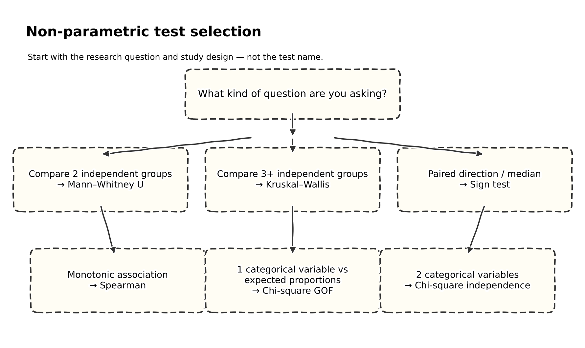
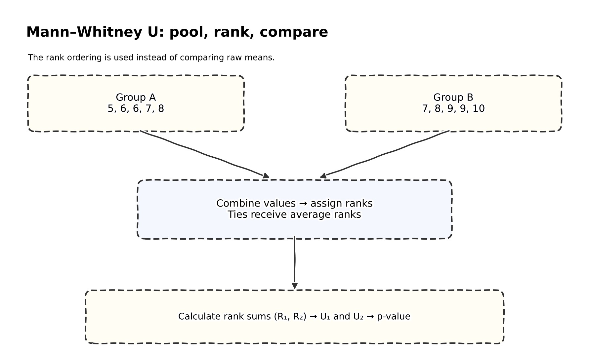
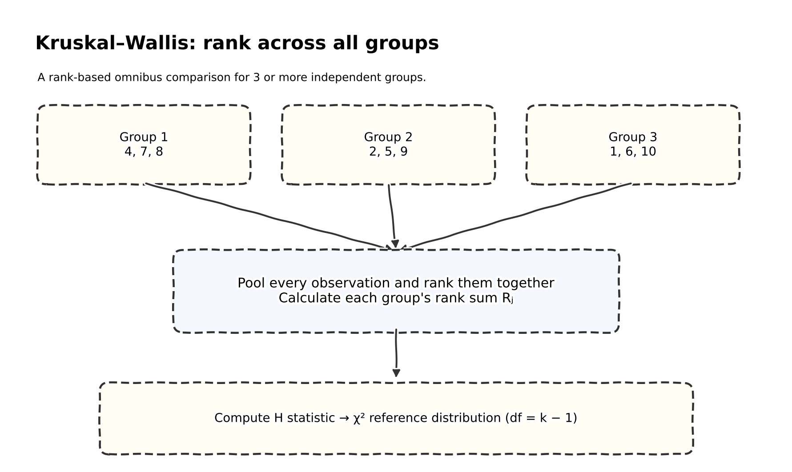
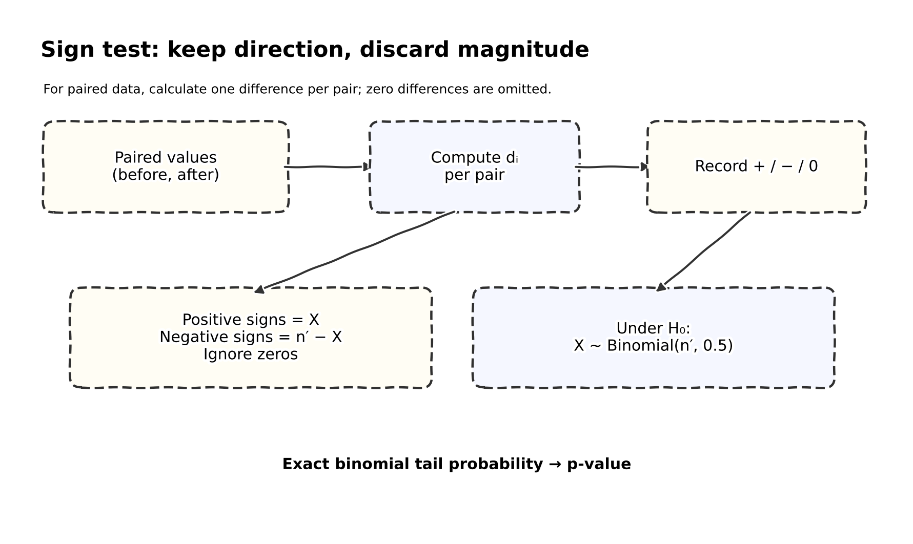
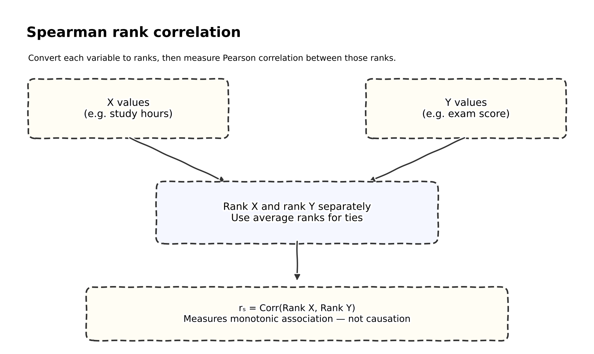
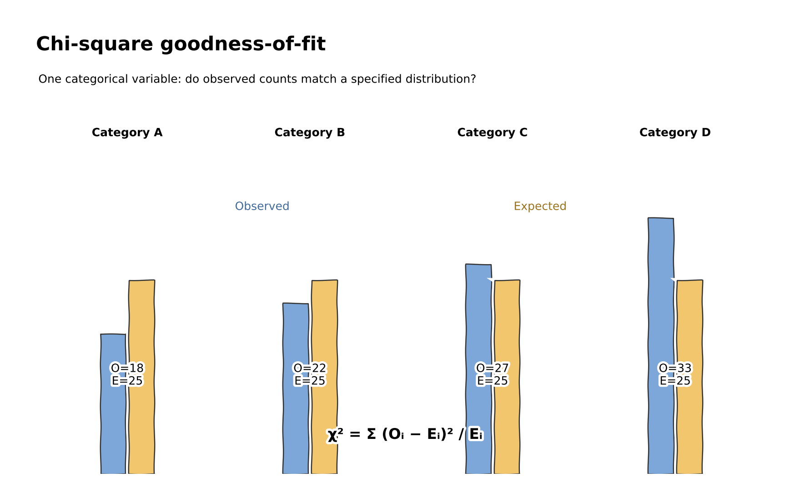
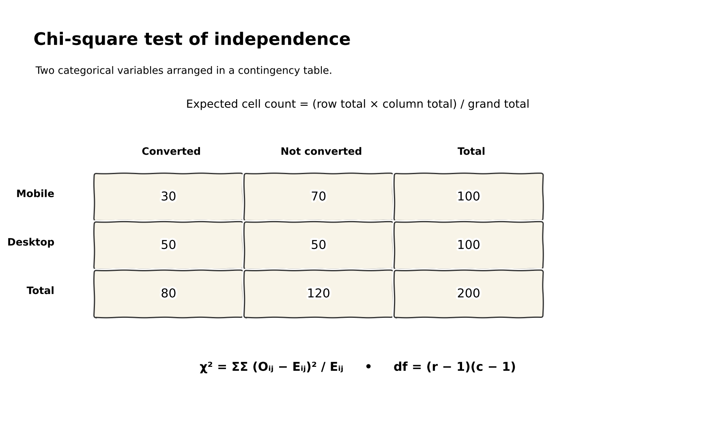

# 02 — Non-parametric Methods

> [!NOTE]
> 
> **Purpose:** A practical reference to rank-based and count-based methods used when the assumptions or data structure make a conventional parametric procedure unsuitable.
>
> **Important distinction:** “Non-parametric” does not mean “assumption-free.” These methods still require appropriate sampling/design, independence where specified, and test-specific conditions.

[← Back to Statistical Tests Repository](https://github.com/Priya200227/statistics/tree/main/06-statistical-tests)

## Contents

1. [Test-selection guide](#1-test-selection-guide)
2. [Shared workflow and notation](#2-shared-workflow-and-notation)
3. [Mann–Whitney U test](#3-mannwhitney-u-test)
4. [Kruskal–Wallis test](#4-kruskalwallis-test)
5. [Sign test](#5-sign-test)
6. [Spearman rank correlation](#6-spearman-rank-correlation)
7. [Chi-square goodness-of-fit test](#7-chi-square-goodness-of-fit-test)
8. [Chi-square test of independence](#8-chi-square-test-of-independence)
9. [Python reference](#9-python-reference)
10. [Common mistakes](#10-common-mistakes)
11. [Quick formula sheet](#11-quick-formula-sheet)
12. [Suggested learning sequence](#12-suggested-learning-sequence)
13. [References](#13-references)

---

## 1. Test-selection guide



| Question/data structure | Test |
|---|---|
| Compare two independent groups using ranks / ordinal or non-normal continuous outcomes | Mann–Whitney U |
| Compare three or more independent groups using ranks | Kruskal–Wallis |
| Test a population median or paired change using only direction (+ / −) | Sign test |
| Measure monotonic association between two ranked or ordinal variables | Spearman rank correlation |
| Compare observed category counts with a specified distribution | Chi-square goodness-of-fit |
| Test association between two categorical variables in one population | Chi-square test of independence |

**Do not select a test only because a normality test is significant.** Consider the research question, design, sample size, outliers, measurement scale, and what parameter or distributional feature the test actually addresses.

## 2. Shared workflow and notation

1. Identify the outcome type and study design.
2. Define the population parameter or null distribution being tested.
3. State $H_0$ and $H_a$ before inspecting the result.
4. Choose the significance level $\alpha$ in advance.
5. Check the method's assumptions and expected-count / independence conditions.
6. Calculate the statistic and degrees of freedom where relevant.
7. Obtain the p-value using the correct reference distribution.
8. State the conclusion in the context of the research question.
9. Report an effect size and an uncertainty interval when appropriate.

Decision rule:

- If $p \leq \alpha$, reject $H_0$.
- If $p > \alpha$, fail to reject $H_0$.

A p-value is calculated under the assumption that $H_0$ is true. It is not the probability that $H_0$ is true. Failure to reject does not prove the null hypothesis.

---

## 3. Mann–Whitney U test

### 3.1 Purpose

The Mann–Whitney U test (also called the Wilcoxon rank-sum test) compares **two independent groups** using the ranks of the combined observations.

Use it when:
- the outcome is ordinal, or
- a quantitative outcome is unsuitable for a two-sample t procedure and a rank-based comparison is appropriate.

It is **not automatically a test of medians**. A median/location-shift interpretation is most defensible when the two population distributions have similar shapes and spreads. More generally, it tests whether values from one group tend to be larger than values from the other.

### 3.2 Hypotheses

For two independent populations:

- $H_0$: the two population distributions are the same.
- $H_a$: the distributions differ (two-sided), or one group tends to produce larger values (one-sided).

A common probabilistic interpretation is based on:

$$
P(X_1 > X_2) + \frac{1}{2}P(X_1=X_2)
$$

Under identical distributions, this probability is $0.5$.

### 3.3 Procedure and statistic

1. Combine the observations from both groups.
2. Rank all observations from smallest to largest.
3. Assign average ranks to ties.
4. Sum the ranks for each group.
5. Calculate the U statistic.

For group 1:

$$
U_1 = R_1 - \frac{n_1(n_1+1)}{2}
$$

For group 2:

$$
U_2 = R_2 - \frac{n_2(n_2+1)}{2}
$$

where $R_i$ is the sum of ranks in group $i$.

The two statistics satisfy:

$$
U_1 + U_2 = n_1n_2
$$

Many software packages report the smaller U value for a two-sided test. Follow the package's convention when interpreting output.

### 3.4 Conditions

- Two independent groups.
- Observations are independent within and between groups.
- Outcome is at least ordinal.
- For a simple location-shift / median interpretation, group distributions should have comparable shapes and spreads.
- For small samples, exact methods may be appropriate; large-sample implementations use an approximation, often with tie correction.

### 3.5 Worked example — customer satisfaction ratings

Suppose satisfaction ratings (1–10) are collected from two independent customer groups. Because ratings are ordinal, compare the groups using Mann–Whitney U.

Illustrative data:

| Group A | Group B |
|---:|---:|
| 5 | 7 |
| 6 | 8 |
| 6 | 9 |
| 7 | 9 |
| 8 | 10 |

The analysis ranks all ten ratings together (ties receive average ranks), calculates the rank sums and U statistic, then obtains a p-value. The conclusion concerns evidence of a difference in the rank distributions / stochastic ordering—not automatically a difference in population medians.



---

## 4. Kruskal–Wallis test

### 4.1 Purpose

The Kruskal–Wallis test is a rank-based alternative to one-way independent-groups ANOVA. It compares **three or more independent groups**.

Use it for ordinal outcomes or quantitative outcomes where a rank-based comparison is preferred.

The test detects differences in the group distributions. It can be interpreted as a test of medians only when the group distributions have similar shapes and spreads.

### 4.2 Hypotheses

- $H_0$: all group distributions are identical.
- $H_a$: at least one group distribution differs.

### 4.3 Procedure and H statistic

1. Combine all $N$ observations.
2. Rank them from smallest to largest; use average ranks for ties.
3. Find each group's rank sum $R_j$.
4. Calculate:

$$
H = \frac{12}{N(N+1)}
\sum_{j=1}^{k}\frac{R_j^2}{n_j}
-3(N+1)
$$

where:
- $k$ = number of groups
- $n_j$ = sample size in group $j$
- $R_j$ = rank sum for group $j$
- $N=\sum_j n_j$

A tie-correction factor is applied when tied observations occur. Statistical software generally handles this automatically.

For sufficiently large samples, $H$ is approximated by a chi-square distribution with:

$$
df=k-1
$$

The p-value is the right-tail probability.

### 4.4 Conditions

- Three or more independent groups.
- Independent observations.
- Outcome is ordinal or quantitative.
- For a median interpretation, group distributions should have similar shapes.
- If repeated measurements or matched subjects are used, ordinary Kruskal–Wallis is not appropriate; consider the Friedman test instead.

### 4.5 After a significant result

A significant Kruskal–Wallis result indicates that at least one group differs; it does not identify which groups. Use suitable post-hoc pairwise comparisons (for example, Dunn's test) with a multiple-comparison adjustment such as Holm.



---

## 5. Sign test

### 5.1 Purpose

The sign test uses only the **direction** of differences, not their magnitudes. It is useful for:
- a one-sample test of a population median, or
- paired data where the question concerns whether the median paired difference is zero.

For paired data, calculate each difference $d_i$. Ignore zero differences, then count positive and negative differences.

### 5.2 Hypotheses

For paired differences:

- $H_0$: the population median difference is zero.
- $H_a$: the population median difference is not zero (or is greater / less than zero for a directional test).

### 5.3 Test statistic and null distribution

Let $n'$ be the number of non-zero differences and let $X$ be the number of positive differences.

Under $H_0$, assuming positive and negative signs are equally likely:

$$
X \sim \operatorname{Binomial}(n', 0.5)
$$

For a two-sided test, the p-value is:

$$
p = 2\min\{P(X\leq x), P(X\geq x)\}
$$

The result is capped at 1. For a one-sided test, use the tail matching $H_a$.

### 5.4 Conditions and limitations

- Paired differences (or observations relative to a hypothesised median) are independent across units.
- The sign of each non-zero difference is meaningful.
- Zero differences are excluded from the binomial count.
- The method assumes that under the null, positive and negative signs are equally likely.
- It discards magnitude information, so it is often less powerful than methods that use more information, such as the paired t-test or Wilcoxon signed-rank test when their assumptions are suitable.

### 5.5 Worked example

Suppose 12 customers rate a service before and after a change. After calculating paired differences, 9 are positive, 2 are negative, and 1 is zero.

Exclude the zero: $n'=11$, with $x=9$ positive signs.

Under $H_0$, $X\sim\operatorname{Binomial}(11,0.5)$. For a two-sided test:

$$
p=2P(X\geq 9)
$$

Calculate this exact binomial tail in software; compare the result with the preselected $\alpha$. Do not count the zero difference as positive or negative.



---

## 6. Spearman rank correlation

### 6.1 Purpose

Spearman's rank correlation ($r_s$ or $\rho_s$) measures the **strength and direction of a monotonic association** between two variables.

Use it when:
- variables are ordinal / ranked,
- a relationship is monotonic but not necessarily linear, or
- Pearson correlation's linearity and scale assumptions are not suitable.

Spearman correlation measures association, not causation. A value near zero means little monotonic association; a non-monotonic relationship can still exist.

### 6.2 Hypotheses

For a population rank correlation:

- $H_0:\rho_s=0$
- $H_a:\rho_s\ne0$ (or $>0$ / $<0$ for a directional test)

### 6.3 Calculation

Rank each variable separately, then calculate the Pearson correlation between the ranks:

$$
r_s = \operatorname{Corr}(R_X,R_Y)
$$

When there are no tied ranks, the shortcut formula is:

$$
r_s=1-\frac{6\sum d_i^2}{n(n^2-1)}
$$

where $d_i$ is the difference between the two ranks for observation $i$.

**Ties:** use average ranks and calculate the Pearson correlation of the rank variables. Do not apply the shortcut formula blindly when ties occur.

### 6.4 Interpretation

- $r_s$ close to $+1$: strong positive monotonic association.
- $r_s$ close to $-1$: strong negative monotonic association.
- $r_s$ close to $0$: weak or no monotonic association.

The coefficient describes direction and strength. Use a p-value or confidence interval for inference; do not infer significance from the coefficient alone.



---

## 7. Chi-square goodness-of-fit test

### 7.1 Purpose

Use the chi-square goodness-of-fit test for **one categorical variable** to compare observed category counts with counts expected under a specified probability distribution.

Examples:
- Are customer choices distributed equally across four product options?
- Does a die appear fair?
- Do observed support-ticket categories match a historical distribution?

### 7.2 Hypotheses

- $H_0$: the population category proportions match the specified probabilities.
- $H_a$: at least one category proportion differs from its specified probability.

### 7.3 Expected counts and test statistic

For category $i$:

$$
E_i = n p_i
$$

where $n$ is the total sample size and $p_i$ is the hypothesised category probability.

The test statistic is:

$$
\chi^2 = \sum_{i=1}^{k}\frac{(O_i-E_i)^2}{E_i}
$$

where $O_i$ and $E_i$ are observed and expected counts.

If all $k$ probabilities are specified in advance and no parameters are estimated from the sample:

$$
df=k-1
$$

If parameters are estimated from the data, degrees of freedom are reduced accordingly (typically $df=k-1-m$, where $m$ parameters are estimated, subject to the model).

### 7.4 Conditions

- Data are counts in mutually exclusive categories.
- Each observation contributes to one category.
- Observations are independent.
- Expected counts are sufficiently large for the chi-square approximation. A common classroom rule is all expected counts at least 5; other accepted guidelines allow limited smaller expected counts. Follow the course or analysis standard and combine categories only when substantively defensible.

### 7.5 Worked example — equal product preference

A survey records 100 customers' first choice among four products. If preference is equally distributed under $H_0$, each expected count is:

$$
E_i=100(0.25)=25
$$

Suppose observed counts are 18, 22, 27, and 33:

$$
\chi^2 =
\frac{(18-25)^2}{25}
+\frac{(22-25)^2}{25}
+\frac{(27-25)^2}{25}
+\frac{(33-25)^2}{25}
$$

$$
\chi^2=1.96+0.36+0.16+2.56=5.04
$$

Degrees of freedom:

$$
df=4-1=3
$$

Use the right tail of the chi-square distribution to obtain the p-value.



---

## 8. Chi-square test of independence

### 8.1 Purpose

Use the chi-square test of independence to assess whether **two categorical variables are associated** in one population.

Examples:
- Is subscription tier associated with churn status?
- Is device type associated with conversion?
- Is region associated with preferred payment method?

### 8.2 Hypotheses

- $H_0$: the two categorical variables are independent (no association).
- $H_a$: the variables are associated.

### 8.3 Expected counts

For each cell in an $r\times c$ contingency table:

$$
E_{ij}=
\frac{(\text{row total}_i)(\text{column total}_j)}
{\text{grand total}}
$$

### 8.4 Test statistic and degrees of freedom

$$
\chi^2=\sum_{i=1}^{r}\sum_{j=1}^{c}
\frac{(O_{ij}-E_{ij})^2}{E_{ij}}
$$

Degrees of freedom:

$$
df=(r-1)(c-1)
$$

The p-value is the right-tail probability from the chi-square distribution.

### 8.5 Conditions

- Both variables are categorical.
- Data are counts of independent observations.
- Each observation belongs to exactly one cell.
- Expected cell counts are sufficiently large for the chi-square approximation.
- If expected counts are too small, consider an exact procedure (such as Fisher's exact test for suitable tables) or a defensible alternative.

### 8.6 Worked example — device type and conversion

Suppose 200 visitors are classified by device and conversion:

| | Converted | Not converted | Total |
|---|---:|---:|---:|
| Mobile | 30 | 70 | 100 |
| Desktop | 50 | 50 | 100 |
| Total | 80 | 120 | 200 |

Expected mobile-converted count:

$$
E_{11}=\frac{100\times80}{200}=40
$$

Expected mobile-not-converted count:

$$
E_{12}=\frac{100\times120}{200}=60
$$

The other expected counts are 40 and 60. Calculate the chi-square statistic across all four cells, with:

$$
df=(2-1)(2-1)=1
$$

A significant result indicates evidence of an association, not that device type caused conversion.



---

## 9. Python reference

Install packages:

```bash
pip install scipy pandas numpy
```

### 9.1 Mann–Whitney U

```python
from scipy import stats

group_a = [5, 6, 6, 7, 8]
group_b = [7, 8, 9, 9, 10]

result = stats.mannwhitneyu(
    group_a,
    group_b,
    alternative="two-sided",
    method="auto"
)

print("U statistic:", result.statistic)
print("p-value:", result.pvalue)
```

### 9.2 Kruskal–Wallis

```python
from scipy import stats

group_a = [12, 14, 15, 16]
group_b = [18, 19, 20, 21]
group_c = [13, 15, 17, 18]

result = stats.kruskal(group_a, group_b, group_c)

print("H statistic:", result.statistic)
print("p-value:", result.pvalue)
```

For post-hoc pairwise comparisons, use a suitable Dunn procedure with a multiple-testing correction; Kruskal–Wallis alone does not identify the differing groups.

### 9.3 Sign test

SciPy does not provide a dedicated one-sample sign-test function in all versions. The exact binomial test is straightforward:

```python
from scipy.stats import binomtest

differences = [2, 1, -1, 3, 0, 2, 1, -2, 1, 2, 1, 1]

nonzero = [d for d in differences if d != 0]
positive = sum(d > 0 for d in nonzero)

result = binomtest(
    k=positive,
    n=len(nonzero),
    p=0.5,
    alternative="two-sided"
)

print("Positive signs:", positive)
print("Non-zero pairs:", len(nonzero))
print("p-value:", result.pvalue)
```

### 9.4 Spearman rank correlation

```python
from scipy import stats

study_hours = [1, 2, 3, 4, 5, 6]
exam_scores = [52, 55, 61, 65, 72, 78]

result = stats.spearmanr(study_hours, exam_scores)

print("Spearman rho:", result.statistic)
print("p-value:", result.pvalue)
```

### 9.5 Chi-square goodness-of-fit

```python
from scipy.stats import chisquare

observed = [18, 22, 27, 33]
expected = [25, 25, 25, 25]

result = chisquare(
    f_obs=observed,
    f_exp=expected
)

print("Chi-square:", result.statistic)
print("p-value:", result.pvalue)
```

### 9.6 Chi-square test of independence

```python
from scipy.stats import chi2_contingency

# Rows: Mobile, Desktop
# Columns: Converted, Not converted
table = [
    [30, 70],
    [50, 50]
]

chi2, p_value, dof, expected = chi2_contingency(
    table,
    correction=False
)

print("Chi-square:", chi2)
print("p-value:", p_value)
print("Degrees of freedom:", dof)
print("Expected counts:\n", expected)
```

For a 2x2 table, some software applies Yates' continuity correction by default. Set the option deliberately and report which version was used.

---

## 10. Common mistakes

| Mistake | Correct approach |
|---|---|
| Calling Mann–Whitney a median test in every situation | It compares rank distributions / stochastic ordering; median interpretation needs similar distribution shapes |
| Using Mann–Whitney for paired observations | Use a paired procedure; do not treat matched observations as independent |
| Assuming Kruskal–Wallis identifies which groups differ | Follow a significant omnibus test with adjusted post-hoc comparisons |
| Applying Kruskal–Wallis to repeated measures | Consider Friedman test for matched/repeated groups |
| Forgetting to remove zero differences in the sign test | Exclude zeros from the binomial count |
| Using difference magnitudes in a sign test | The sign test uses direction only |
| Using Spearman to claim causation | Correlation is association, not causation |
| Using the no-ties Spearman shortcut when ties exist | Rank with average ranks and correlate the rank variables |
| Using percentages instead of counts in chi-square tests | Use observed and expected counts |
| Using chi-square GOF for two variables | GOF is one categorical variable; independence is two categorical variables |
| Ignoring small expected counts | Check expected counts and consider an exact alternative |
| Treating a significant chi-square result as causal | It supports association / distribution mismatch, not causality |
| Reporting p = 0.000 | Report a bound such as $p<0.001$ when appropriate |

---

## 11. Quick formula sheet

### Mann–Whitney U

$$
U_1=R_1-\frac{n_1(n_1+1)}{2},
\qquad
U_2=R_2-\frac{n_2(n_2+1)}{2}
$$

### Kruskal–Wallis

$$
H=\frac{12}{N(N+1)}
\sum_{j=1}^{k}\frac{R_j^2}{n_j}-3(N+1),
\qquad df=k-1
$$

### Sign test

$$
X\sim\operatorname{Binomial}(n',0.5)
$$

### Spearman rank correlation

$$
r_s=\operatorname{Corr}(R_X,R_Y)
$$

No ties:

$$
r_s=1-\frac{6\sum d_i^2}{n(n^2-1)}
$$

### Chi-square goodness-of-fit

$$
E_i=np_i,
\qquad
\chi^2=\sum_{i=1}^{k}\frac{(O_i-E_i)^2}{E_i}
$$

### Chi-square test of independence

$$
E_{ij}=
\frac{(\text{row total}_i)(\text{column total}_j)}
{\text{grand total}}
$$

$$
\chi^2=\sum_{i=1}^{r}\sum_{j=1}^{c}
\frac{(O_{ij}-E_{ij})^2}{E_{ij}},
\qquad
df=(r-1)(c-1)
$$

---

## 12. Suggested learning sequence

1. Mann–Whitney U: ranking, U statistic, interpretation and assumptions.
2. Kruskal–Wallis: rank sums, H statistic, degrees of freedom and post-hoc comparisons.
3. Sign test: paired differences, zero handling and exact binomial p-value.
4. Spearman: rank variables, monotonic association, ties and interpretation.
5. Chi-square goodness-of-fit: expected counts, statistic and degrees of freedom.
6. Chi-square independence: contingency tables, expected cells and association.
7. Implement all six methods in Python and interpret the outputs.

## 13. References

- SciPy documentation:
  - [mannwhitneyu](https://docs.scipy.org/doc/scipy/reference/generated/scipy.stats.mannwhitneyu.html)
  - [kruskal](https://docs.scipy.org/doc/scipy/reference/generated/scipy.stats.kruskal.html)
  - [binomtest](https://docs.scipy.org/doc/scipy/reference/generated/scipy.stats.binomtest.html)
  - [spearmanr](https://docs.scipy.org/doc/scipy/reference/generated/scipy.stats.spearmanr.html)
  - [chisquare](https://docs.scipy.org/doc/scipy/reference/generated/scipy.stats.chisquare.html)
  - [chi2_contingency](https://docs.scipy.org/doc/scipy/reference/generated/scipy.stats.chi2_contingency.html)
- Penn State Online Statistics: [STAT 500 — Applied Statistics](https://online.stat.psu.edu/stat500/)
