# Regression and Relationships

> [!NOTE]
> **Purpose:** Understand how variables move together, quantify relationships, build regression models, diagnose model problems, and evaluate predictions.

[← Back to Statistics Repository](https://github.com/Priya200227/statistics) 

---

## 1. Where regression fits

Regression and relationship analysis are used to answer questions such as:

- Do advertising spend and sales move together?
- How strongly are customer age and spending associated?
- How much does an outcome change when a predictor increases?
- Can we predict sales, demand, revenue, or customer lifetime value?
- Does a relationship remain after accounting for other variables?

**Correlation** quantifies the strength and direction of an association. **Regression** models an outcome as a function of one or more predictors. Neither, by itself, proves causation.

### Relationship-analysis map

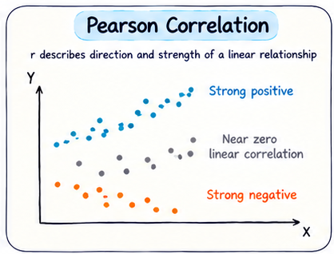

---

## 2. Covariance

Covariance describes whether two quantitative variables tend to move together.

- Positive covariance: values above the mean of X tend to occur with values above the mean of Y, and below with below.
- Negative covariance: above-average values of one tend to occur with below-average values of the other.
- Covariance near zero: little linear co-movement, though a nonlinear relationship may still exist.

### Sample covariance

For paired observations $ (x_i,y_i) $, $i=1,\ldots,n$:

$$
s_{XY}=\frac{\sum_{i=1}^{n}(x_i-\bar{x})(y_i-\bar{y})}{n-1}
$$

Population covariance:

$$
\mathrm{Cov}(X,Y)=
\frac{1}{N}\sum_{i=1}^{N}(x_i-\mu_X)(y_i-\mu_Y)
$$

**Interpretation:** The sign gives the direction of linear co-movement. The magnitude depends on the units and scales of both variables, so covariance values are not directly comparable across differently scaled datasets.

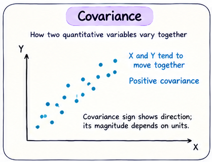

---

## 3. Pearson correlation

Pearson's correlation coefficient measures the **direction and strength of a linear relationship** between two quantitative variables.

$$
r=
\frac{\sum_{i=1}^{n}(x_i-\bar{x})(y_i-\bar{y})}
{\sqrt{\sum_{i=1}^{n}(x_i-\bar{x})^2
\sum_{i=1}^{n}(y_i-\bar{y})^2}}
$$

Equivalent form:

$$
r=\frac{s_{XY}}{s_Xs_Y}
$$

The population correlation is denoted by $\rho$.

### Range and interpretation

$$
-1\leq r\leq 1
$$

| Value of r | Interpretation |
|---|---|
| Near +1 | Strong positive linear association |
| Near 0 | Weak or no linear association |
| Near −1 | Strong negative linear association |

A correlation near zero does **not** rule out a strong nonlinear relationship. Always inspect a scatterplot and investigate outliers.


### Example

If the correlation between advertising spend and sales is $r=0.82$, the sample shows a strong positive linear association. It does not establish that advertising caused the increase in sales.

---

## 4. Correlation vs causation

**Correlation** means two variables are associated. **Causation** means a change in one variable produces a change in another, under a defensible causal design and assumptions.

Possible explanations for an observed association:

1. X may affect Y.
2. Y may affect X (reverse causality).
3. A third variable may affect both (confounding).
4. The association may be coincidental or affected by selection or measurement bias.

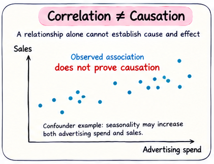

### Example

Advertising spend and sales may be positively correlated. But seasonal demand could increase both advertising budgets and sales. Without a suitable design, the correlation alone cannot isolate the causal effect of advertising.

**To support causal claims:** use a well-designed randomised experiment where feasible, or a suitable causal-inference design with clearly stated assumptions.

---

## 5. Simple linear regression

Simple linear regression models the relationship between one quantitative predictor $X$ and a quantitative outcome $Y$.

$$
\hat{y}=b_0+b_1x
$$

Where:

- $\hat{y}$: predicted outcome
- $b_0$: estimated intercept
- $b_1$: estimated slope
- $x$: predictor value

The model separates observed outcomes from fitted predictions:

$$
y_i=\hat{y}_i+e_i
$$

where $e_i$ is the residual for observation $i$.

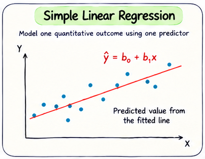

### Example

Suppose a fitted model predicts monthly sales (in thousands) from advertising spend (in thousands):

$$
\widehat{\text{Sales}}=12+2.5(\text{Advertising})
$$

For advertising spend of 4:

$$
\widehat{\text{Sales}}=12+2.5(4)=22
$$

The model predicts sales of 22 thousand units/currency units, according to the units used in the dataset. This is a prediction, not a guarantee.

---

## 6. Least-squares method

The ordinary least-squares (OLS) method estimates regression coefficients by minimising the **sum of squared residuals**.

Residual for observation $i$:

$$
e_i=y_i-\hat{y}_i
$$

Sum of squared errors / residual sum of squares:

$$
SSE=\sum_{i=1}^{n}(y_i-\hat{y}_i)^2
$$

OLS chooses the coefficients that minimise this quantity.

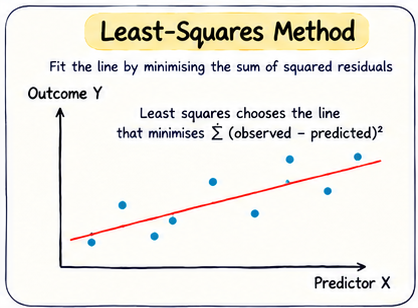

For simple linear regression with an intercept:

$$
b_1=
\frac{\sum_{i=1}^{n}(x_i-\bar{x})(y_i-\bar{y})}
{\sum_{i=1}^{n}(x_i-\bar{x})^2}
$$

$$
b_0=\bar{y}-b_1\bar{x}
$$

The fitted line passes through the point $(\bar{x},\bar{y})$.

**Why square residuals?** Squaring prevents positive and negative residuals from cancelling and penalises larger errors more heavily.

---

## 7. Regression coefficients and interpretation

For the simple regression model:

$$
\hat{y}=b_0+b_1x
$$

- **Intercept $b_0$:** predicted value of Y when X is zero. It may not be meaningful if zero is outside the observed or realistic range of X.
- **Slope $b_1$:** expected change in the predicted mean of Y for a one-unit increase in X.

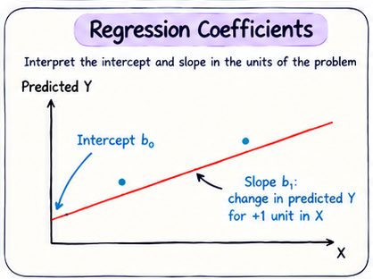

### Multiple regression coefficient interpretation

In a multiple linear regression, a coefficient describes the expected change in the predicted outcome for a one-unit increase in that predictor, **holding the other included predictors constant**.

Interpret coefficients using the original measurement units. Be cautious with extrapolation and with predictors that are highly correlated.

---

## 8. Residuals and residual plots

A residual is the observed outcome minus the model's predicted outcome:

$$
e_i=y_i-\hat{y}_i
$$

- Positive residual: the model underpredicted the observation.
- Negative residual: the model overpredicted the observation.
- Residual near zero: prediction was close to the observed value.

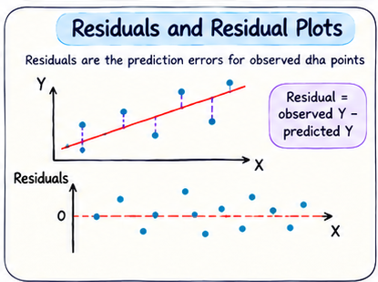

### What to inspect

Plot residuals against fitted values and, where useful, against each predictor or time/order.

| Residual pattern | Possible issue |
|---|---|
| Random scatter around zero | Consistent with a reasonable functional form |
| Curved pattern | Nonlinear relationship not captured |
| Funnel / changing spread | Non-constant error variance (heteroscedasticity) |
| Clusters or time pattern | Dependence, missing group structure, or omitted variables |
| Isolated extreme residual | Potential outlier or influential observation |

Residuals are diagnostic evidence, not automatic proof that an assumption is met or violated.

---

## 9. R-squared and adjusted R-squared

### R-squared

R-squared measures the proportion of the sample variation in the outcome explained by the fitted regression model, relative to the intercept-only model.

For a standard OLS model with an intercept:

$$
R^2=1-\frac{SSE}{SST}
$$

where:

$$
SST=\sum_{i=1}^{n}(y_i-\bar{y})^2
$$

For OLS with an intercept, $R^2$ is between 0 and 1. It is not the percentage of predictions that are correct.

### Adjusted R-squared

Adjusted R-squared accounts for the number of predictors relative to the sample size:

$$
R^2_{\mathrm{adj}}=
1-(1-R^2)\frac{n-1}{n-p-1}
$$

where:

- $n$: number of observations
- $p$: number of predictors, excluding the intercept

Adjusted R-squared can decrease when a predictor adds too little explanatory value. It is useful for comparing models fitted to the same outcome and dataset, but it does not replace validation on unseen data.

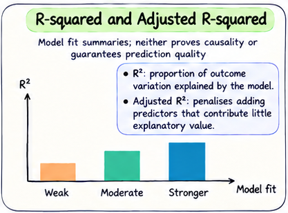

**Caution:** A high R-squared does not prove causation, validate assumptions, or guarantee accurate future predictions.

---

## 10. Multiple linear regression

Multiple linear regression models a quantitative outcome using two or more predictors.

$$
\hat{y}=b_0+b_1x_1+b_2x_2+\cdots+b_px_p
$$

Example: predict monthly sales using advertising spend, store visits, and discount rate.

$$
\widehat{\text{Sales}}=
b_0+b_1(\text{Advertising})+
b_2(\text{Visits})+
b_3(\text{Discount})
$$


### Why use multiple predictors?

- Represent several relevant factors together.
- Improve prediction when added variables provide useful information.
- Estimate conditional associations between each predictor and the outcome.

### Important cautions

- Adding predictors always gives an OLS training $R^2$ that stays the same or increases; this does not guarantee better test performance.
- Coefficients are conditional on the other included predictors.
- Omitted variables, measurement error, multicollinearity, and inappropriate functional form can undermine interpretation.
- Do not include variables that would not be available at prediction time (data leakage).

---

## 11. Regression assumptions and diagnostics

Assumptions depend on the model and the purpose of inference or prediction. For classical linear regression inference, commonly examined conditions include:

| Assumption / condition | Meaning | How to investigate |
|---|---|---|
| Linearity / correct functional form | The conditional mean is represented adequately by the model | Scatterplots, residual plots, partial-residual plots |
| Independence of errors | Errors are not dependent across observations | Study design, residuals by time/order, domain knowledge |
| Homoscedasticity | Error variance is approximately constant across fitted values / predictors | Residuals vs fitted plot |
| Residual normality | Residual distribution is approximately normal for exact small-sample classical inference | Q–Q plot; histogram as a supplement |
| No perfect multicollinearity | Predictors are not exact linear combinations of other predictors | Design-matrix checks, VIF |
| No highly influential data point dominating fit | Estimates are not unduly driven by a small number of observations | Leverage, studentised residuals, Cook's distance |

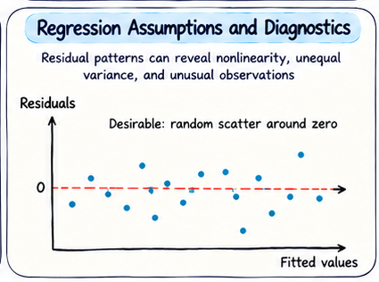

### Important distinctions

- Normality concerns the **errors/residuals** for classical inference, not a requirement that every predictor be normally distributed.
- OLS can be calculated without normally distributed residuals. Normality mainly supports exact small-sample t and F inference under the classical model.
- Heteroscedasticity does not necessarily bias OLS coefficients under exogeneity, but conventional standard errors may be unreliable.
- Independence is primarily supported by the study design and data-generating process; a residual plot alone cannot prove it.
- A model can have high R-squared and still violate important assumptions.

---

## 12. Multicollinearity

Multicollinearity occurs when two or more predictors in a multiple regression are strongly linearly related.

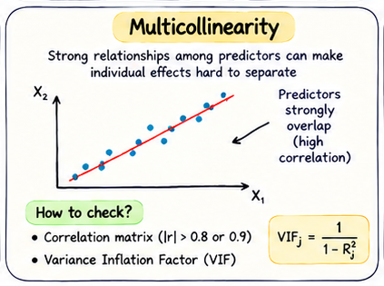

### Why it matters

- Coefficient estimates can become unstable.
- Standard errors can become larger.
- Coefficient signs or magnitudes may change substantially across model specifications.
- It becomes difficult to separate the individual contribution of correlated predictors.

Multicollinearity does not automatically make a model useless for prediction. Its main concern is often coefficient interpretation and uncertainty.

### Variance Inflation Factor (VIF)

For predictor $X_j$, regress it on all the other predictors and obtain $R_j^2$. Then:

$$
VIF_j=\frac{1}{1-R_j^2}
$$

Tolerance:

$$
\text{Tolerance}_j=1-R_j^2=\frac{1}{VIF_j}
$$

Higher VIF indicates greater variance inflation due to linear relationships with other predictors. Thresholds such as 5 or 10 are rules of thumb, not universal pass/fail boundaries.

### Possible responses

- Review whether predictors measure essentially the same construct.
- Remove or combine redundant predictors when justified.
- Use domain knowledge to choose a defensible specification.
- Consider regularisation (Ridge or Lasso) when prediction or coefficient stability is the goal; understand that these change the estimation method and interpretation.

---

## 13. Model evaluation and prediction

Do not evaluate a predictive model only on the data used to fit it.

### Train / validation / test approach

1. **Training set:** fit model parameters.
2. **Validation set or cross-validation:** compare models and tune choices.
3. **Test set:** estimate final performance on held-out data that was not used for model selection.

For time-dependent data, use a time-aware split rather than randomly mixing future observations into training.

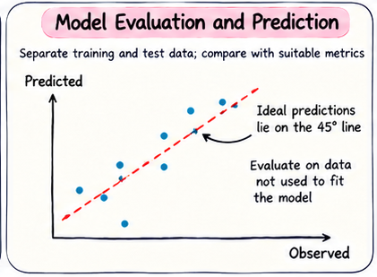

### Common regression metrics

Let $y_i$ be observed values, $\hat{y}_i$ predictions, and $n$ the number of observations.

**Mean Absolute Error (MAE)**

$$
MAE=\frac{1}{n}\sum_{i=1}^{n}|y_i-\hat{y}_i|
$$

Average absolute prediction error, in the outcome's units.

**Mean Squared Error (MSE)**

$$
MSE=\frac{1}{n}\sum_{i=1}^{n}(y_i-\hat{y}_i)^2
$$

Penalises larger errors more heavily; units are squared.

**Root Mean Squared Error (RMSE)**

$$
RMSE=\sqrt{\frac{1}{n}\sum_{i=1}^{n}(y_i-\hat{y}_i)^2}
$$

Returns error to the outcome's units and gives greater weight to large errors than MAE.

**Mean Absolute Percentage Error (MAPE)**

$$
MAPE=\frac{100\%}{n}\sum_{i=1}^{n}
\left|\frac{y_i-\hat{y}_i}{y_i}\right|
$$

MAPE is undefined when an actual value is zero and can behave badly when actual values are near zero. It is not suitable for every outcome.

### Prediction vs explanation

- **Explanation / inference:** understand relationships and quantify uncertainty about coefficients.
- **Prediction:** estimate outcomes for new observations and evaluate generalisation on unseen data.

A model can be useful for prediction without supporting causal interpretation.

---

## 14. Formula sheet

| Concept | Formula |
|---|---|
| Sample covariance | $s_{XY}=\frac{\sum (x_i-\bar{x})(y_i-\bar{y})}{n-1}$ |
| Pearson correlation | $r=\frac{s_{XY}}{s_Xs_Y}$ |
| Simple regression | $\hat{y}=b_0+b_1x$ |
| OLS slope | $b_1=\frac{\sum(x_i-\bar{x})(y_i-\bar{y})}{\sum(x_i-\bar{x})^2}$ |
| OLS intercept | $b_0=\bar{y}-b_1\bar{x}$ |
| Residual | $e_i=y_i-\hat{y}_i$ |
| SSE | $\sum(y_i-\hat{y}_i)^2$ |
| R-squared | $R^2=1-\frac{SSE}{SST}$ |
| Adjusted R-squared | $1-(1-R^2)\frac{n-1}{n-p-1}$ |
| Multiple regression | $\hat{y}=b_0+\sum_{j=1}^{p}b_jx_j$ |
| VIF | $VIF_j=\frac{1}{1-R_j^2}$ |
| MAE | $\frac{1}{n}\sum_{i=1}^{n}|y_i-\hat{y}_i|$ |
| RMSE | $\sqrt{\frac{1}{n}\sum(y_i-\hat{y}_i)^2}$ |

---

## 15. Python implementation

The examples below use `pandas`, `numpy`, `matplotlib`, `seaborn`, and `scikit-learn`. Install them if needed:

```bash
pip install pandas numpy matplotlib seaborn scipy statsmodels scikit-learn
```

### 15.1 Covariance and Pearson correlation

```python
import pandas as pd

# df contains numeric columns: advertising and sales
covariance = df["advertising"].cov(df["sales"])
correlation = df["advertising"].corr(df["sales"], method="pearson")

print("Sample covariance:", covariance)
print("Pearson correlation:", correlation)
```

### 15.2 Scatterplot

```python
import seaborn as sns
import matplotlib.pyplot as plt

sns.regplot(data=df, x="advertising", y="sales")
plt.title("Advertising vs Sales")
plt.show()
```

### 15.3 Simple linear regression with statsmodels

```python
import statsmodels.api as sm

X = df[["advertising"]]
X = sm.add_constant(X)
y = df["sales"]

model = sm.OLS(y, X).fit()
print(model.summary())
```

### 15.4 Multiple linear regression

```python
import statsmodels.api as sm

features = ["advertising", "store_visits", "discount_rate"]
X = sm.add_constant(df[features])
y = df["sales"]

model = sm.OLS(y, X).fit()
print(model.summary())
```

### 15.5 Residual diagnostics

```python
import matplotlib.pyplot as plt
import seaborn as sns

fitted = model.fittedvalues
residuals = model.resid

sns.scatterplot(x=fitted, y=residuals)
plt.axhline(0, linestyle="--", color="red")
plt.xlabel("Fitted values")
plt.ylabel("Residuals")
plt.title("Residuals vs Fitted")
plt.show()

sm.qqplot(residuals, line="45")
plt.title("Residual Q-Q Plot")
plt.show()
```

### 15.6 VIF

```python
from statsmodels.stats.outliers_influence import variance_inflation_factor
import pandas as pd
import statsmodels.api as sm

X = sm.add_constant(df[["advertising", "store_visits", "discount_rate"]])

vif = pd.DataFrame({
    "feature": X.columns,
    "VIF": [
        variance_inflation_factor(X.values, i)
        for i in range(X.shape[1])
    ]
})

print(vif)
```

The intercept's VIF is generally not the quantity of interest; focus on the predictor rows.

### 15.7 Train/test evaluation with scikit-learn

```python
from sklearn.model_selection import train_test_split
from sklearn.linear_model import LinearRegression
from sklearn.metrics import mean_absolute_error, mean_squared_error, r2_score
import numpy as np

features = ["advertising", "store_visits", "discount_rate"]
X = df[features]
y = df["sales"]

X_train, X_test, y_train, y_test = train_test_split(
    X, y, test_size=0.2, random_state=42
)

model = LinearRegression()
model.fit(X_train, y_train)

predictions = model.predict(X_test)

mae = mean_absolute_error(y_test, predictions)
mse = mean_squared_error(y_test, predictions)
rmse = np.sqrt(mse)
r2 = r2_score(y_test, predictions)

print("MAE:", mae)
print("MSE:", mse)
print("RMSE:", rmse)
print("Test R-squared:", r2)
```

For time series or time-ordered observations, replace random splitting with a chronological split.

---

## 16. Common mistakes

| Mistake | Correct understanding |
|---|---|
| Correlation proves causation | Association alone does not establish cause |
| Pearson correlation detects every relationship | It measures linear association; inspect plots for nonlinear patterns |
| Covariance magnitude is directly interpretable across datasets | Its magnitude depends on variable units |
| A slope is always causal | A regression slope is an estimated conditional association unless a causal design justifies more |
| Intercept always has practical meaning | It may describe an X value outside the observed range |
| High R-squared means a good model | Check residuals, generalisation, assumptions, and practical error |
| Adding predictors always improves the model | Training fit may rise while test performance worsens |
| Residuals are the same as errors | Errors are unobserved population deviations; residuals are their fitted-sample estimates |
| Normality is required for every predictor | Classical inference concerns the error distribution, not predictor normality |
| Multicollinearity always destroys prediction | It mainly destabilises individual coefficient estimates and their interpretation |
| Random train/test split is always appropriate | Time-dependent data needs time-aware validation |
| MAPE works for all outcomes | Zero and near-zero actual values create problems |

---

## Practical workflow

Use this sequence when working on a regression problem:

1. Define the business question and prediction/inference objective.
2. Identify the outcome and candidate predictors.
3. Inspect data types, missing values, outliers, and measurement quality.
4. Use descriptive statistics and visualisations to explore relationships.
5. Calculate covariance and correlation where appropriate.
6. Fit a baseline regression model.
7. Interpret coefficients in context and in original units.
8. Inspect residual plots and model diagnostics.
9. Check multicollinearity and influential observations.
10. Compare suitable model specifications without leaking test data.
11. Evaluate on held-out data using metrics that match the business objective.
12. Communicate limitations, uncertainty, and whether the model is intended for explanation or prediction.

---

## References

### Official documentation

- [Statsmodels - Regression and Linear Models](https://www.statsmodels.org/stable/regression.html)
- [Statsmodels - OLS](https://www.statsmodels.org/stable/generated/statsmodels.regression.linear_model.OLS.html)
- [Statsmodels - Regression diagnostics](https://www.statsmodels.org/stable/diagnostic.html)
- [Scikit-learn - Linear models](https://scikit-learn.org/stable/modules/linear_model.html)
- [Scikit-learn - Model evaluation](https://scikit-learn.org/stable/modules/model_evaluation.html)
- [Scikit-learn - Train/test split](https://scikit-learn.org/stable/modules/generated/sklearn.model_selection.train_test_split.html)
- [SciPy - Pearson correlation](https://docs.scipy.org/doc/scipy/reference/generated/scipy.stats.pearsonr.html)

### Further reading

- [Penn State - STAT 501: Regression Methods](https://online.stat.psu.edu/stat501/)
- [NIST/SEMATECH e-Handbook of Statistical Methods](https://www.itl.nist.gov/div898/handbook/)

