# Experimental Design and A/B Testing

> [!NOTE]
>
>**Purpose:** Learn how to design credible experiments, compare treatments fairly, analyse A/B tests, and make decisions using statistical evidence and practical impact.

[← Back to Statistics Repository](https://github.com/Priya200227/statistics) 

---

## 1. Observational vs experimental studies

### Observational study

Researchers observe existing conditions, exposures, or behaviour without assigning participants to a treatment.

Examples:
- Comparing average spending between customers who use a loyalty programme and those who do not.
- Studying the relationship between exercise frequency and health outcomes using survey data.

Observational studies can identify associations, but confounding, selection effects, and reverse causality can make causal conclusions difficult.

### Experimental study

Researchers deliberately assign an intervention or treatment and measure its effect on an outcome.

Examples:
- Randomly showing one group a redesigned checkout page and another group the existing page.
- Randomly assigning eligible users to different notification strategies.

A well-designed randomised experiment can support causal inference because random assignment helps balance measured and unmeasured baseline factors on average.

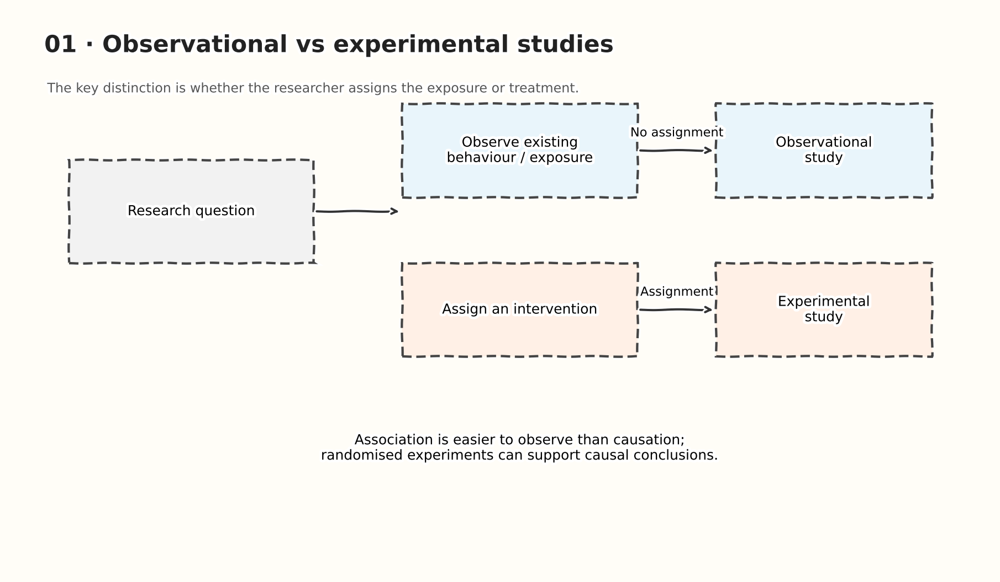

**Key distinction:** Random sampling concerns how participants are selected from a population. Random assignment concerns how selected participants are allocated to study groups. They solve different problems.

---

## 2. Independent and dependent variables

### Independent variable

The variable manipulated, assigned, or used to define exposure or treatment.

Examples:
- Website design: old layout vs new layout.
- Email subject line: version A vs version B.
- Pricing display: monthly price first vs annual price first.

### Dependent variable

The outcome measured to assess the response to the independent variable.

Examples:
- Conversion rate.
- Average order value.
- Time to complete checkout.
- Customer retention.

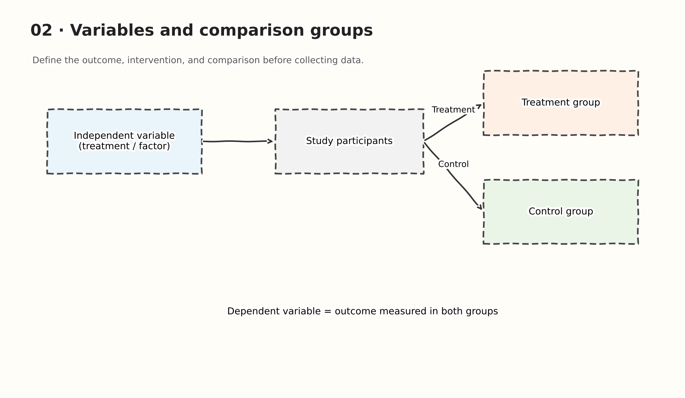

In a product experiment:
- Independent variable: experience assigned to the user.
- Dependent variable: user outcome measured after exposure.

Be precise about the unit of analysis: users, sessions, accounts, transactions, stores, or another unit. A mismatch can create dependence or incorrect standard errors.

---

## 3. Control and treatment groups

### Control group

The comparison group. It usually receives the existing experience, standard practice, placebo, or no intervention.

### Treatment group

The group receiving the new intervention or variant being evaluated.

Example - checkout redesign:

| Group | Experience |
|---|---|
| Control (A) | Existing checkout |
| Treatment (B) | Redesigned checkout |

The treatment effect is generally estimated as the difference in outcomes between the groups.

For a mean outcome:

$$
\widehat{\Delta}=\bar{Y}_B-\bar{Y}_A
$$

For a conversion outcome:

$$
\widehat{\Delta}=\hat{p}_B-\hat{p}_A
$$

A control group helps distinguish the effect of the intervention from changes that would have happened anyway, such as seasonality or general traffic shifts.

---

## 4. Randomisation

Randomisation assigns eligible experimental units to treatment groups using a chance mechanism.

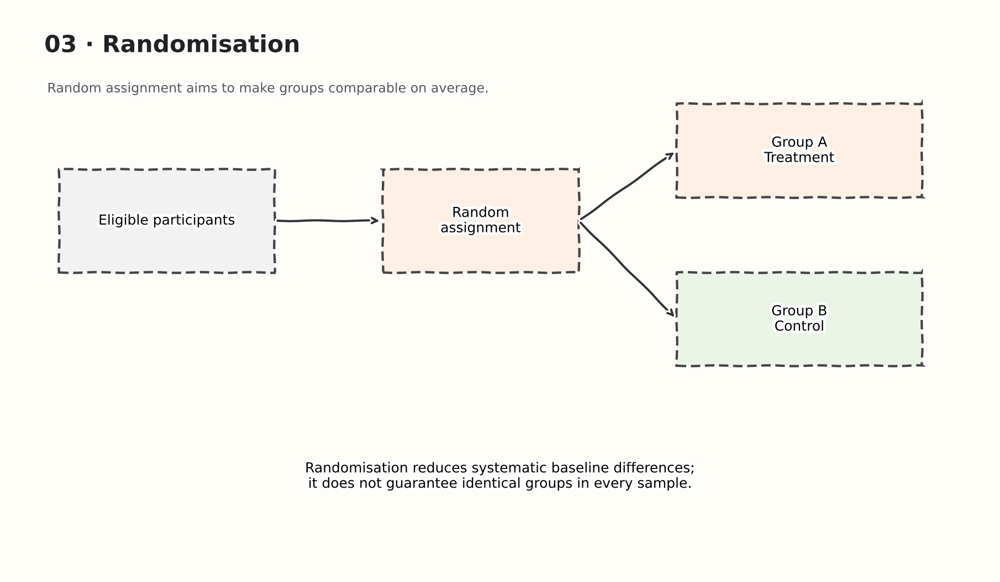

### Why randomise?

Random assignment helps:
- Reduce systematic differences between groups at baseline.
- Balance known and unknown confounders on average.
- Support valid statistical comparisons when the experiment is correctly implemented.

### Common approaches

- **Simple randomisation:** each unit is independently assigned according to a probability, such as 50/50.
- **Blocked / stratified randomisation:** randomise within important strata (e.g. country, device type, or customer segment) to improve balance.
- **Cluster randomisation:** randomise groups such as stores, classrooms, or geographic regions when individual-level assignment is impractical or contamination is likely.

### Important checks

- Keep assignment stable for the same user when appropriate.
- Avoid users switching between variants.
- Check sample-ratio mismatch (SRM): compare observed allocation counts with the planned allocation ratio.
- Analyse participants according to their assigned group for an intention-to-treat analysis, unless a different estimand was pre-specified.

Randomisation does not guarantee identical groups in every realised sample; it provides balance in expectation.

---

## 5. Confounding variables

A confounder is a variable related to both the exposure/treatment and the outcome that can distort the observed relationship.

Example:
- A company compares customers who received a discount with those who did not.
- High-value customers may be more likely to receive discounts and also spend more.
- Customer value may confound the relationship between discount exposure and spending.

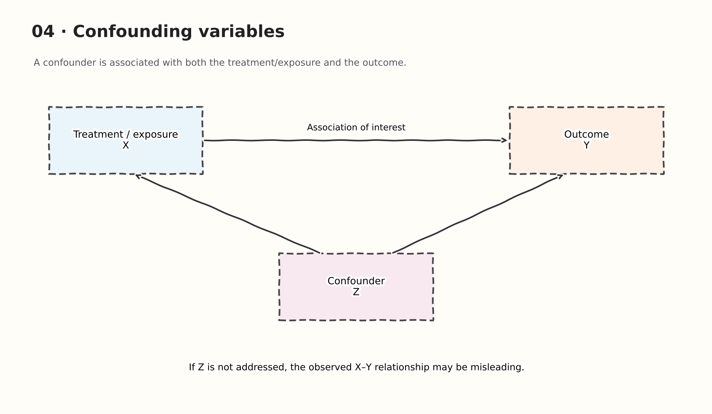

### In experiments

Proper random assignment helps prevent systematic confounding at baseline, on average. However, problems can still arise from:
- Broken randomisation.
- Differential attrition.
- Non-compliance.
- Contamination between groups.
- Post-treatment adjustment that introduces bias.

Do not automatically control for every variable collected. Adjusting for post-treatment variables can distort the treatment effect.

---

## 6. Bias and experimental validity

Bias is a systematic error that can push an estimate away from the true effect.

### Common sources of bias

| Bias | Meaning | Example |
|---|---|---|
| Selection bias | Groups differ because of how participants enter or remain in the study | Users self-select into a new feature |
| Measurement bias | Outcome is measured differently or inaccurately | One variant's events are tracked incorrectly |
| Attrition bias | Dropout differs across groups | More users abandon one treatment |
| Non-response bias | Responders differ from non-responders | Only highly engaged users complete a survey |
| Observer / implementation bias | Knowledge of assignment changes treatment or measurement | Staff provide different support by group |
| Publication / reporting bias | Outcomes are selectively reported | Only favourable metrics are highlighted |

### Internal validity

How credible is the estimated treatment effect for the participants and setting actually studied?

### External validity

How well might the result generalise to other populations, contexts, devices, regions, or time periods?

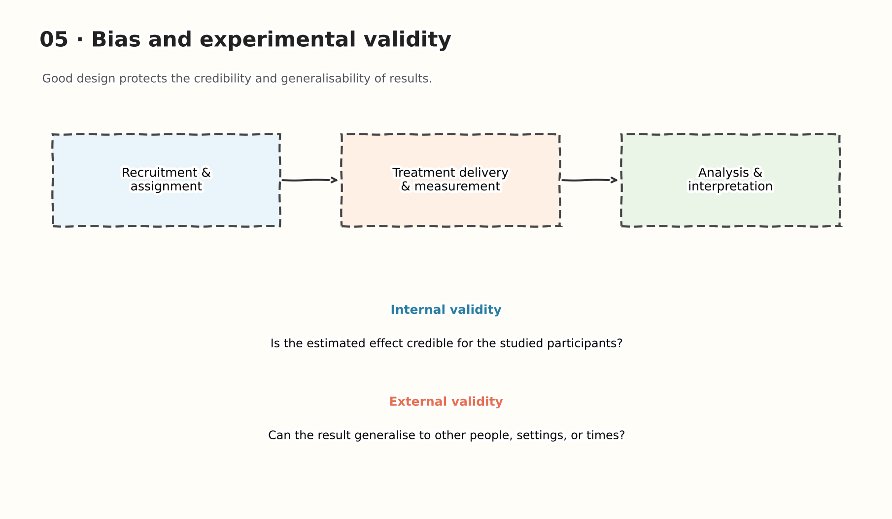

A randomised experiment can have strong internal validity but limited external validity if the participants or setting are unusually narrow.

---

## 7. A/B testing fundamentals

A/B testing is a controlled experiment comparing two versions of an experience:

- **A:** control / current version.
- **B:** treatment / new version.

Users or other experimental units are assigned to a variant, and outcomes are compared using pre-defined metrics.

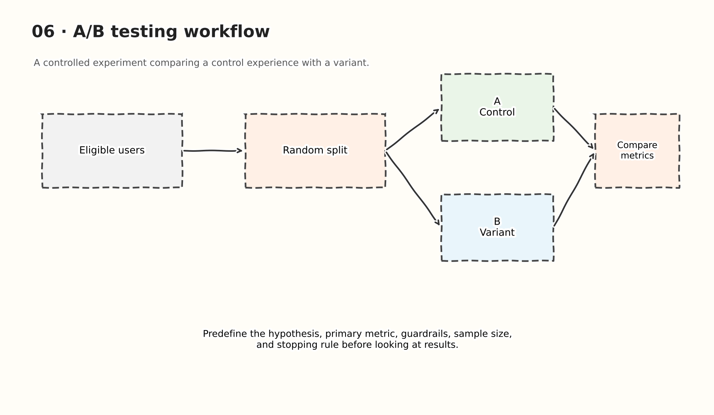

### Example

A product team wants to test whether a new sign-up page increases completed registrations.

- Population: eligible new visitors.
- Unit of randomisation: visitor or user ID.
- Control: current sign-up page.
- Treatment: new sign-up page.
- Primary outcome: registration conversion within a defined attribution window.
- Guardrails: page load time, error rate, and downstream activation.

### Key design decisions

1. Who is eligible?
2. What is the randomisation unit?
3. What is the allocation ratio?
4. What is the primary metric?
5. What are the guardrail metrics?
6. What is the minimum effect worth detecting?
7. What sample size and duration are required?
8. What is the stopping rule?
9. How will missing data, bots, internal traffic, and repeat users be handled?

A/B tests should be planned before results are examined.

---

## 8. Hypotheses for A/B tests

Hypotheses describe the population-level effect the experiment is designed to assess.

Let:
- \(p_A\): population conversion rate under control.
- \(p_B\): population conversion rate under treatment.

### Two-sided test

Use when any difference matters:

$$
H_0:p_B-p_A=0
$$

$$
H_a:p_B-p_A\ne 0
$$

### One-sided test

Use only when a direction was justified and selected before observing the data:

$$
H_0:p_B-p_A=0
$$

$$
H_a:p_B-p_A>0
$$

For a mean outcome, replace proportions with population means:

$$
H_0:\mu_B-\mu_A=0
$$

$$
H_a:\mu_B-\mu_A\ne 0
$$

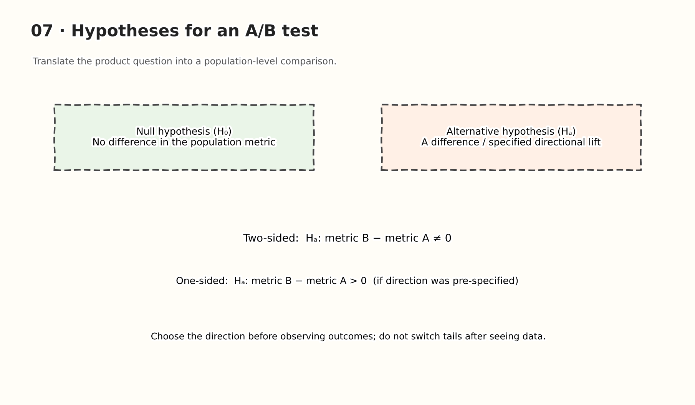

**Do not switch from a two-sided to a one-sided test after seeing the result.** That inflates the false-positive risk.

---

## 9. Choosing metrics and guardrail metrics

### Primary metric

The single main outcome used to evaluate whether the experiment achieved its objective.

Examples:
- Purchase conversion rate.
- Revenue per eligible user.
- Successful sign-up rate.
- 7-day activation rate.

Choose a metric that is:
- Closely connected to the product or business objective.
- Clearly defined and measurable.
- Sensitive enough to detect a meaningful change.
- Not easily distorted by tracking changes or user mix.

### Guardrail metrics

Guardrails detect harmful side effects even if the primary metric improves.

Examples:

| Primary objective | Possible guardrails |
|---|---|
| Increase purchases | Refund rate, cancellations, support contacts |
| Increase sign-ups | Activation, fraud, low-quality accounts |
| Increase engagement | Uninstalls, complaints, latency |
| Increase revenue | Profit margin, returns, customer retention |

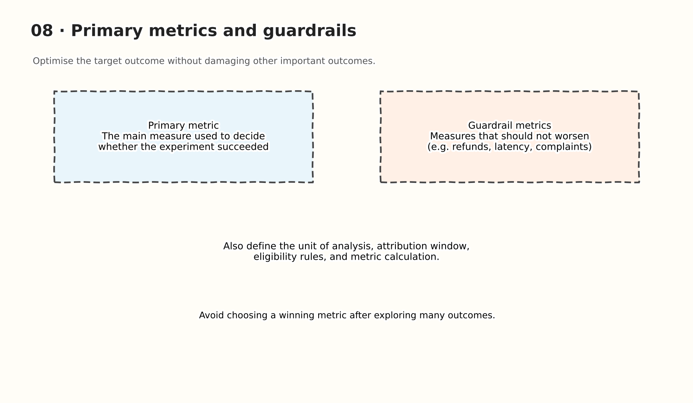

### Metric specification checklist

For each metric, document:
- Numerator and denominator.
- Unit of analysis.
- Eligibility criteria.
- Attribution window.
- Event definition and data source.
- Treatment of missing, duplicate, or invalid events.
- Whether the metric is primary, secondary, or a guardrail.

Avoid selecting a winner based on whichever of many metrics happens to look significant. Multiple testing increases false-positive risk.

---

## 10. Sample size and statistical power

### Statistical power

Power is the probability that a test rejects the null hypothesis when a specified alternative is true.

$$
\text{Power}=1-\beta
$$

where \(\beta\) is the Type II error probability.

### Significance level

The significance level \(\alpha\) is the pre-selected Type I error rate: the long-run probability of rejecting a true null hypothesis under the test assumptions.

Common choices include 0.05, but the value should be chosen before the experiment.

### Minimum detectable effect (MDE)

The MDE is the smallest effect the experiment is designed to detect with the chosen power and significance level. It should be based on business relevance, not merely on what is easy to detect.

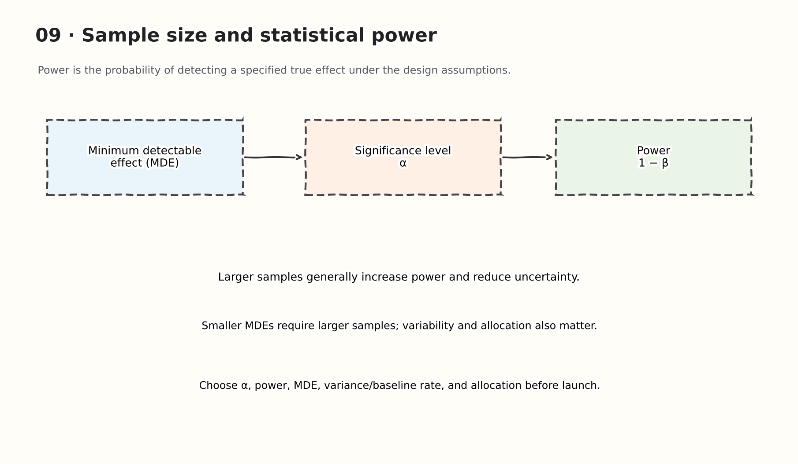

### Factors affecting sample size

- Baseline conversion rate or outcome variability.
- MDE / effect size.
- Significance level \(\alpha\).
- Desired power \(1-\beta\).
- Allocation ratio between groups.
- Whether the test is one-sided or two-sided.
- Clustering, repeated observations, or other dependence.

For a fixed design, smaller detectable effects generally require larger samples. Higher desired power generally requires larger samples.

### Approximate sample size for two proportions

For equal-sized groups, a common normal-approximation planning formula is:

$$
n \approx
\frac{
\left[
z_{1-\alpha/2}\sqrt{2\bar{p}(1-\bar{p})}
+
z_{1-\beta}\sqrt{p_A(1-p_A)+p_B(1-p_B)}
\right]^2
}{
(p_B-p_A)^2
}
$$

where:

$$
\bar{p}=\frac{p_A+p_B}{2}
$$

Here \(n\) is the approximate sample size **per group** for a two-sided test. This is a planning approximation; use a validated power calculator or statistical software for final design, especially with unequal allocation, clustering, or low event rates.

---

## 11. Significance testing for experiments

A common workflow for a two-proportion A/B test:

1. Define \(H_0\) and \(H_a\).
2. Verify randomisation and data quality.
3. Calculate the observed conversion rates.
4. Calculate the difference in proportions.
5. Calculate the test statistic and p-value.
6. Compare the p-value with the pre-selected \(\alpha\).
7. Report the effect size and confidence interval.
8. Interpret the result in context, including guardrails.

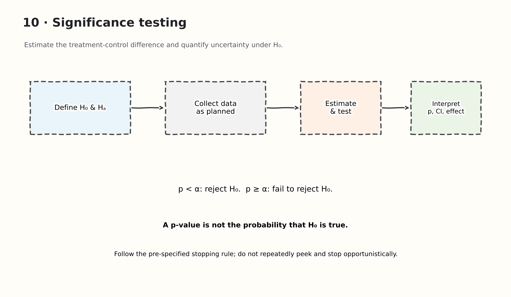

### Two-proportion z-test

Let:
- \(x_A,x_B\): conversions in each group.
- \(n_A,n_B\): sample sizes.
- \(\hat p_A=x_A/n_A\), \(\hat p_B=x_B/n_B\).

Under the null hypothesis \(p_A=p_B\), the pooled estimate is:

$$
\hat p_{\text{pool}}=
\frac{x_A+x_B}{n_A+n_B}
$$

The null standard error is:

$$
SE_0=
\sqrt{
\hat p_{\text{pool}}(1-\hat p_{\text{pool}})
\left(\frac{1}{n_A}+\frac{1}{n_B}\right)
}
$$

Test statistic:

$$
z=
\frac{\hat p_B-\hat p_A}{SE_0}
$$

For a two-sided test, the p-value is:

$$
p\text{-value}=2P(Z\geq |z|)
$$

The normal approximation requires adequate expected success and failure counts in both groups under the pooled null model. For sparse outcomes, use an appropriate exact or alternative method.

### Confidence interval for the difference

For estimation, an unpooled standard error is commonly used:

$$
(\hat p_B-\hat p_A)
\pm z_{1-\alpha/2}
\sqrt{
\frac{\hat p_A(1-\hat p_A)}{n_A}
+
\frac{\hat p_B(1-\hat p_B)}{n_B}
}
$$

The interval estimates the plausible range of the treatment-control difference under the method's assumptions.

### Decision

- If \(p\text{-value}<\alpha\): reject \(H_0\).
- If \(p\text{-value}\geq\alpha\): fail to reject \(H_0\).

Failing to reject does not prove that the variants are identical. It may reflect a small effect, high variability, or insufficient sample size.

### Worked example

Suppose:

| Group | Visitors | Conversions | Conversion rate |
|---|---:|---:|---:|
| Control A | 1,000 | 100 | 10.0% |
| Treatment B | 1,000 | 120 | 12.0% |

Observed absolute lift:

$$
\hat p_B-\hat p_A=0.12-0.10=0.02
$$

That is a **2 percentage-point** increase. Relative lift is:

$$
\frac{0.12-0.10}{0.10}=0.20=20\%
$$

Pooled rate:

$$
\hat p_{\text{pool}}=\frac{100+120}{2000}=0.11
$$

Null standard error:

$$
SE_0=\sqrt{0.11(0.89)(1/1000+1/1000)}
\approx 0.0140
$$

Test statistic:

$$
z=\frac{0.02}{0.0140}\approx 1.43
$$

The two-sided p-value is approximately 0.15. At \(\alpha=0.05\), we fail to reject the null hypothesis. The observed 2-point lift is not statistically significant at the 5% level. This does **not** establish that there is no effect.

---

## 12. Practical significance and experiment interpretation

Statistical significance and practical significance answer different questions.

- **Statistical significance:** Is the observed result sufficiently inconsistent with the null model under the chosen test?
- **Practical significance:** Is the size of the effect valuable enough to justify implementation, cost, risk, and maintenance?

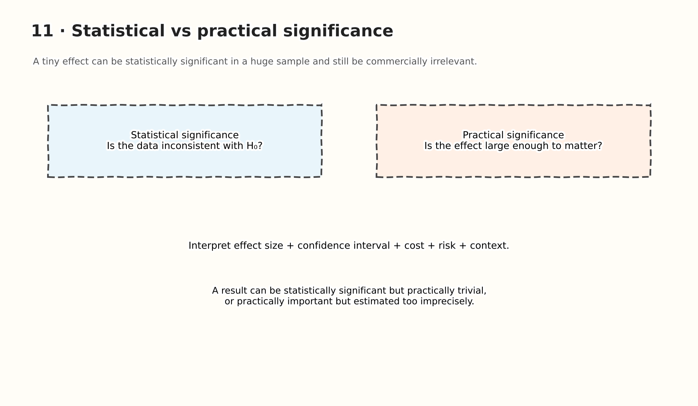

### Interpret the complete evidence

A sound experiment readout should include:

1. Absolute effect (e.g. +2 percentage points).
2. Relative effect (e.g. +20% relative to baseline).
3. Confidence interval.
4. P-value and pre-selected significance level.
5. Sample size and experiment duration.
6. Guardrail outcomes.
7. Data quality and randomisation checks.
8. Business impact, implementation cost, and risks.
9. Limitations and population to which the result may generalise.

### Possible outcomes

| Result | Interpretation / next step |
|---|---|
| Significant and practically valuable; guardrails acceptable | Consider rollout, subject to operational checks |
| Significant but effect is too small to matter | Do not ship solely because p < α |
| Not significant and interval is wide | Inconclusive; assess whether more data or a better design is justified |
| Not significant and interval rules out the MDE | Evidence suggests the effect is smaller than the target threshold |
| Primary metric improves but guardrails worsen | Evaluate the trade-off; do not declare an automatic win |

Do not confuse “not statistically significant” with “no effect.” Use the confidence interval to understand which effect sizes remain plausible.

---

## 13. Formula sheet

| Concept | Formula |
|---|---|
| Mean treatment effect estimate | \(\widehat{\Delta}=\bar Y_B-\bar Y_A\) |
| Difference in proportions | \(\widehat{\Delta}=\hat p_B-\hat p_A\) |
| Conversion rate | \(\hat p=x/n\) |
| Pooled proportion under \(H_0\) | \(\hat p_{\mathrm{pool}}=(x_A+x_B)/(n_A+n_B)\) |
| Two-proportion null SE | \(\sqrt{\hat p_{\mathrm{pool}}(1-\hat p_{\mathrm{pool}})(1/n_A+1/n_B)}\) |
| Two-proportion z statistic | \((\hat p_B-\hat p_A)/SE_0\) |
| Power | \(1-\beta\) |
| Type I error rate | \(\alpha\) |
| Type II error rate | \(\beta\) |
| Relative lift | \((\hat p_B-\hat p_A)/\hat p_A\) |
| Approximate sample size | Use the two-proportion planning formula in Section 22 |

---

## 14. Python implementation

Install packages:

```bash
pip install numpy pandas scipy statsmodels matplotlib
```

### 14.1 Calculate conversion rates and lift

```python
import pandas as pd

results = pd.DataFrame({
    "group": ["A_control", "B_treatment"],
    "visitors": [1000, 1000],
    "conversions": [100, 120]
})

results["conversion_rate"] = (
    results["conversions"] / results["visitors"]
)

p_a = results.loc[0, "conversion_rate"]
p_b = results.loc[1, "conversion_rate"]

absolute_lift = p_b - p_a
relative_lift = absolute_lift / p_a

print(results)
print("Absolute lift:", absolute_lift)
print("Relative lift:", relative_lift)
```

### 14.2 Two-proportion z-test

```python
from statsmodels.stats.proportion import proportions_ztest

conversions = [100, 120]
sample_sizes = [1000, 1000]

z_stat, p_value = proportions_ztest(
    count=conversions,
    nobs=sample_sizes,
    alternative="two-sided"
)

print("z statistic:", z_stat)
print("p-value:", p_value)
```

### 14.3 Confidence interval for difference in proportions

```python
from statsmodels.stats.proportion import confint_proportions_2indep

ci_low, ci_high = confint_proportions_2indep(
    count1=120,
    nobs1=1000,
    count2=100,
    nobs2=1000,
    method="newcomb",
    compare="diff"
)

print("CI for treatment - control:", (ci_low, ci_high))
```

Check the function's argument ordering and installed Statsmodels version before using it in a production analysis. Keep the subtraction direction consistent with your stated treatment effect.

### 14.4 Power and sample-size planning

```python
from statsmodels.stats.power import NormalIndPower
from statsmodels.stats.proportion import proportion_effectsize

baseline = 0.10
target = 0.12

effect_size = proportion_effectsize(target, baseline)

analysis = NormalIndPower()

n_per_group = analysis.solve_power(
    effect_size=effect_size,
    power=0.80,
    alpha=0.05,
    ratio=1.0,
    alternative="two-sided"
)

print("Approximate sample size per group:", round(n_per_group))
```

Power calculations depend on the effect-size definition and approximation used. Validate the design with an appropriate method for your experiment.

### 14.5 Visualise group conversion rates

```python
import matplotlib.pyplot as plt

plt.bar(
    ["Control A", "Treatment B"],
    [p_a, p_b]
)

plt.ylabel("Conversion rate")
plt.title("A/B Test Conversion Rates")
plt.show()
```

---

## 15. Common mistakes

| Mistake | Correct approach |
|---|---|
| Treating observational data as a randomised experiment | Be cautious about causal claims and address confounding |
| Confusing random sampling with random assignment | Sampling selects participants; assignment allocates participants to groups |
| Changing the hypothesis after viewing results | Pre-specify hypotheses and test direction |
| Choosing a primary metric after the experiment | Define one primary metric before launch |
| Ignoring guardrails | Check whether improvements harm other outcomes |
| Stopping as soon as p < 0.05 | Use a pre-specified sample size or valid sequential-testing design |
| Repeatedly checking p-values with a fixed-sample test | This can inflate false-positive rates |
| Treating users as independent when assignment is clustered | Account for clustering in design and analysis |
| Ignoring sample-ratio mismatch | Investigate assignment and instrumentation before interpreting outcomes |
| Calling a non-significant result “no effect” | Interpret the confidence interval and study power |
| Reporting only relative lift | Report absolute and relative effects |
| Treating statistical significance as business success | Evaluate effect size, costs, risks, and guardrails |
| Running many tests without correction or planning | Account for multiplicity and prioritise hypotheses |
| Ignoring novelty or seasonality | Consider experiment duration and whether effects persist |

---

## 16. Practical experiment workflow

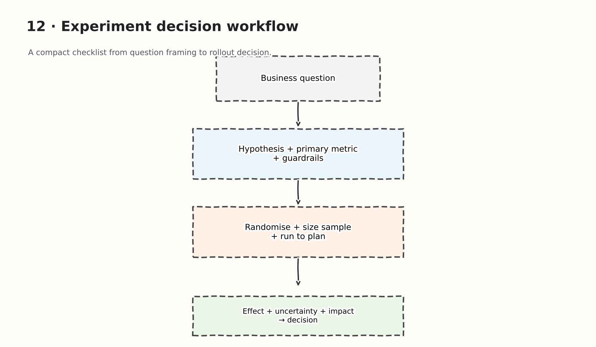

---

## References

### Experimental design and causal inference

- [Penn State - STAT 200: Experimental Design](https://online.stat.psu.edu/stat200/)
- [NIST/SEMATECH e-Handbook of Statistical Methods](https://www.itl.nist.gov/div898/handbook/)
- [The ASA Statement on P-Values](https://www.amstat.org/asa/files/pdfs/P-ValueStatement.pdf)

### A/B testing and statistical implementation

- [Statsmodels - Proportion Tests](https://www.statsmodels.org/stable/generated/statsmodels.stats.proportion.proportions_ztest.html)
- [Statsmodels - Proportion Confidence Intervals](https://www.statsmodels.org/stable/generated/statsmodels.stats.proportion.confint_proportions_2indep.html)
- [Statsmodels - Power and Sample Size](https://www.statsmodels.org/stable/stats.html#power-and-sample-size-calculations)
- [Microsoft - Experimentation Platform and A/B Testing](https://www.microsoft.com/en-us/research/group/experimentation-platform-exp/)
